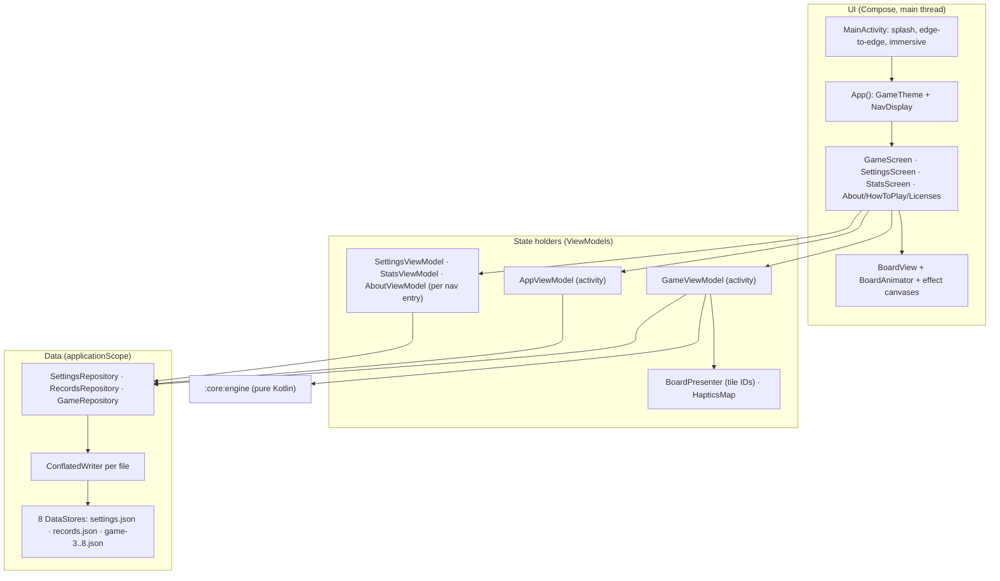

# ARCHITECTURE.md: structure, build and code shape of the 2048 native rewrite

Status: plan document for the execution PR (D-160), dated 2026-10-28.

`DECISIONS.md` is canonical. This document turns those decisions into a repository layout, copy-pasteable build files, Kotlin API shapes, data flows and a file-by-file work list. When this document and `DECISIONS.md` disagree, `DECISIONS.md` wins. The disagreements found during planning are settled by D-174–D-211 and the technical corrections TC-1–TC-7 (`DECISIONS.md` Appendix B), and this document already uses their text and the canonical names of `PLAN.md` §2.

Audience: the implementer agents (milestone integrators and WP implementers, D-194) that execute milestones M0–M6 (D-162, D-211) with no other context. Read `DECISIONS.md` first, then this file.

Notation:
- `D-NNN` is a decision in `DECISIONS.md`. `research/0N-….md §X` is a research file under `docs/modernization/research/`.
- `[M0]` … `[M6]` is the milestone (D-162) that creates or changes an item. M3 is two pushed commits (D-211): "M3 p1" is M3 part 1 and "M3 p2" is M3 part 2. "Plan PR" marks files that the plan PR commits before M0 (D-177).
- "Full / Reduced / Off" is the effective motion mode (D-063).
- All paths are relative to the repository root.

---

## 0. Verification log for this document

Before writing the build sections, a scratch copy of `research/smoke-build/` was rebuilt with exactly the files in §2 and §8 (same machine, JDK 21, Gradle 9.7.1, Android SDK `platforms;android-37.0`, build-tools 37.0.0). Maven Central was reached through the local-only mirror init script of D-019, passed on the command line; nothing about it is in any file below.

| Checked | Result |
|---|---|
| §2 build files + the D-016 catalog, repositories `google()` + `mavenCentral()` only (no Plugin Portal) | Configure and build. Kover, Spotless, detekt, Roborazzi and the Kotlin plugin markers all resolve without `gradlePluginPortal()` (settles DECISIONS OI-2) |
| One invocation of `spotlessCheck detektMain detektTest :core:engine:test :core:engine:koverVerify :app:testDebugUnitTest -Proborazzi.test.verify=true :app:lintDebug :app:assembleDebug :app:assembleRelease` | Passes (detekt after the §2.8 tuning; Roborazzi golden recorded first with `-Proborazzi.test.record=true`) |
| `isPseudoLocalesEnabled = true` on AGP 9.4.1 | Compiles; debug badging lists `en-XA` and `ar-XB`. Resolves DECISIONS "Verification-pending" item 4 |
| `currentWindowAdaptiveInfoV2()` + `WindowSizeClass.WIDTH_DP_EXPANDED_LOWER_BOUND` | Compile under `allWarningsAsErrors` with no opt-in. Resolves item 9 |
| `kotlin.io.encoding.Base64` in stdlib 2.4.21 | `@SinceKotlin("2.2") @WasExperimental(ExperimentalEncodingApi)`: stable, no opt-in. Resolves item 7 |
| Kover 0.9.11 DSL (`javap`) | `KoverVerifyRule.minBound(Int, CoverageUnit, AggregationType)`; `KoverVerifyBound` has `minValue`, `maxValue`, `coverageUnits`, `aggregationForGroup`. Resolves item 3 |
| Release APK | 1,002,520 B. Only `uses-permission` is `com.clayboicardi.game2048.DYNAMIC_RECEIVER_NOT_EXPORTED_PERMISSION`. Exported = {`MainActivity`, `ProfileInstallReceiver`}. `zipalign -c -P 16` passes. Signer digest equals `signing/ci-sideload.sha256` |
| Debug APK | Package `com.clayboicardi.game2048.debug`, label `2048 Debug`. Exported adds only `androidx.activity.ComponentActivity` (from `ui-test-manifest`) |
| `aapt2 dump badging` (build-tools 37.0.0) | Prints `minSdkVersion:'24'`, not `sdkVersion:'24'` (technical correction TC-2) |
| D-131 `keytool` command as written | Fails: `keytool error: java.io.IOException: Incorrect AVA format`; the escaped form in §2.9 works (technical correction TC-1) |
| `ui-tooling` 1.12.1 AAR manifest | Declares `androidx.compose.ui.tooling.PreviewActivity` with `exported="true"` (§2.6 note) |
| Spotless with D-141's literal `targetExclude("**/build/**")` | `spotlessCheck` fails on 5 files under `docs/modernization/research/smoke-build/` (D-175) |
| Lint with D-090's `tools:targetApi="26"` on `<application>` | Passes (`warningsAsErrors`) |
| Library signatures (`javap` on the cached AARs) | Nav3 1.2.0 `rememberNavBackStack(SavedStateConfiguration, vararg NavKey)`, `NavDisplay(…, entryDecorators, …, predictivePopTransitionSpec: (Int) -> ContentTransform, entryProvider)`; DataStore 1.3.0 `DataStoreFactory.create(serializer, corruptionHandler, migrations, scope, produceFile)`; `HapticFeedbackType.{Confirm, GestureThresholdActivate, Reject, SegmentTick, ToggleOn, ToggleOff}`; `MaterialExpressiveTheme(colorScheme, motionScheme, shapes, typography, content)`; `LifecycleResumeEffect`; `FontVariation.Setting(String, Float)` not experimental; `Modifier.dropShadow/innerShadow(shape, block)` |
| SplitMix64 and D-032 golden rows | Re-derived with a transliteration of §3.3; all DECISIONS vectors match. New `newGame`/replay vectors are in §3.6 |

---

## 1. Repository layout

### 1.1 Final tree (end of M6)

```text
.
├── .gitattributes                               [M0] line endings + binary types (§2.10)
├── .gitignore                                   [M0] rewritten (§2.10)
├── .github/
│   └── workflows/
│       └── ci.yml                               from the plan PR (D-177); the only workflow (D-151)
├── AGENTS.md                                    from the plan PR (D-177); `## Code Review Rules` (D-171, D-192)
├── CLAUDE.md                                    from the plan PR (D-177); root agent instructions
├── LICENSE                                      [M0] MIT, three copyright lines (D-120)
├── NOTICE                                       [M5] attributions (D-121)
├── PRIVACY.md                                   [M5] "collects nothing" (D-123)
├── README.md                                    [M0 build note, M5 full rewrite] (D-116)
├── build.gradle.kts                             [M0] root: plugin aliases + Spotless (§2.5)
├── settings.gradle.kts                          [M0] repositories, JDK check, modules (§2.3)
├── gradle.properties                            [M0] the five smoke-build lines (§2.4)
├── gradlew  gradlew.bat                         [M0] regenerated by Gradle 9.7.1; gradlew is +x (D-010)
├── gradle/
│   ├── libs.versions.toml                       [M0] D-016 verbatim (§2.2)
│   └── wrapper/
│       ├── gradle-wrapper.jar                   [M0]
│       └── gradle-wrapper.properties            [M0] 9.7.1-bin + sha256 (D-010)
├── config/
│   ├── detekt/detekt.yml                        [M0] generated, then tuned (§2.8)
│   ├── license-groups.txt                       [M0] Maven group -> license id (D-122)
│   └── test-count-floor.txt                     [M0] engine=<n> / app=<n> (D-149)
├── scripts/
│   ├── verify.sh                                [M0] the single gate (D-140, D-178)
│   ├── check-apk.sh                             [M0] APK + merged-manifest gates (D-148, §8.6)
│   ├── check-licenses.sh                        [M0] runtime classpath coverage (D-122)
│   ├── check-metadata.sh                        [M0, assertions added M4/M5] (D-152, D-179, D-190)
│   ├── check-test-counts.sh                     [M0] (D-149, D-179)
│   ├── repro-probe.sh                           [M6] report-only reproducibility probe (D-191)
│   ├── fonts/subset-google-sans-flex.sh         [M4] (D-076)
│   └── signing/generate-ci-sideload-keystore.sh [M0] (D-131, TC-1, §2.9)
├── signing/
│   ├── README.md                                [M0] "public password, CI/sideload only, never for stores"
│   ├── ci-sideload.p12                          [M0] PKCS12, committed on purpose (D-131)
│   └── ci-sideload.sha256                       [M0] certificate SHA-256, lowercase hex, one line
├── docs/
│   └── modernization/
│       ├── README.md                            from the plan PR (D-177); index of the planning set
│       ├── DECISIONS.md                         from the plan PR; canonical decision log
│       ├── PLAN.md                              from the plan PR; master execution plan
│       ├── ARCHITECTURE.md                      from the plan PR; this file
│       ├── FEATURES.md                          from the plan PR; features and acceptance criteria
│       ├── DESIGN_SYSTEM.md                     from the plan PR; visual design and goldens
│       ├── MOTION_SPEC.md                       from the plan PR; motion and haptics
│       ├── QUALITY.md                           from the plan PR; tests, gates, CI and review protocol
│       ├── L10N_STORE_LEGAL.md                  from the plan PR; strings, store listing, legal files
│       ├── legacy-credits.md                    [M0, before the submodule is removed] (D-124, D-209)
│       ├── i18n-glossary.md                     [M5, before any translation] (D-105)
│       └── research/                            from the plan PR; frozen evidence, never formatted, linted or built (D-175)
├── fastlane/
│   └── metadata/android/
│       ├── en-US/
│       │   ├── title.txt  short_description.txt  full_description.txt
│       │   ├── changelogs/30000.txt
│       │   └── images/
│       │       ├── icon.png  featureGraphic.png
│       │       ├── phoneScreenshots/1.png … 4.png
│       │       ├── sevenInchScreenshots/1.png
│       │       └── tenInchScreenshots/1.png
│       └── cs da de el eo es fa fr hu it ko lt nl pl pt-BR pt-PT ru sl sr tr uk/
│           └── title.txt  short_description.txt  full_description.txt  changelogs/30000.txt
├── core/
│   └── engine/
│       ├── AGENTS.md                            [M0] `## Code Review Rules` → `### Game rules` (D-171, D-192)
│       ├── build.gradle.kts                     [M0] (§2.7)
│       └── src/
│           ├── main/kotlin/com/clayboicardi/game2048/engine/   [M1] (§10.1)
│           └── test/kotlin/com/clayboicardi/game2048/engine/   [M1] (§10.2)
└── app/
    ├── build.gradle.kts                         [M0] (§2.6)
    ├── proguard-rules.pro                       [M0] header comment only (D-132)
    └── src/
        ├── main/
        │   ├── AndroidManifest.xml              [M0] (§8.1)
        │   ├── kotlin/com/clayboicardi/game2048/  (§10.3)
        │   └── res/                             (§10.4)
        ├── debug/res/values/strings.xml         [M0] app_name = "2048 Debug" (D-110)
        └── test/
            ├── kotlin/com/clayboicardi/game2048/  (§10.5)
            ├── resources/
            │   ├── robolectric.properties       [M0] sdk=36 (D-146)
            │   ├── fixtures/v1/                 [M2] settings.json records.json game-4.json game-8-long.json (D-041)
            │   └── i18n/identical-to-english.txt [M5] allowed identical translations (L10N_STORE_LEGAL.md §1.9)
            └── screenshots/*.png                [M0 one golden; M3–M5 the 45-PNG matrix of D-204]
```

There is no `buildSrc/`, `build-logic/`, `androidTest/`, `:baselineprofile`, `release.yml` or `.github/dependabot.yml` (D-017, D-020, D-153).

### 1.2 What exists after M0

M0 (D-162, D-211) leaves a buildable, gated skeleton. `.github/workflows/ci.yml`, root `AGENTS.md`, `CLAUDE.md` and the planning documents already exist from the plan PR and M0 leaves them unchanged (D-177). M0 adds:
- the whole build layer of §2, including `signing/`, `config/` and `scripts/`;
- `app/` with:
  - `Game2048Application` (an empty `Application` subclass in M0; it creates `AppContainer` from M2);
  - `MainActivity`, which calls `installSplashScreen()`, `super.onCreate`, `enableEdgeToEdge()` and then only `setContent { App() }`;
  - `App.kt`, which holds the M0 placeholder: `GameTheme` around a centered `Text(stringResource(R.string.settings), color = MaterialTheme.colorScheme.onBackground)` with test tag `placeholder`, so the migrated string is used. The color role is explicit (D-083) because the theme provides no content color and nothing draws a background over the light or dark window background;
  - a minimal `ui/theme/GameTheme.kt` (`MaterialExpressiveTheme` with the default light/dark scheme and `MotionScheme.expressive()`);
  - the full manifest of §8.1, the adaptive icon (D-111), the splash and window themes (D-112, theme only), the migrated `values*/strings.xml` (D-101) and the debug label override;
- `core/engine/` with `Direction.kt` and its JUnit 6 test (enough for Kover and the test-count floor to have data), and `core/engine/AGENTS.md` with its `## Code Review Rules` section (D-171, D-192);
- `testing/Goldens.kt` and `testing/Accessibility.kt` (the D-174 opt-in), `LaunchSmokeTest` (`@Config(sdk = [24, 37])`, asserts launch, the placeholder text and its D-083 contrast against the window background in light and dark mode, captures nothing) and `PlaceholderScreenshotTest` (default SDK 36) with the one golden `app/src/test/screenshots/launch_placeholder.png`. A golden captured under two SDKs would write two different images to one file;
- `fastlane/metadata/android/` after the `git mv`, with the 16 listing-only locales and `promoGraphic.png` deleted and the legacy images moved under `en-US/images/` (content is rewritten in M5);
- `docs/modernization/legacy-credits.md` (D-124, D-209), written **before** the submodule is removed.

### 1.3 Legacy files: deleted, moved or rewritten

All in the first M0 commit unless noted. "Mine first" means copy the content out before deleting.

| Legacy path | Action | Mine first |
|---|---|---|
| `assets/2048` (submodule), `.gitmodules`, `.git/modules/assets/2048` | `git submodule deinit -f assets/2048 && git rm -f assets/2048 && rm -rf .git/modules/assets/2048 && git rm -f .gitmodules` | Contributor names from `git -C assets/2048 log --format='%an' fc1ef4f..7a477eb` into `legacy-credits.md` (D-124) |
| `src/com/uberspot/a2048/MainActivity.java` | `git rm` | — |
| `AndroidManifest.xml` (root) | `git rm` | — |
| `build.gradle` | `git rm` | — |
| `gradlew`, `gradlew.bat`, `gradle/wrapper/gradle-wrapper.jar`, `gradle/wrapper/gradle-wrapper.properties` | Replaced by the 9.7.1 wrapper (D-010) | — |
| `.travis.yml` | `git rm` | — |
| `res/layout/activity_main.xml`, `res/menu/main.xml`, `res/values/styles.xml`, `res/values/dimens.xml`, `res/values-sw720dp-land/dimens.xml` | `git rm` | — |
| `res/drawable/ic_2048.xml` | `git rm` | The 4 `<path>` elements go into `app/src/main/res/drawable/ic_launcher_foreground.xml` and both `mipmap-anydpi/*.xml` fallbacks (D-111, §10.4) |
| `res/raw/changelog_master.xml` | `git rm` | The 9 releases go into `legacy-credits.md`; M4 turns them into `res/raw/legacy_history.json` (D-124) |
| `res/values/strings.xml` and the 20 `res/values-xx/strings.xml` | `git mv` to `app/src/main/res/values*/strings.xml`, then edit per D-101 (rename `action_settings` → `settings`, delete the two hint strings, strip the `values-cs` BOM, delete `app_name` from all 20 locales, mark the default `app_name` `translatable="false"`) | — |
| `metadata/` (29 locales) | `git mv metadata fastlane/metadata/android`; delete af am ar bg ca et fi hi id ja lv ro sv sw th vi; delete `en-US/promoGraphic.png`; move `en-US/{icon,featureGraphic}.png`, `phoneScreenshots/`, `sevenInchScreenshots/` under `en-US/images/` | — (texts are rewritten in M5, D-114) |
| `.gitignore` | Rewritten (§2.10) | — |
| `LICENSE` | Keep; add `Copyright (c) 2014 Gabriele Cirulli` and `Copyright (c) 2026 clayboicardi` under the existing line (D-120) | — |
| `README.md` | [M0] drop the Travis badge and the `com.uberspot.a2048` store badges, add "build with JDK 21 and `./scripts/verify.sh`"; [M5] full rewrite (D-116) | — |

After M0, `git submodule status` prints nothing and `git ls-files | grep -E '^(src|res|metadata|assets)/'` prints nothing.

---

## 2. Gradle build

### 2.1 AGP 9 built-in Kotlin: rules the build files follow

- AGP 9.4.1 compiles Kotlin itself. **Never** apply `org.jetbrains.kotlin.android` (AGP 9 fails with "no longer required … Cannot add extension with name 'kotlin'"; research/03 §1.2).
- The root `plugins {}` declares `kotlin-jvm`, `kotlin-compose` and `kotlin-serialization` at 2.4.21 with `apply false`. That lifts AGP's runtime KGP from 2.2.10 to 2.4.21 by normal conflict resolution (verified with `buildEnvironment`, research/03 §1.2). No `buildscript {}` classpath.
- In `:app`, Kotlin options go in the top-level `kotlin { compilerOptions { … } }` block. There is no `android.kotlinOptions {}`. `jvmTarget` follows `android.compileOptions.targetCompatibility` (17).
- Sources live in `src/<sourceSet>/kotlin`. AGP picks this up by default.
- `android.*` flags are not set in `gradle.properties`: the AGP 9 defaults (`builtInKotlin`, `newDsl`, `uniquePackageNames`, R8 strict full mode, `resValues` off) are what the project wants (D-011, D-134). BuildConfig, off by AGP default, is switched on in `:app` only, through the per-module `buildFeatures { buildConfig = true }` (AGP 9 removed only the `android.defaults.buildfeatures.buildconfig` property, not this DSL), with AGP's standard fields and no `buildConfigField` (§2.6, D-134).
- `getDefaultProguardFile("proguard-android.txt")` is disallowed by AGP 9; only `proguard-android-optimize.txt` is used (D-132).
- `kapt` is incompatible with built-in Kotlin. The project has no annotation processing at all (D-022).
- `:core:engine` is a plain `org.jetbrains.kotlin.jvm` module. Lint treats it as an external dependency and prints "Lint will treat :core:engine as an external dependency and not analyze it". That line is expected and harmless.

### 2.2 `gradle/libs.versions.toml`

Exactly D-016. Copy it from `DECISIONS.md` D-016 byte for byte; it is reproduced here for convenience:

```toml
[versions]
agp = "9.4.1"
kotlin = "2.4.21"
composeBom = "2026.09.00"            # Compose 1.12.1, adaptive 1.3.0
material3 = "1.5.0-beta02"           # overrides BOM 1.4.0 (D-012)
activityCompose = "1.13.0"
coreKtx = "1.19.1"
coreSplashscreen = "1.2.0"
lifecycle = "2.11.0"
navigation3 = "1.2.0"
datastore = "1.3.0"
graphicsShapes = "1.1.0"
profileinstaller = "1.4.1"
kotlinxSerialization = "1.12.0"
kotlinxCoroutines = "1.11.0"
kotlinxCollectionsImmutable = "0.5.2"
junit4 = "4.13.2"
junitBom = "6.1.3"
kotest = "6.2.6"
robolectric = "4.17"
roborazzi = "1.77.0"
truth = "1.4.5"
turbine = "1.2.1"
androidxTestCore = "1.7.0"
androidxTestExtJunit = "1.3.0"
espresso = "3.7.0"                   # forced: ui-test-junit4 1.12.1 drags 3.5.1, which crashes on SDK 37
spotless = "8.10.4"
ktfmt = "0.65"
kover = "0.9.11"
detekt = "2.0.0-alpha.6"
composeLintChecks = "1.6.1"

[libraries]
androidx-compose-bom = { module = "androidx.compose:compose-bom", version.ref = "composeBom" }
androidx-compose-ui = { module = "androidx.compose.ui:ui" }
androidx-compose-ui-graphics = { module = "androidx.compose.ui:ui-graphics" }
androidx-compose-ui-tooling = { module = "androidx.compose.ui:ui-tooling" }
androidx-compose-ui-tooling-preview = { module = "androidx.compose.ui:ui-tooling-preview" }
androidx-compose-ui-test-junit4 = { module = "androidx.compose.ui:ui-test-junit4" }
androidx-compose-ui-test-manifest = { module = "androidx.compose.ui:ui-test-manifest" }
androidx-compose-foundation = { module = "androidx.compose.foundation:foundation" }
androidx-compose-animation = { module = "androidx.compose.animation:animation" }
androidx-compose-material3 = { module = "androidx.compose.material3:material3", version.ref = "material3" }
androidx-compose-material3-adaptive = { module = "androidx.compose.material3.adaptive:adaptive" }
androidx-activity-compose = { module = "androidx.activity:activity-compose", version.ref = "activityCompose" }
androidx-core-ktx = { module = "androidx.core:core-ktx", version.ref = "coreKtx" }
androidx-core-splashscreen = { module = "androidx.core:core-splashscreen", version.ref = "coreSplashscreen" }
androidx-lifecycle-runtime-compose = { module = "androidx.lifecycle:lifecycle-runtime-compose", version.ref = "lifecycle" }
androidx-lifecycle-viewmodel-compose = { module = "androidx.lifecycle:lifecycle-viewmodel-compose", version.ref = "lifecycle" }
androidx-lifecycle-viewmodel-navigation3 = { module = "androidx.lifecycle:lifecycle-viewmodel-navigation3", version.ref = "lifecycle" }
androidx-navigation3-runtime = { module = "androidx.navigation3:navigation3-runtime", version.ref = "navigation3" }
androidx-navigation3-ui = { module = "androidx.navigation3:navigation3-ui", version.ref = "navigation3" }
androidx-datastore = { module = "androidx.datastore:datastore", version.ref = "datastore" }
androidx-graphics-shapes = { module = "androidx.graphics:graphics-shapes", version.ref = "graphicsShapes" }
androidx-profileinstaller = { module = "androidx.profileinstaller:profileinstaller", version.ref = "profileinstaller" }
kotlinx-serialization-json = { module = "org.jetbrains.kotlinx:kotlinx-serialization-json", version.ref = "kotlinxSerialization" }
kotlinx-coroutines-test = { module = "org.jetbrains.kotlinx:kotlinx-coroutines-test", version.ref = "kotlinxCoroutines" }
kotlinx-collections-immutable = { module = "org.jetbrains.kotlinx:kotlinx-collections-immutable", version.ref = "kotlinxCollectionsImmutable" }
junit4 = { module = "junit:junit", version.ref = "junit4" }
junit-bom = { module = "org.junit:junit-bom", version.ref = "junitBom" }
junit-jupiter = { module = "org.junit.jupiter:junit-jupiter" }
junit-platform-launcher = { module = "org.junit.platform:junit-platform-launcher" }
kotest-property = { module = "io.kotest:kotest-property", version.ref = "kotest" }
robolectric = { module = "org.robolectric:robolectric", version.ref = "robolectric" }
roborazzi = { module = "io.github.takahirom.roborazzi:roborazzi", version.ref = "roborazzi" }
roborazzi-compose = { module = "io.github.takahirom.roborazzi:roborazzi-compose", version.ref = "roborazzi" }
roborazzi-junit-rule = { module = "io.github.takahirom.roborazzi:roborazzi-junit-rule", version.ref = "roborazzi" }
roborazzi-accessibility-check = { module = "io.github.takahirom.roborazzi:roborazzi-accessibility-check", version.ref = "roborazzi" }
truth = { module = "com.google.truth:truth", version.ref = "truth" }
turbine = { module = "app.cash.turbine:turbine", version.ref = "turbine" }
androidx-test-core = { module = "androidx.test:core", version.ref = "androidxTestCore" }
androidx-test-ext-junit = { module = "androidx.test.ext:junit", version.ref = "androidxTestExtJunit" }
androidx-test-espresso-core = { module = "androidx.test.espresso:espresso-core", version.ref = "espresso" }
compose-lint-checks = { module = "com.slack.lint.compose:compose-lint-checks", version.ref = "composeLintChecks" }

[plugins]
android-application = { id = "com.android.application", version.ref = "agp" }
kotlin-jvm = { id = "org.jetbrains.kotlin.jvm", version.ref = "kotlin" }
kotlin-compose = { id = "org.jetbrains.kotlin.plugin.compose", version.ref = "kotlin" }
kotlin-serialization = { id = "org.jetbrains.kotlin.plugin.serialization", version.ref = "kotlin" }
roborazzi = { id = "io.github.takahirom.roborazzi", version.ref = "roborazzi" }
spotless = { id = "com.diffplug.spotless", version.ref = "spotless" }
kover = { id = "org.jetbrains.kotlinx.kover", version.ref = "kover" }
detekt = { id = "dev.detekt", version.ref = "detekt" }
# No org.jetbrains.kotlin.android (D-011).
```

Catalog entries that v1.0 deliberately leaves unused: `androidx-compose-ui-tooling` and `androidx-compose-ui-tooling-preview`. `ui-tooling` merges an exported `PreviewActivity` into the debug manifest, which D-148 item 3 forbids (§2.6 note). v1.0 therefore has no `@Preview` functions; Roborazzi goldens are the rendering check (D-147). Unused catalog entries cost nothing and keep D-016 exact.

Coroutines: `kotlinx-coroutines-core` and `-android` arrive transitively (lifecycle, activity, DataStore). The catalog has no direct entry and none is added (D-016 is exact).

### 2.3 `settings.gradle.kts`

```kotlin
pluginManagement {
    repositories {
        google {
            content {
                includeGroupByRegex("com\\.android.*")
                includeGroupByRegex("com\\.google.*")
                includeGroupByRegex("androidx.*")
            }
        }
        mavenCentral()
    }
}

dependencyResolutionManagement {
    repositoriesMode = RepositoriesMode.FAIL_ON_PROJECT_REPOS
    repositories {
        google()
        mavenCentral()
    }
}

check(JavaVersion.current().isCompatibleWith(JavaVersion.VERSION_21)) {
    "JDK 21 is required (Robolectric SDK 36/37)"
}

rootProject.name = "game2048"

include(":app", ":core:engine")
```

No `gradlePluginPortal()` (D-015). In the scratch build all plugin markers resolved from Central, which settled DECISIONS OI-2. If a marker ever fails to resolve in CI, do not add the Portal; stop and record the failing coordinate in a new execution-time decision under D-173's change control (D-212 or later).

### 2.4 `gradle.properties` and the wrapper

`gradle.properties` is exactly these five lines (D-017):

```properties
org.gradle.jvmargs=-Xmx4g -Dfile.encoding=UTF-8
org.gradle.caching=true
org.gradle.configuration-cache=true
org.gradle.parallel=true
kotlin.code.style=official
```

`gradle/wrapper/gradle-wrapper.properties` is exactly:

```properties
distributionBase=GRADLE_USER_HOME
distributionPath=wrapper/dists
distributionSha256Sum=acd53f1edaf02f1a8ff99879f8a34b302661a057d9b063ae9e35b552f804d20a
distributionUrl=https\://services.gradle.org/distributions/gradle-9.7.1-bin.zip
networkTimeout=10000
validateDistributionUrl=true
zipStoreBase=GRADLE_USER_HOME
zipStorePath=wrapper/dists
```

Bootstrap per D-010 with technical correction TC-4. Everything up to the copy step runs in a **new, empty temporary directory outside the repository**:

```bash
cd "$(mktemp -d)"                    # new, empty, outside the repository
touch settings.gradle.kts            # an empty settings file makes the directory a Gradle build
gradle wrapper --gradle-version 9.7.1 --distribution-type bin \
  --gradle-distribution-sha256-sum acd53f1edaf02f1a8ff99879f8a34b302661a057d9b063ae9e35b552f804d20a
./gradlew wrapper --gradle-version 9.7.1 --distribution-type bin \
  --gradle-distribution-sha256-sum acd53f1edaf02f1a8ff99879f8a34b302661a057d9b063ae9e35b552f804d20a
```

The first `wrapper` call uses the locally installed Gradle 8.14.3; the second runs the new wrapper in that same directory, so the wrapper JAR comes from 9.7.1. Then copy only `gradlew`, `gradlew.bat` and `gradle/wrapper/*` into the repository (never the temporary `settings.gradle.kts`) and run `git update-index --chmod=+x gradlew`. Gradle 9.7.1's `wrapper` task also writes `retries=0` and `retryBackOffMs=500` (the wrapper JAR's defaults for absent keys); delete both lines, so the committed `gradle-wrapper.properties` is byte-identical to the listing above (D-212). A directory without a settings file is not a Gradle build, and the repository root is not a build between M0.6 and M0.8 (TC-4).

Do not add `--warning-mode=fail` anywhere. detekt 2.0.0-alpha.6 prints one Gradle-10 deprecation from `:app:detektRelease` ("Querying the output of an artifact transform from a task action without declaring it as a task input"); it is harmless and outside the project's control.

### 2.5 Root `build.gradle.kts`

```kotlin
plugins {
    alias(libs.plugins.android.application) apply false
    alias(libs.plugins.kotlin.jvm) apply false
    alias(libs.plugins.kotlin.compose) apply false
    alias(libs.plugins.kotlin.serialization) apply false
    alias(libs.plugins.roborazzi) apply false
    alias(libs.plugins.kover) apply false
    alias(libs.plugins.detekt) apply false
    alias(libs.plugins.spotless)
}

spotless {
    kotlin {
        target("**/*.kt")
        targetExclude("**/build/**", "docs/**")
        ktfmt(libs.versions.ktfmt.get()).kotlinlangStyle()
    }
    kotlinGradle {
        target("**/*.gradle.kts")
        targetExclude("**/build/**", "docs/**")
        ktfmt(libs.versions.ktfmt.get()).kotlinlangStyle()
    }
}
```

`docs/**` is excluded in both targets (D-175) because `docs/modernization/research/smoke-build/` contains committed `.kt` and `.gradle.kts` evidence files that are not ktfmt-formatted: with `**/build/**` alone, `spotlessCheck` fails on 3 Kotlin sources and 2 build scripts there (verified), and `spotlessApply` would rewrite frozen research evidence. If ktfmt 0.65 fails to resolve or is not idempotent, change only `ktfmt = "0.64"` in the catalog and record it (D-141).

### 2.6 `app/build.gradle.kts`

```kotlin
plugins {
    alias(libs.plugins.android.application)
    alias(libs.plugins.kotlin.compose)
    alias(libs.plugins.kotlin.serialization)
    alias(libs.plugins.roborazzi)
    alias(libs.plugins.detekt)
}

// Local-only hooks (D-019). CI sets neither property.
val robolectricRepoUrl: Provider<String> = providers.gradleProperty("robolectricRepoUrl")
val recordStoreAssets: Boolean =
    providers.gradleProperty("recordStoreAssets").map(String::toBoolean).getOrElse(false)
val storeAssetsDir: String =
    rootProject.layout.projectDirectory
        .dir("fastlane/metadata/android/en-US/images")
        .asFile
        .absolutePath

android {
    namespace = "com.clayboicardi.game2048"
    compileSdk = 37

    defaultConfig {
        applicationId = "com.clayboicardi.game2048"
        minSdk = 24
        targetSdk = 37
        versionCode = 30000
        versionName = "3.0.0"
    }

    signingConfigs {
        // Intentionally public CI sideload key (D-131). Never used for store uploads.
        create("ciSideload") {
            storeFile = rootProject.file("signing/ci-sideload.p12")
            storePassword = "game2048-ci-sideload"
            keyAlias = "ci-sideload"
            keyPassword = "game2048-ci-sideload"
            storeType = "PKCS12"
        }
    }

    buildTypes {
        debug {
            applicationIdSuffix = ".debug"
            isPseudoLocalesEnabled = true
            signingConfig = signingConfigs.getByName("ciSideload")
        }
        release {
            isMinifyEnabled = true
            isShrinkResources = true
            proguardFiles(
                getDefaultProguardFile("proguard-android-optimize.txt"),
                "proguard-rules.pro",
            )
            signingConfig = signingConfigs.getByName("ciSideload")
        }
    }

    compileOptions {
        sourceCompatibility = JavaVersion.VERSION_17
        targetCompatibility = JavaVersion.VERSION_17
    }

    buildFeatures {
        compose = true
        buildConfig = true // VERSION_CODE/VERSION_NAME as compile-time constants (D-134)
    }

    androidResources { generateLocaleConfig = true }

    dependenciesInfo {
        includeInApk = false
        includeInBundle = false
    }

    lint {
        abortOnError = true
        warningsAsErrors = true
        checkReleaseBuilds = true
        checkDependencies = true
        disable +=
            setOf(
                "GradleDependency",
                "NewerVersionAvailable",
                "AndroidGradlePluginVersion",
                "OldTargetApi",
            )
        error += setOf("MissingTranslation", "ExtraTranslation")
        sarifReport = true
    }

    testOptions {
        unitTests {
            isIncludeAndroidResources = true
            all {
                it.maxHeapSize = "3g"
                it.jvmArgs(
                    "--add-opens=java.base/java.lang=ALL-UNNAMED",
                    "--add-opens=java.base/java.util=ALL-UNNAMED",
                    "--add-opens=java.base/java.io=ALL-UNNAMED",
                    "--add-opens=java.base/java.net=ALL-UNNAMED",
                    "--add-opens=java.base/java.security=ALL-UNNAMED",
                    "--add-opens=java.base/java.text=ALL-UNNAMED",
                    "--add-opens=java.base/jdk.internal.access=ALL-UNNAMED",
                    "--add-opens=java.desktop/java.awt.font=ALL-UNNAMED",
                    "--add-opens=jdk.compiler/com.sun.tools.javac.api=ALL-UNNAMED",
                )
                robolectricRepoUrl.orNull?.let { url ->
                    it.systemProperty("robolectric.dependency.repo.url", url)
                }
                if (recordStoreAssets) {
                    it.systemProperty("game2048.storeAssetsDir", storeAssetsDir)
                } else {
                    it.filter.excludeTestsMatching("com.clayboicardi.game2048.store.*")
                }
                // QUALITY.md §2.6: files that tests read by path are declared inputs, and test
                // results are never restored from the build cache.
                it.inputs
                    .files(fileTree("src/test/screenshots") { include("**/*.png") })
                    .withPathSensitivity(PathSensitivity.RELATIVE)
                    .withPropertyName("goldenScreenshots")
                it.inputs
                    .files(rootProject.layout.projectDirectory.file("config/license-groups.txt"))
                    .withPathSensitivity(PathSensitivity.RELATIVE)
                    .withPropertyName("licenseGroups")
                it.outputs.cacheIf("test results are never reused from the build cache") { false }
            }
        }
    }
}

kotlin { compilerOptions { allWarningsAsErrors = true } }

detekt {
    buildUponDefaultConfig = true
    // One root file for every module (technical correction TC-5 of D-144).
    config.setFrom(rootProject.layout.projectDirectory.file("config/detekt/detekt.yml"))
    parallel = true
}

dependencies {
    implementation(project(":core:engine"))

    implementation(platform(libs.androidx.compose.bom))
    implementation(libs.androidx.compose.ui)
    implementation(libs.androidx.compose.ui.graphics)
    implementation(libs.androidx.compose.foundation)
    implementation(libs.androidx.compose.animation)
    implementation(libs.androidx.compose.material3)
    implementation(libs.androidx.compose.material3.adaptive)
    implementation(libs.androidx.activity.compose)
    implementation(libs.androidx.core.ktx)
    implementation(libs.androidx.core.splashscreen)
    implementation(libs.androidx.lifecycle.runtime.compose)
    implementation(libs.androidx.lifecycle.viewmodel.compose)
    implementation(libs.androidx.lifecycle.viewmodel.navigation3)
    implementation(libs.androidx.navigation3.runtime)
    implementation(libs.androidx.navigation3.ui)
    implementation(libs.androidx.datastore)
    implementation(libs.androidx.graphics.shapes)
    implementation(libs.androidx.profileinstaller)
    implementation(libs.kotlinx.serialization.json)
    implementation(libs.kotlinx.collections.immutable)

    debugImplementation(libs.androidx.compose.ui.test.manifest)

    lintChecks(libs.compose.lint.checks)

    testImplementation(platform(libs.androidx.compose.bom))
    testImplementation(libs.androidx.compose.ui.test.junit4)
    testImplementation(libs.junit4)
    testImplementation(libs.robolectric)
    testImplementation(libs.roborazzi)
    testImplementation(libs.roborazzi.compose)
    testImplementation(libs.roborazzi.junit.rule)
    testImplementation(libs.roborazzi.accessibility.check)
    testImplementation(libs.androidx.test.core)
    testImplementation(libs.androidx.test.ext.junit)
    testImplementation(libs.androidx.test.espresso.core)
    testImplementation(libs.truth)
    testImplementation(libs.turbine)
    testImplementation(libs.kotlinx.coroutines.test)
}
```

Notes:
- `versionCode` and `versionName` are literals (D-130). There is no `testInstrumentationRunner`: the project has no instrumented tests (D-153).
- `buildConfig = true` generates `com.clayboicardi.game2048.BuildConfig` with exactly AGP's standard application fields: `DEBUG`, `APPLICATION_ID`, `BUILD_TYPE`, `VERSION_CODE`, `VERSION_NAME`. The build declares no `buildConfigField`, so nothing time-, path- or git-dependent enters the class (D-134). `VERSION_CODE` and `VERSION_NAME` are generated from the two literals above, so the build file stays their only source. They are Java compile-time constants, which Kotlin inlines at each use, so R8 drops the class from the release APK. They are the app's only source for its own version: `AppContainer.create` (§4.2) and the About header read them, and no main source calls `PackageManager` for it (AGENTS.md: no `PackageManager` work on the main thread). `di/AppContainerTest` pins the field set and the values (F30-AC10, F30-AC11). The scratch build of §0 ran with BuildConfig off; the switch is AGP's documented per-module DSL and is first compiled in M0.8.
- Both build types use `ciSideload`, so every CI-built APK of a variant updates in place over the previous one (U5, D-131).
- `isPseudoLocalesEnabled` is set on debug only (D-106). It compiled and produced `en-XA`/`ar-XB` in the scratch build.
- `StoreAssetsTest` (package `com.clayboicardi.game2048.store`) is excluded from every normal run and included only with `-PrecordStoreAssets=true` (D-115). The output directory is passed as the system property `game2048.storeAssetsDir`.
- The test task declares the goldens and `config/license-groups.txt` as inputs and never reuses cached results (D-176). Without the inputs, a golden-only change leaves `:app:testDebugUnitTest` `UP-TO-DATE` and a wrong golden passes. Any later test that reads a repository file by path adds that file to these inputs in the same commit.
- `ui-tooling` and `ui-tooling-preview` are not on any classpath: there are no `@Preview` functions, because `ui-tooling`'s exported `PreviewActivity` would break D-148 item 3 on the debug APK. If IDE previews are wanted later, `app/src/debug/AndroidManifest.xml` can remove that activity with `tools:node="remove"`, which needs no allowlist change.
- The detekt `config` path resolves from the root project, so both modules read the one root file (technical correction TC-5).
- The Roborazzi plugin has no extension block: goldens are written by explicit relative paths `src/test/screenshots/<name>.png`, and the Gradle test working directory for `:app` is `app/` (D-147, X19).
- `checkDependencies = true` with the Slack checks means every composable that emits UI takes `modifier: Modifier = Modifier` as its first optional parameter (`ComposeModifierMissing` fired as an error in research/03 §1.10).
- Never add a `-keep` rule without a failing release-only test that proves it necessary (D-134, D-171). `@Serializable` classes never get a *named* companion object (D-134).

### 2.7 `core/engine/build.gradle.kts`

```kotlin
import kotlinx.kover.gradle.plugin.dsl.AggregationType
import kotlinx.kover.gradle.plugin.dsl.CoverageUnit
import org.jetbrains.kotlin.gradle.dsl.JvmTarget

plugins {
    alias(libs.plugins.kotlin.jvm)
    alias(libs.plugins.kover)
    alias(libs.plugins.detekt)
}

java {
    sourceCompatibility = JavaVersion.VERSION_17
    targetCompatibility = JavaVersion.VERSION_17
}

kotlin {
    compilerOptions {
        jvmTarget = JvmTarget.JVM_17
        allWarningsAsErrors = true
    }
}

dependencies {
    testImplementation(platform(libs.junit.bom))
    testImplementation(libs.junit.jupiter)
    testRuntimeOnly(libs.junit.platform.launcher)
    testImplementation(libs.kotest.property)
}

tasks.test {
    useJUnitPlatform()
    maxHeapSize = "1g"
    // QUALITY.md §2.6: EngineImportsGuardTest reads the main sources as text.
    inputs
        .files(fileTree("src/main/kotlin"))
        .withPathSensitivity(PathSensitivity.RELATIVE)
        .withPropertyName("engineSources")
    outputs.cacheIf("test results are never reused from the build cache") { false }
}

kover {
    reports {
        verify {
            rule("line") { minBound(90, CoverageUnit.LINE, AggregationType.COVERED_PERCENTAGE) }
            rule("branch") {
                minBound(85, CoverageUnit.BRANCH, AggregationType.COVERED_PERCENTAGE)
            }
        }
    }
}

detekt {
    buildUponDefaultConfig = true
    // One root file for every module (technical correction TC-5 of D-144).
    config.setFrom(rootProject.layout.projectDirectory.file("config/detekt/detekt.yml"))
    parallel = true
}
```

Differences from `research/smoke-build/core/engine/build.gradle.kts`: no `kotlin-serialization` plugin and no `kotlinx-serialization-json` dependency (both required by D-021), and the `engineSources` input plus the never-cached test results of D-176. `kotest-property` brings `kotlinx.coroutines.runBlocking` to the **test** classpath only; property tests wrap `checkAll` in a block-bodied `runBlocking { }` (D-145; expression-bodied tests are silently skipped by JUnit 6).

### 2.8 `config/detekt/detekt.yml`

Generate it once with `./gradlew :core:engine:detektGenerateConfig` (it writes to the configured path), then make exactly these edits. Each one is needed: the first two fired on the scratch build's minimal sources.

| Rule (section) | Edit | Why |
|---|---|---|
| `FunctionNaming` (naming) | add `ignoreAnnotated: ['Composable']` | Composables are PascalCase (fired in the scratch build) |
| `MagicNumber` (style) | add `'**/ui/theme/**'` to `excludes`; set `ignoreEnums: true` | Palette hexes, dp and token literals (D-144); enum constructor codes such as `LEFT(3)` (fired in the scratch build). There is no exclude for the engine: its literals outside −1..2 are named constants (§3.2) |
| `MaxLineLength` (style) | `maxLineLength: 100` | Matches ktfmt kotlinlang style (D-144) |
| `LongParameterList` (complexity) | add `ignoreAnnotated: ['Composable']` | Composables take many styling parameters (research/06 §2.4) |
| `LongMethod` (complexity) | add `ignoreAnnotated: ['Composable']` | Same |

detekt on `:app` prints "There were N compiler errors found during analysis. This affects accuracy of reporting." That is a type-resolution limitation of the alpha under AGP 9, not a failure; the task fails only on findings. `detektMain` on `:app` runs `detektDebug` and `detektRelease`. The D-144 exit criterion applies only to tool crashes.

### 2.9 Signing: the committed CI sideload key

Public values (D-131): store file `signing/ci-sideload.p12`, store type PKCS12, alias `ci-sideload`, store and key password `game2048-ci-sideload`. The key is for CI and sideload builds only and is never used for any store upload (U5).

`scripts/signing/generate-ci-sideload-keystore.sh` (run once in M0; the output is committed):

```bash
#!/usr/bin/env bash
# Generates the intentionally public CI sideload key (D-131). Run once; commit the outputs.
set -euo pipefail
cd "$(dirname "$0")/../.."
test ! -e signing/ci-sideload.p12 || { echo "signing/ci-sideload.p12 already exists"; exit 1; }
mkdir -p signing
keytool -genkeypair -v -keystore signing/ci-sideload.p12 -storetype PKCS12 \
  -storepass game2048-ci-sideload -keypass game2048-ci-sideload -alias ci-sideload \
  -keyalg RSA -keysize 4096 -validity 10000 \
  -dname "CN=2048 CI sideload key (public\; not for store uploads), O=clayboicardi"
keytool -exportcert -keystore signing/ci-sideload.p12 -storetype PKCS12 \
  -storepass game2048-ci-sideload -alias ci-sideload | sha256sum | cut -d' ' -f1 \
  > signing/ci-sideload.sha256
cat signing/ci-sideload.sha256
```

The only change from D-131's original command is `\;` inside `-dname` (technical correction TC-1): keytool parses an unescaped `;` as an RDN separator and fails with `Incorrect AVA format` (verified on JDK 21.0.12). The resulting subject is `CN="2048 CI sideload key (public; not for store uploads)", O=clayboicardi`, which is D-131's intended text. The SHA-256 of the DER certificate is exactly the lowercase hex that `apksigner verify --print-certs` prints as `certificate SHA-256 digest` (verified), so `check-apk.sh` compares the two strings directly.

`signing/README.md` states, in this order: the password and alias above; "This key is intentionally public. Anyone can sign an APK with it. It exists only so that every CI-built APK installs over the previous one."; "It is never used for Google Play or any other store. Real release signing is out of scope until the repository owner adds secrets."; the regeneration command (the script above).

### 2.10 Small build-adjacent files

`.gitignore` (D-162 M0; research/07 G2 step 7):

```gitignore
.gradle/
.kotlin/
build/
local.properties
.idea/
*.iml
captures/
.DS_Store
```

It never ignores `*.p12`, `*.png` or `*.jar`: the keystore, the goldens and the wrapper JAR are committed.

`.gitattributes` keeps binaries byte-exact and scripts LF:

```gitattributes
* text=auto eol=lf
*.bat text eol=crlf
*.png binary
*.jpg binary
*.ttf binary
*.p12 binary
*.jar binary
```

`app/proguard-rules.pro`:

```proguard
# Release keep rules. Intentionally empty: kotlinx-serialization ships its own R8 rules,
# and no @Serializable class has a named companion object (D-134). Add a rule only with a
# release-only failure that proves it is needed.
```

`app/src/main/res/resources.properties`: `unqualifiedResLocale=en-US` (D-102). `app/src/test/resources/robolectric.properties`: `sdk=36` (D-146).

### 2.11 Command reference

Locally, every `./scripts/verify.sh …` and every direct `./gradlew …` below runs as `flock "$HOME/.cache/game2048-gradle.lock" <command>`, so only one build runs at a time across all checkouts and worktrees; the scripts never take the lock themselves (D-178).

| Purpose | Command |
|---|---|
| Full gate (local == CI), the only push gate | `./scripts/verify.sh` (= `full`, D-140, D-178). Locally it runs detached and logs to `$HOME/.cache/game2048/verify-<short-sha>-full.log`; only the final `verify.sh: level=… result=PASS\|FAIL` line decides |
| Inner loop only | `./scripts/verify.sh quick` (`spotlessCheck :core:engine:test`; never a push gate, D-178) |
| Sandbox-only extras | `VERIFY_GRADLE_ARGS="--init-script <path outside the repo> -ProbolectricRepoUrl=<mirror>" ./scripts/verify.sh` (D-019) |
| Record goldens | `./scripts/verify.sh --record` (or `full --record`), then Read every new or changed PNG it lists (D-147, D-178) |
| Verify goldens only | `./gradlew :app:testDebugUnitTest -Proborazzi.test.verify=true` |
| Store graphics | `./gradlew :app:testDebugUnitTest -PrecordStoreAssets=true --tests 'com.clayboicardi.game2048.store.*'` (D-115) |
| Coverage report | `./gradlew :core:engine:koverHtmlReport` |
| Format | `./gradlew spotlessApply` before every commit (D-141) |

---

## 3. Engine (`:core:engine`, package `com.clayboicardi.game2048.engine`)

### 3.1 Concept-to-name map

The task brief for this document used generic names. D-021 fixes the real names; this table maps one to the other so nothing is lost. (Likewise, the keystore is D-131's `signing/ci-sideload.p12`.)

| Concept | Canonical type (D-021) | Notes |
|---|---|---|
| Board size | `BoardSize` (value class) | N ∈ 3..8; carries the win target (D-030, D-036) |
| Board | `Board` | Immutable row-major `ByteArray` of exponents with content equality (D-030) |
| Tile with stable id | **not in the engine**. `:app` `TileUi(id: Long, exp: Int, …)` | The engine assigns no IDs; `BoardPresenter` maps transitions to IDs (D-021, D-025, §5.2) |
| Direction | `Direction` | Codes 0..3 (D-031) |
| Game state | `GameState` (data class) | Includes RNG state and history (D-030, D-039) |
| Move result | `MoveOutcome` (`Moved` / `Invalid` / `Blocked`) | `Moved` carries `transitions`, `spawn`, deltas and flags |
| RNG | `SplitMix64` + `fun interface RandomSource` | State is one `Long`; unbiased `nextInt(bound)` (D-038) |
| Engine entry point | `object Game` | `newGame`, `move`, `keepGoing`, `undo`, `canMove`, `replay` |
| Status queries | `GameStatus` + extension properties | `isWon`, `hasWon`, `isKeepPlaying`, `isOver`, `isInProgress` |
| Undo log | `MoveLog` + `Snapshot` inside `GameState` | 2-bit log + snapshot every **32** moves (D-039) |
| Serialization DTOs | **not in the engine**. `:app` `data/game/GameDocument` (`@Serializable`, `schemaVersion`) | The engine owns only the byte layouts of `MoveLog` and `Snapshot` (D-042) |

### 3.2 Public API

Every type below is in `core/engine/src/main/kotlin/com/clayboicardi/game2048/engine/`. Anything not listed is `internal`.

```kotlin
/** Legacy direction codes; also the 2-bit move-log values (D-031). */
enum class Direction(val code: Int) {
    UP(0),
    RIGHT(1),
    DOWN(2),
    LEFT(3);

    companion object {
        fun fromCode(code: Int): Direction =
            requireNotNull(entries.firstOrNull { it.code == code }) { "Unknown direction code $code" }
    }
}

/** D-036. Ordinals are persisted inside snapshot bytes: never reorder or insert. */
enum class GameStatus { PLAYING, WON, KEEP_PLAYING, OVER }

@JvmInline
value class BoardSize private constructor(val n: Int) {
    val cellCount: Int get() = n * n
    /** 8 (= 256) on 3×3, otherwise 11 (= 2048) (D-036). */
    val targetExp: Int get() = if (n == MIN_N) TARGET_EXP_3X3 else TARGET_EXP_DEFAULT
    /** N² + 1, the largest exponent play makes: 10 on 3×3 … 65 on 8×8 (D-030, D-270). */
    val maxReachableExp: Int get() = cellCount + 1

    override fun toString(): String = "${n}x$n"

    companion object {
        const val MIN_N = 3
        const val MAX_N = 8
        const val DEFAULT_N = 4
        const val TARGET_EXP_3X3 = 8
        const val TARGET_EXP_DEFAULT = 11
        val ALL: List<BoardSize> = (MIN_N..MAX_N).map(::BoardSize)
        val DEFAULT: BoardSize = BoardSize(DEFAULT_N)

        fun of(n: Int): BoardSize {
            require(n in MIN_N..MAX_N) { "Board size $n is outside $MIN_N..$MAX_N" }
            return BoardSize(n)
        }
    }
}

/** Row-major exponents: index = row * n + col, row 0 at the top, 0 = empty, k = value 2^k (D-030). */
class Board private constructor(val size: BoardSize, private val cells: ByteArray) {
    val cellCount: Int get() = cells.size
    operator fun get(index: Int): Int = cells[index].toInt()
    operator fun get(row: Int, col: Int): Int = cells[row * size.n + col].toInt()
    fun emptyCount(): Int
    fun tileCount(): Int
    fun maxExp(): Int                      // 0 for an empty board
    fun toByteArray(): ByteArray           // defensive copy
    override fun equals(other: Any?): Boolean   // size + contentEquals
    override fun hashCode(): Int                // 31 * size.hashCode() + contentHashCode
    override fun toString(): String             // rows of exponents, "/"-separated

    companion object {
        const val MAX_EXP = 127
        fun empty(size: BoardSize): Board
        /** Copies; requires cells.size == size.cellCount and every byte in 0..MAX_EXP. */
        fun of(size: BoardSize, cells: ByteArray): Board
    }
}

/** Value of a tile exponent, saturating at Long.MAX_VALUE for exp >= 63. */
fun tileValue(exp: Int): Long

data class Transition(val fromIndex: Int, val toIndex: Int, val mergedIntoIndex: Int?)

data class Spawn(val index: Int, val exp: Int)

sealed interface MoveOutcome {
    data class Moved(
        val state: GameState,
        val transitions: List<Transition>,   // one per occupied cell of the pre-move board
        val spawn: Spawn,                    // always present after an accepted move (§3.5 I9)
        val scoreDelta: Long,
        val mergeCount: Int,
        val maxMergedExp: Int,               // 0 when mergeCount == 0
        val becameWon: Boolean,
        val becameOver: Boolean,
    ) : MoveOutcome

    data class Invalid(val direction: Direction) : MoveOutcome

    data class Blocked(val status: GameStatus) : MoveOutcome
}

fun interface RandomSource {
    fun nextInt(bound: Int): Int
}

class SplitMix64(state: Long) : RandomSource {
    var state: Long = state
        private set

    fun nextLong(): Long

    /** Unbiased value in 0 until bound (rejection sampling, D-038). */
    override fun nextInt(bound: Int): Int

    companion object {
        const val GOLDEN_GAMMA: Long = -0x61C8864680B583EBL // 0x9E3779B97F4A7C15
        const val MIX1: Long = -0x40A7B892E31B1A47L // 0xBF58476D1CE4E5B9
        const val MIX2: Long = -0x6B2FB644ECCEEE15L // 0x94D049BB133111EB
        private const val SHIFT_1 = 30
        private const val SHIFT_2 = 27
        private const val SHIFT_3 = 31
    }
}

/** Packed 2-bit move log (D-039). Move i is in byte i/4, bits 2*(i%4)..2*(i%4)+1, LSB-first. */
class MoveLog private constructor(private val packed: ByteArray, val size: Int) {
    operator fun get(index: Int): Direction
    fun append(direction: Direction): MoveLog
    fun truncate(newSize: Int): MoveLog
    fun toPackedBytes(): ByteArray
    fun toList(): List<Direction>
    override fun equals(other: Any?): Boolean
    override fun hashCode(): Int

    companion object {
        private const val MOVES_PER_BYTE = 4
        private const val BITS_PER_MOVE = 2
        private const val MOVE_MASK = 0b11
        val EMPTY: MoveLog
        fun packedSize(moves: Int): Int = (moves + MOVES_PER_BYTE - 1) / MOVES_PER_BYTE
        /** Requires bytes.size == packedSize(size) and unused high bits of the last byte == 0. */
        fun fromPackedBytes(bytes: ByteArray, size: Int): MoveLog
    }
}

/** State at move 32k (D-039). Binary layout in §3.4. keepGoingAtMove is deliberately absent (D-042). */
data class Snapshot(
    val moveCount: Int,
    val score: Long,
    val rngState: Long,
    val status: GameStatus,
    val board: Board,
) {
    fun toBytes(): ByteArray

    companion object {
        // Big-endian offsets of the §3.4 layout; the N² cell bytes start at HEADER_BYTES.
        private const val OFFSET_SCORE = 4
        private const val OFFSET_RNG = 12
        private const val OFFSET_STATUS = 20
        private const val HEADER_BYTES = 21
        private const val BYTE_MASK = 0xFF
        fun fromBytes(bytes: ByteArray, size: BoardSize): Snapshot
    }
}

data class GameState(
    val size: BoardSize,
    val seed: Long,
    val board: Board,
    val score: Long,
    val rngState: Long,
    val status: GameStatus,
    val moveCount: Int,
    val keepGoingAtMove: Int,          // -1 when unset
    val moveLog: MoveLog,
    val snapshots: List<Snapshot>,     // snapshots[k] = state at move 32k
    val undoCount: Int,
) {
    init {
        // O(1) structural checks only; they run on every copy and make a corrupt DTO fail fast.
        require(board.size == size)
        require(moveCount >= 0 && moveLog.size == moveCount)
        require(snapshots.size == moveCount / Game.SNAPSHOT_INTERVAL + 1)
        require(keepGoingAtMove in -1..moveCount)
        require(score >= 0 && undoCount >= 0)
    }
}

val GameState.isWon: Boolean get() = status == GameStatus.WON
val GameState.hasWon: Boolean get() = board.maxExp() >= size.targetExp   // used for stats (D-044)
val GameState.isKeepPlaying: Boolean get() = status == GameStatus.KEEP_PLAYING
val GameState.isOver: Boolean get() = status == GameStatus.OVER
/** D-007 / Conventions: moveCount >= 1 and status PLAYING or KEEP_PLAYING. */
val GameState.isInProgress: Boolean
    get() = moveCount >= 1 && (status == GameStatus.PLAYING || status == GameStatus.KEEP_PLAYING)
val GameState.canUndo: Boolean get() = moveCount > 0

object Game {
    const val SNAPSHOT_INTERVAL = 32
    const val FOUR_ONE_IN = 10               // a 4 spawns when nextInt(10) == 0 (D-034)
    const val START_TILES = 2

    fun newGame(size: BoardSize, seed: Long): GameState
    /** Throws IllegalStateException on a merge of two Board.MAX_EXP tiles (§3.3, D-214). */
    fun move(state: GameState, direction: Direction): MoveOutcome
    /** Requires status == WON. Returns KEEP_PLAYING, or OVER when no move is possible (D-036). */
    fun keepGoing(state: GameState): GameState
    /** null when moveCount == 0 (D-039). Throws IllegalStateException when a logged move does not replay (D-214). */
    fun undo(state: GameState): GameState?
    fun canMove(state: GameState): Boolean
    fun canMove(board: Board): Boolean
    /** Deterministic replay from a seed; throws IllegalArgumentException on a non-accepted move. */
    fun replay(size: BoardSize, seed: Long, moves: List<Direction>): GameState
}

/** Full structural check (I1–I8 and I10–I12 of §3.5) and the reachability bound (D-270). Used by tests and by the :app decoder (§4.4). */
object GameInvariants {
    /** Empty when the state is consistent; otherwise one human-readable message per violation. */
    fun violations(state: GameState): List<String>
    /** D-270: null when no exponent of the board or a snapshot exceeds size.maxReachableExp; else a message. Not one of the violations. */
    fun reachability(state: GameState): String?
}
```

Kotlin rejects `0x9E3779B97F4A7C15` as a `Long` literal (out of range), hence the negative two's-complement literals above (computed and checked against the golden vectors).

**Literal rule (detekt `MagicNumber`, no engine exclude).** Every numeric literal outside −1..2 in an engine function body is a named constant: the `private const val`s above, `Game.SNAPSHOT_INTERVAL`, `Game.FOUR_ONE_IN`, `Board.MAX_EXP` and the `BoardSize` constants. Byte-level code uses the stdlib constants `Byte.SIZE_BITS`, `Int.SIZE_BYTES` and `Long.SIZE_BYTES` for shifts and loop bounds, and `tileValue` saturates at `exp >= Long.SIZE_BITS - 1`. Enum constructor codes (`ignoreEnums`), `const val` declarations and `hashCode` bodies are exempt by the detekt configuration (§2.8).

### 3.3 Algorithms

All arithmetic is on `Long` with two's-complement wraparound unless stated. Pseudocode is Kotlin-flavoured; `n = state.size.n`.

**SplitMix64 (D-038).**

```text
nextLong():
    state += GOLDEN_GAMMA
    z = state
    z = (z xor (z ushr SHIFT_1)) * MIX1    // SHIFT_1 = 30
    z = (z xor (z ushr SHIFT_2)) * MIX2    // SHIFT_2 = 27
    return z xor (z ushr SHIFT_3)          // SHIFT_3 = 31

nextInt(bound):
    require(bound > 0)
    u = nextLong() ushr 1                 // 63-bit non-negative
    r = u % bound
    while (u - r + (bound - 1) < 0):      // overflow means u fell in the biased tail
        u = nextLong() ushr 1
        r = u % bound
    return r.toInt()
```

**Line order (traversal, D-032).** For each move, the board splits into `n` lines. Each line lists its cell indices starting at the wall the move goes toward:

| Direction | Line `l` (0 until n) |
|---|---|
| LEFT | `[l*n + 0, l*n + 1, …, l*n + (n-1)]` |
| RIGHT | `[l*n + (n-1), …, l*n + 0]` |
| UP | `[0*n + l, 1*n + l, …, (n-1)*n + l]` |
| DOWN | `[(n-1)*n + l, …, 0*n + l]` |

**Slide and merge-once (D-032, D-033).** One pass per line; `out` is the new board, initially all 0.

```text
slide(cells, direction) -> SlideResult(newCells, moved, scoreDelta, transitions, mergedExps):
    for each line in lines(direction):
        target = 0                              // next free position in this line
        mergedAt = BooleanArray(n)              // position already produced by a merge this move
        transitionAt = IntArray(n) { -1 }       // index into transitions of the tile placed at a position
        for i in 0 until n:
            src = line[i]; e = cells[src]
            if e == 0: continue
            if target > 0 and out[line[target-1]] == e and not mergedAt[target-1]:
                dst = line[target-1]
                out[dst] = e + 1                // check(e + 1 <= Board.MAX_EXP); unreachable (max is N²+1 <= 65)
                mergedAt[target-1] = true
                transitions[transitionAt[target-1]].mergedIntoIndex = dst   // first source becomes a merge source too
                transitions += Transition(src, dst, mergedIntoIndex = dst)
                scoreDelta = saturatingAdd(scoreDelta, tileValue(e + 1))
                mergedExps += e + 1
                moved = true
            else:
                dst = line[target]
                out[dst] = e
                transitionAt[target] = transitions.size
                transitions += Transition(src, dst, mergedIntoIndex = null)
                if dst != src: moved = true
                target += 1
```

`transitions` therefore contains exactly one entry per occupied cell of the pre-move board, in processing order, and both sources of a merge carry `mergedIntoIndex == toIndex`. A `Transition` is built mutably inside the algorithm and frozen before it leaves the engine.

**Spawn (D-034).** The draw order is value first, then cell; golden tests freeze it.

```text
spawnInto(cells, rng: RandomSource) -> Spawn:
    exp = if (rng.nextInt(FOUR_ONE_IN) == 0) 2 else 1      // P(4) = 1/10 exactly
    empty = indices i in 0 until n*n with cells[i] == 0, ascending (row-major)
    index = empty[rng.nextInt(empty.size)]
    cells[index] = exp
    return Spawn(index, exp)
```

**Game over (D-037).**

```text
canMove(board):
    for r in 0 until n, c in 0 until n:
        e = board[r, c]
        if e == 0: return true
        if c + 1 < n and board[r, c + 1] == e: return true
        if r + 1 < n and board[r + 1, c] == e: return true
    return false
```

Checking only the right and down neighbours is complete: every orthogonal pair is visited once from its left or upper cell (D-037). It is equivalent to "all four directions are no-ops", and P8 (§3.5) asserts that equivalence against `slide` in all four directions. `OVER` is evaluated after the spawn of an accepted move, never before it.

**New game (D-034).**

```text
newGame(size, seed):
    rng = SplitMix64(seed)
    cells = ByteArray(n*n)
    repeat(START_TILES) { spawnInto(cells, rng) }
    board = Board(size, cells)
    return GameState(size, seed, board, score = 0, rngState = rng.state, status = PLAYING,
                     moveCount = 0, keepGoingAtMove = -1, moveLog = EMPTY,
                     snapshots = [Snapshot(0, 0, rng.state, PLAYING, board)], undoCount = 0)
```

**Move (D-032–D-037).** `move` and undo reconstruction share one internal step over a history-free core, so no intermediate `GameState` ever violates its `init` checks:

```kotlin
internal data class Core(val board: Board, val score: Long, val rngState: Long, val status: GameStatus, val moveCount: Int)
```

```text
step(c: Core, size, r: SlideResult) -> Pair<Core, Spawn>:     // caller guarantees r.moved
    rng = SplitMix64(c.rngState)
    cells = r.newCells.copyOf(); spawn = spawnInto(cells, rng)
    status = c.status
    if status == PLAYING and size.targetExp in r.mergedExps: status = WON    // exact match (D-036)
    if not canMove(cells) and status != WON: status = OVER                   // after the spawn (D-037)
    return Core(Board(size, cells), saturatingAdd(c.score, r.scoreDelta), rng.state, status, c.moveCount + 1) to spawn

move(s, d):
    if s.status == WON or s.status == OVER: return Blocked(s.status)
    r = slide(s.board, d)
    if not r.moved: return Invalid(d)                  // no RNG draw, no history, nothing changes (D-035)
    (c, spawn) = step(s.core(), s.size, r)
    snaps = if (c.moveCount % SNAPSHOT_INTERVAL == 0) s.snapshots + Snapshot(c.moveCount, c.score, c.rngState, c.status, c.board)
            else s.snapshots
    next = GameState(s.size, s.seed, c.board, c.score, c.rngState, c.status, c.moveCount,
                     s.keepGoingAtMove, s.moveLog.append(d), snaps, s.undoCount)
    return Moved(next, r.transitions, spawn, r.scoreDelta, r.mergedExps.size, r.mergedExps.maxOrNull() ?: 0,
                 becameWon = s.status == PLAYING and c.status == WON,
                 becameOver = c.status == OVER)
```

`s.core()` is `Core(s.board, s.score, s.rngState, s.status, s.moveCount)`.

**Keep going (D-036).**

```text
keepGoing(s):
    require(s.status == WON)
    kept = s.copy(status = KEEP_PLAYING, keepGoingAtMove = s.moveCount)
    return if canMove(kept.board) kept else kept.copy(status = OVER)
```

**Undo and reconstruction (D-036, D-039).** Cost: at most 31 replayed `step`s.

```text
reconstructionRule(x: Core, keepGoingAtMove) -> Core:
    return if (0 <= keepGoingAtMove <= x.moveCount and x.status == WON) x.copy(status = KEEP_PLAYING) else x

undo(s):
    if s.moveCount == 0: return null
    t = s.moveCount - 1
    k = t / SNAPSHOT_INTERVAL
    snap = s.snapshots[k]
    x = Core(snap.board, snap.score, snap.rngState, snap.status, snap.moveCount)
    for i in SNAPSHOT_INTERVAL*k until t:
        x = reconstructionRule(x, s.keepGoingAtMove)
        r = slide(x.board, s.moveLog[i])
        check(r.moved)                                       // a logged move is always accepted
        x = step(x, s.size, r).first
    x = reconstructionRule(x, s.keepGoingAtMove)
    kg = if (s.keepGoingAtMove > t) -1 else s.keepGoingAtMove
    return GameState(s.size, s.seed, x.board, x.score, x.rngState, x.status, moveCount = t,
                     keepGoingAtMove = kg, moveLog = s.moveLog.truncate(t),
                     snapshots = s.snapshots.subList(0, k + 1).toList(), undoCount = s.undoCount + 1)
```

The RNG state comes from the snapshot and the replay, so the next identical move draws the identical spawn (anti-reroll, D-039). Undo works from `PLAYING`, `KEEP_PLAYING`, `WON` and `OVER`.

**Replay.** `replay(size, seed, moves)` = `newGame(size, seed)` folded with `move`; an `Invalid` or `Blocked` outcome throws `IllegalArgumentException`. Tests use it; production code does not.

### 3.4 History byte layouts

The engine owns these two byte layouts; `:app` only Base64-encodes them (D-042). They are on-disk formats: changing either requires a `schemaVersion` bump and a `DataMigration` (D-041), and `PersistenceFixturesTest` catches accidental changes.

| Layout | Bytes |
|---|---|
| `MoveLog.toPackedBytes()` | `packedSize(size) = (size + MOVES_PER_BYTE - 1) / MOVES_PER_BYTE` bytes (`MOVES_PER_BYTE = 4`). Move `i` at byte `i / MOVES_PER_BYTE`, value `code shl (BITS_PER_MOVE * (i % MOVES_PER_BYTE))` (`BITS_PER_MOVE = 2`), read back with `MOVE_MASK = 0b11`, LSB-first. Unused high bits of the last byte are 0 |
| `Snapshot.toBytes()` (big-endian, `HEADER_BYTES + N²` = `21 + N²` bytes; 85 B for 8×8) | 0–3 `moveCount` (Int); `OFFSET_SCORE` = 4–11 `score` (Long); `OFFSET_RNG` = 12–19 `rngState` (Long); `OFFSET_STATUS` = 20 `status.ordinal`; `HEADER_BYTES` = 21… the N² cell bytes |

`Snapshot.fromBytes` and `MoveLog.fromPackedBytes` throw `IllegalArgumentException` on any length, ordinal or exponent violation.

### 3.5 Invariants (property-tested)

`EnginePropertiesTest` (kotest-property; N ∈ 3..8, exponents 0..17 weighted toward 0; D-145) asserts P1–P13. The first 12 adapt research/06 §1.1; P13 replaces its statistical item, which lives in `SpawnDistributionTest`.

Seeding follows technical correction TC-6 of D-145 (no `@ExperimentalKotest` API is used):

```kotlin
@BeforeEach
fun seed() {
    PropertyTesting.defaultSeed = 0x2048L
    PropertyTesting.writeFailedSeed = false
}

@Test
fun p1SumConservedPlusSpawn() {
    runBlocking { checkAll(Arbs.ITERATIONS, Arbs.board, Arbs.direction) { board, direction -> /* … */ } }
}
```

`Arbs.ITERATIONS = 1_000`, so every property runs `checkAll(1_000, …)`. Each test is block-bodied and wraps `checkAll` in `runBlocking { }` (expression-bodied tests are silently skipped by JUnit 6, D-145). A failure prints the shrunk counterexample; it is copied into `EngineRegressionTest` (created on first need, QUALITY.md §1.4) as a named example test before the bug is fixed.

| # | Property |
|---|---|
| P1 | Sum conservation: Σ values after `slide` = Σ before; after an accepted move the sum grows by exactly the spawned value (2 or 4) |
| P2 | Merge-once: the slide equals a naive oracle (filter zeros, merge adjacent equal pairs left-to-right once, pad) applied per line |
| P3 | No-op: `Invalid` iff `slide` changes nothing; the state is untouched and a counting `RandomSource` saw zero draws |
| P4 | `scoreDelta == Σ tileValue(e)` over `mergedExps`; `score` never decreases except through `undo` |
| P5 | `tileCount(after slide) == tileCount(before) − mergeCount`; an accepted move then adds exactly 1 tile |
| P6 | `maxExp` never decreases across accepted moves |
| P7 | Metamorphic: for each of the 4 rotations and the transpose `T`, `slide(T(b), T(d)) == T(slide(b, d))` |
| P8 | `!canMove(b)` ⇔ no empty cell and no equal orthogonal pair ⇔ all 4 directions are no-ops |
| P9 | `becameWon` is true at most once per game, exactly on the first merge that produces `targetExp`; never in `KEEP_PLAYING` |
| P10 | Determinism: `replay(size, seed, moves)` twice gives equal states |
| P11 | Undo: for every accepted `m = move(s, d)`, `undo(m.state)!!.copy(undoCount = s.undoCount) == s`; `undo` of an `OVER` state has status `PLAYING` or `KEEP_PLAYING`; `undo(x)` never returns `WON` or `OVER` |
| P12 | History bytes round-trip: `MoveLog.fromPackedBytes(log.toPackedBytes(), log.size) == log` and `Snapshot.fromBytes(s.toBytes(), size) == s` |
| P13 | Spawn validity: the spawn lands on a cell that was empty after the slide, with `exp ∈ {1, 2}` |

Structural invariants. `GameState.init` checks the O(1) parts (sizes and counts of I1–I4, I6) on every construction and copy. `GameInvariants.violations(state)` checks all of I1–I8 and I10–I12 (D-214); every engine test that produces a state asserts it is empty, and the `:app` decoder rejects a document whose decoded state has any violation (§4.4). None of these checks replays the move log, so two corruptions pass them: a snapshot whose board or `rngState` the logged moves do not follow from, and a board on which two `Board.MAX_EXP` tiles meet. `Game.undo` and `Game.move` throw `IllegalStateException` on these, and `GameViewModel` handles that like a corrupt game file (§9.1, D-214).

**Reachability bound (D-270).** `GameInvariants.reachability(state)` reports an exponent above `size.maxReachableExp` = N² + 1 (10, 17, 26, 37, 50, 65) on the board or in a snapshot. Play never makes one, so `:app` treats it as corruption: the decoder rejects such a document (§4.4), and `GameViewModel` checks the board of every `Game.move` and `Game.undo` result, because a consistent state within the bound can still move or replay past it (two adjacent N² + 1 tiles, or a snapshot the logged moves do not follow from). It is not an invariant: I1 keeps 0..127, moves keep I1–I12 from any consistent state but not the bound, and the property boards hold exponents up to 17 on every size (D-145, D-214). Every bound is below the 70 that `TileLabels` draws, and with every held state within it no merge reaches `Board.MAX_EXP`, so the two-127 case above no longer comes from a decodable save.

| # | Invariant |
|---|---|
| I1 | `board.size == size`; every exponent in 0..127 |
| I2 | `moveLog.size == moveCount`; packed length `MoveLog.packedSize(moveCount)` |
| I3 | `snapshots.size == moveCount / 32 + 1` and `snapshots[k].moveCount == 32k` |
| I4 | `keepGoingAtMove == -1` or `0 ≤ keepGoingAtMove ≤ moveCount`; if `status == KEEP_PLAYING` then `keepGoingAtMove ≥ 0` |
| I5 | `status == WON` ⇒ `keepGoingAtMove == -1` and `board.maxExp() >= targetExp` |
| I6 | `score ≥ 0`, `undoCount ≥ 0` |
| I7 | `snapshots[0]` equals the board, score 0, status `PLAYING` and `rngState` of `newGame(size, seed)` (two spawns; cheap) |
| I8 | `status == OVER` ⇒ `!canMove(board)` |
| I9 | An accepted move always leaves ≥ 1 empty cell before its spawn, so `Moved.spawn` is never absent |
| I10 | For every `k ≥ 1` (I7 pins `snapshots[0]`): `snapshots[k].board.size == size` (D-214) |
| I11 | `0 ≤ snapshots[1].score ≤ … ≤ snapshots[last].score ≤ score` (D-214) |
| I12 | For every `k ≥ 1`, the status of `snapshots[k]` is one an accepted move stores at move 32k: `WON` ⇒ its `board.maxExp() >= targetExp`; `KEEP_PLAYING` ⇒ `0 ≤ keepGoingAtMove < 32k`; `OVER` ⇒ `moveCount == 32k` and `!canMove` of its board (D-214) |

### 3.6 Golden vectors

From `DECISIONS.md` D-038 (asserted by `SplitMix64GoldenTest`) and D-032 (asserted by `EngineGoldenTest`). The following additional vectors were computed on 2026-10-28 with a transliteration of §3.3; `EngineReplayGoldenTest` asserts them. Cells are exponents, rows separated by `/`.

| Call | Expected |
|---|---|
| `newGame(BoardSize.of(3), 0x2048)` | cells `0 0 1 / 2 0 0 / 0 0 0`; spawns `(2, 1)` then `(3, 2)`; `rngState = 0x78DDE6E5FD2A109C` |
| `newGame(BoardSize.of(4), 0x2048)` | cells `0 0 0 0 / 0 0 0 0 / 0 0 1 2 / 0 0 0 0`; spawns `(10, 1)`, `(11, 2)`; `rngState = 0x78DDE6E5FD2A109C` |
| `newGame(BoardSize.of(8), 0x2048)` | spawns `(10, 1)`, `(62, 2)`; `rngState = 0x78DDE6E5FD2A109C` |

Replay from `newGame(BoardSize.of(4), 0x2048)`:

| # | Move | Cells after | Score | Δ | Spawn | `rngState` |
|---|---|---|---|---|---|---|
| 1 | LEFT | `0 0 0 0 / 0 1 0 0 / 1 2 0 0 / 0 0 0 0` | 0 | 0 | (5, 1) | `0xB54CDA58FBBF08C6` |
| 2 | UP | `1 1 1 0 / 0 2 0 0 / 0 0 0 0 / 0 0 0 0` | 0 | 0 | (2, 1) | `0xF1BBCDCBFA5400F0` |
| 3 | RIGHT | `0 0 1 2 / 0 1 0 2 / 0 0 0 0 / 0 0 0 0` | 4 | 4 | (5, 1) | `0x2E2AC13EF8E8F91A` |
| 4 | DOWN | `0 0 1 0 / 0 0 0 0 / 0 0 0 0 / 0 1 1 3` | 12 | 8 | (2, 1) | `0x6A99B4B1F77DF144` |
| 5 | LEFT | `1 0 0 0 / 0 0 0 0 / 0 0 0 0 / 2 3 0 1` | 16 | 4 | (15, 1) | `0xA708A824F612E96E` |
| 6 | LEFT | `1 0 0 1 / 0 0 0 0 / 0 0 0 0 / 2 3 1 0` | 16 | 0 | (3, 1) | `0xE3779B97F4A7E198` |
| 7 | UP | `1 3 1 1 / 2 0 0 0 / 0 1 0 0 / 0 0 0 0` | 16 | 0 | (9, 1) | `0x1FE68F0AF33CD9C2` |
| 8 | UP | `1 3 1 1 / 2 1 1 0 / 0 0 0 0 / 0 0 0 0` | 16 | 0 | (6, 1) | `0x5C55827DF1D1D1EC` |

Move 3's `transitions` are exactly `[(2, 3, 3), (1, 3, 3), (0, 2, null), (5, 7, null)]`, with `mergeCount = 1` and `maxMergedExp = 2`.

If the Kotlin output differs, re-check the Kotlin against §3.3 before touching a vector. A vector changes only through D-173.

### 3.7 Purity guard and performance

- `EngineImportsGuardTest` reads every file under `src/main/kotlin` (the JUnit working directory is `core/engine/`) and fails on any of: `java.time`, `System.currentTimeMillis`, `System.nanoTime`, `Math.random`, `kotlin.random`, `java.util.Random`, `SecureRandom`, `import android.`, `import kotlinx.` (D-021). It is a plain text scan, so engine comments and KDoc must not contain these tokens either (write "the platform RNG", not the class name).
- `EnginePerformanceTest`: 100,000 accepted random moves on 8×8 in ≤ 2 s (D-150). Play games from consecutive seeds; when a game reaches `OVER`, start the next seed. Measure with `System.nanoTime()` in the **test** only.
- `MoveLog.append` and `snapshots + …` copy on write. That is O(moves) per move but bounded by game length; a 10,000-move game copies ≤ 2.5 KB of log per move, which is negligible.

---

## 4. App architecture

### 4.1 Layers



Rules:
- Only `GameViewModel` calls the engine. Only repositories touch DataStore. Composables never write repositories directly; they call ViewModel functions.
- All game-state mutation happens on the main thread, synchronously, in the input callback (D-024, D-052).
- Persistence is fire-and-forget from the caller's view: `save` enqueues; nothing on the input path waits for disk.

### 4.2 `AppContainer` (manual DI, D-022)

`di/AppContainer.kt`:

```kotlin
fun interface DataStoreFileProvider { fun file(name: String): File }

class AppContainer(
    private val files: DataStoreFileProvider,
    val versionCode: Int,
    val applicationScope: CoroutineScope = CoroutineScope(SupervisorJob() + Dispatchers.Default),
    val ioDispatcher: CoroutineDispatcher = Dispatchers.IO,      // public from M4: AboutViewModel's raw reads (D-248)
    private val mainDispatcher: CoroutineDispatcher = Dispatchers.Main.immediate,
    val clock: MonotonicClock = SystemMonotonicClock,          // SystemClock.elapsedRealtime()
    val seedSource: SeedSource = SecureRandomSeedSource(),      // SecureRandom().nextLong()
    val animatorScale: AnimatorScaleSource,                     // [M3 p1] ui/theme/EffectiveMotion.kt (§5.8)
    val contrastLevel: ContrastLevelSource = StandardContrastLevel,       // [M4] ui/theme/ContrastLevel.kt (D-073, D-248)
    val systemBars: SystemBarsController = WindowSystemBarsController,   // [M4] ui/components/ImmersiveMode.kt (D-093, D-248)
) {
    private val storeScope: CoroutineScope = applicationScope + ioDispatcher

    val settingsStore: DataStore<Settings> = DataStoreFactory.create(
        serializer = JsonDocumentSerializer(Settings.serializer(), Settings()),
        corruptionHandler = ReplaceFileCorruptionHandler { Settings() },
        migrations = emptyList(),
        scope = storeScope,
        produceFile = { files.file(DataStoreFiles.SETTINGS) },
    )
    val recordsStore: DataStore<Records> = DataStoreFactory.create(
        serializer = JsonDocumentSerializer(Records.serializer(), Records()),
        corruptionHandler = ReplaceFileCorruptionHandler { Records() },
        migrations = emptyList(),
        scope = storeScope,
        produceFile = { files.file(DataStoreFiles.RECORDS) },
    )
    private val gameStores = HashMap<Int, DataStore<GameDocument>>()

    fun gameStore(size: BoardSize): DataStore<GameDocument> =
        synchronized(gameStores) {
            gameStores.getOrPut(size.n) {
                DataStoreFactory.create(
                    serializer = GameDocumentSerializer,
                    corruptionHandler = ReplaceFileCorruptionHandler { GameDocument() },
                    migrations = emptyList(),
                    scope = storeScope,
                    produceFile = { files.file(DataStoreFiles.game(size)) },
                )
            }
        }

    val settingsRepository by lazy { SettingsRepository(settingsStore, applicationScope, mainDispatcher) }
    val recordsRepository by lazy { RecordsRepository(recordsStore, applicationScope, mainDispatcher) }
    val gameRepository by lazy { GameRepository(::gameStore, applicationScope) }

    companion object {
        fun create(
            context: Context,
            systemBars: SystemBarsController = WindowSystemBarsController,   // [M4] a test application passes its fake
            contrastLevel: ContrastLevelSource? = null,                       // [M4] null: the system source
        ): AppContainer {
            val app = context.applicationContext
            val scope = CoroutineScope(SupervisorJob() + Dispatchers.Default)
            return AppContainer(
                files = { name -> app.dataStoreFile(name) },
                versionCode = BuildConfig.VERSION_CODE,                       // compile-time constant (D-134); no PackageManager
                applicationScope = scope,
                animatorScale = SystemAnimatorScaleSource(app, scope),        // from M3 p1
                contrastLevel = contrastLevel ?: SystemContrastLevelSource(app, scope),   // from M4
                systemBars = systemBars,                                      // from M4
            )
        }
    }
}
```

The `animatorScale` parameter arrives in M3 p1 together with `ui/theme/EffectiveMotion.kt`; the M2 container does not have it. `AppContainer` owns the one `SystemAnimatorScaleSource`; tests pass a fake whose `scale` is a `MutableStateFlow<Float>` (MOTION_SPEC.md §2.1).

**M4 seams (PLAN.md §2.6 E, D-248).** `contrastLevel` is the live system contrast level (`ContrastLevelSource { contrast: StateFlow<Float> }`; `create` passes the one `SystemContrastLevelSource` over the application scope, D-073), and `StandardContrastLevel` (always 0) is the constructor's default, so JVM tests that build the container directly see standard contrast. `systemBars` is the `SystemBarsController { setSystemBarsBehavior, hide, show }` through which `ImmersiveMode.apply(window, on, controller)` hides and shows the bars (D-093); `WindowSystemBarsController` calls `WindowCompat.getInsetsController`. `ioDispatcher` is public from M4, because `aboutViewModelFactory(resources)` hands it to `AboutViewModel` for its raw-resource reads (§4.7).

- `Game2048Application` is `open`. `onCreate()` sets `container = createContainer()`, and `protected open fun createContainer(): AppContainer = AppContainer.create(this)`. Activities read it through `(application as Game2048Application).container`. Robolectric tests that need the fakes in an activity run under `@Config(application = SeamsTestApplication::class)` (`testing/SeamsTestApplication.kt`), whose `createContainer()` passes a `FakeSystemBarsController` and a `FakeContrastLevelSource` to `AppContainer.create` (§10.5).
- There is exactly **one** DataStore per file per process; two instances on one file throw `IllegalStateException` (D-022).
- Tests construct `AppContainer(files = { File(tmp.root, it) }, versionCode = 30000, applicationScope = testScope.backgroundScope, ioDispatcher = testDispatcher, mainDispatcher = testDispatcher, clock = FakeClock(), seedSource = FixedSeedSource(0x2048))` (from M3 p1 also `animatorScale = <fake>`; from M4 optionally `contrastLevel = FakeContrastLevelSource()` and `systemBars = FakeSystemBarsController()`) through `testing/TestAppContainer.kt`. Each test uses a fresh `TemporaryFolder`.
- `DataStoreFiles`: `SETTINGS = "settings.json"`, `RECORDS = "records.json"`, `fun game(size) = "game-${size.n}.json"`. Production files land in `files/datastore/<name>` (D-040), which the backup rules include (§8.2).
- **Version without `PackageManager` (D-134).** `create` runs on the main thread inside `Application.onCreate()`, so it makes no `PackageManager` call. `versionCode` is `BuildConfig.VERSION_CODE`, the compile-time constant AGP generates from D-130's literal (§2.6); it is the same value in debug and release. The M2 container already passes it, so the version needs no M4 helper. There is no `AppVersion` class and no `getPackageInfo`/`PackageInfoCompat` call anywhere in main sources; the About header formats `BuildConfig.VERSION_NAME` and `BuildConfig.VERSION_CODE` the same way (FEATURES.md F25). The app's own startup code (`Game2048Application.onCreate` → `create`, `MainActivity.onCreate`, the first composition) calls no `PackageManager` at all. `di/AppContainerTest` (Robolectric, M2) guards this:
  - `createDoesNotTouchPackageManager` (F30-AC10) wraps the Robolectric application in a `ContextWrapper` whose `getPackageManager()` throws `AssertionError("PackageManager on the startup path")` and whose `getApplicationContext()` returns the wrapper itself. `AppContainer.create(wrapper)` must return, and `versionCode` must be 30000; the test then cancels `applicationScope`. A `PackageManager` version lookup in `create`, the old `AppVersion.code(context)` included, fails it;
  - `versionComesFromBuildConfigStandardFields` (F30-AC11) checks that the names of `BuildConfig::class.java.declaredFields.filterNot { it.isSynthetic }` (coverage agents add synthetic fields) are exactly `{DEBUG, APPLICATION_ID, BUILD_TYPE, VERSION_CODE, VERSION_NAME}`, that `BuildConfig.VERSION_CODE == 30000` and that `BuildConfig.VERSION_NAME == "3.0.0"` (D-130). An added `buildConfigField`, such as a build time, fails it.

### 4.3 Persisted documents

Package `data`. All are `@Serializable`, every field has a default (D-041), enums are encoded by name, and no class has a named companion object (D-134).

```kotlin
// data/AppJson.kt
val AppJson: Json = Json {
    ignoreUnknownKeys = true
    explicitNulls = false
    encodeDefaults = true
    coerceInputValues = true
}

// data/settings/Settings.kt   (file: settings.json, D-042)
@Serializable enum class ThemeMode { SYSTEM, LIGHT, DARK }
@Serializable enum class PaletteId { CLASSIC, NEON }
@Serializable enum class MotionPreference { FULL, REDUCED, OFF }
@Serializable enum class MoveTiming { DURING_SWIPE, ON_RELEASE }
@Serializable enum class SwipeSensitivity(val thresholdDp: Int) { LOW(40), MEDIUM(24), HIGH(12) }

@Serializable
data class Settings(
    val schemaVersion: Int = 1,
    val themeMode: ThemeMode = ThemeMode.SYSTEM,
    val palette: PaletteId = PaletteId.CLASSIC,
    val highContrast: Boolean = false,
    val dynamicChrome: Boolean = false,
    val motion: MotionPreference = MotionPreference.FULL,
    val haptics: Boolean = true,
    val moveTiming: MoveTiming = MoveTiming.DURING_SWIPE,
    val swipeSensitivity: SwipeSensitivity = SwipeSensitivity.MEDIUM,
    val immersive: Boolean = false,
    val keepScreenOn: Boolean = false,
    val lastBoardSize: Int = 4,
    val lastSeenVersionCode: Int = 0,
    val onboardingDone: Boolean = false,
)

// data/records/Records.kt   (file: records.json, D-042, D-044)
@Serializable
data class SizeRecord(
    val bestScore: Long = 0,
    val bestScoreNoUndo: Long = 0,
    val bestTileExp: Int = 0,
    val gamesPlayed: Int = 0,
    val gamesWon: Int = 0,
    val gamesAbandoned: Int = 0,
    val totalScore: Long = 0,
    val totalMoves: Long = 0,
    val totalTimeMs: Long = 0,
    val totalUndos: Long = 0,
    val tileReach: List<Int> = emptyList(),   // index k = games that reached >= 2^k
    val currentWinStreak: Int = 0,
    val longestWinStreak: Int = 0,
)

@Serializable
data class Records(
    val schemaVersion: Int = 1,
    val sizes: Map<String, SizeRecord> = emptyMap(),   // keys "3".."8"
    val lastFinalizedGameId: Map<String, Long> = emptyMap(),   // same keys; highest gameId finalized on that size (D-044). Not a statistic: Reset keeps it
)

// data/game/GameDocument.kt   (files: game-3.json .. game-8.json, D-042)
@Serializable enum class StatusDto { PLAYING, WON, KEEP_PLAYING, OVER }   // frozen names, mapped to GameStatus

@Serializable
data class GameDocument(
    val schemaVersion: Int = 1,
    val size: Int = 0,                      // 0 = "no saved game" (default value and corruption fallback)
    val seed: Long = 0,
    val cells: String = "",                 // Base64 of N² exponent bytes
    val score: Long = 0,
    val rngState: Long = 0,
    val status: StatusDto = StatusDto.PLAYING,
    val moveCount: Int = 0,
    val keepGoingAtMove: Int = -1,
    val moveLog: String = "",               // Base64 of MoveLog.toPackedBytes()
    val snapshots: List<String> = emptyList(), // Base64 of Snapshot.toBytes()
    val undoCount: Int = 0,
    val elapsedMs: Long = 0,
    val bestAtStart: Long = 0,
    val newBestAnnounced: Boolean = false,
    val gameId: Long = 0,                   // D-044 finalization identity; >= 1 whenever size != 0. No valid default: 0 serves GameDocument() only, so a missing key with size != 0 is corrupt (§4.4)
    val pendingFinalizations: List<FinalizationDocument> = emptyList(),   // D-044 recovery entries, ascending gameId, at most MAX_PENDING_FINALIZATIONS (16); empty when none is pending (§4.9)
)

@Serializable
data class FinalizationDocument(            // finalization input of a counted game an earlier New game on this size replaced, not yet known to be in records.json
    val gameId: Long = 0,
    val status: StatusDto = StatusDto.PLAYING,
    val score: Long = 0,
    val moveCount: Int = 0,
    val elapsedMs: Long = 0,
    val undoCount: Int = 0,
    val maxExp: Int = 0,
)
```

All Base64 uses `kotlin.io.encoding.Base64.Default` (stable in Kotlin 2.4.21, no opt-in; verified). The `:app` domain model of a saved game is:

```kotlin
// data/game/SavedGame.kt
data class SavedGame(
    val state: GameState,          // engine
    val elapsedMs: Long,           // app-owned metadata (the engine reads no clock)
    val bestAtStart: Long,
    val newBestAnnounced: Boolean,
    val gameId: Long,              // D-044: unique, strictly increasing per size; app-owned, the engine never sees it
    val pendingFinalizations: List<Finalization>,   // D-044 recovery entries, ascending gameId; carried unchanged by every later save of this game
)

// data/records/Finalization.kt
/** Everything RecordsMath.finalize reads from a game (D-044). */
data class Finalization(
    val size: BoardSize,
    val gameId: Long,
    val status: GameStatus,
    val score: Long,
    val moveCount: Int,
    val elapsedMs: Long,
    val undoCount: Int,
    val maxExp: Int,
)

/** D-044, D-046: the most recovery entries one game file carries (§4.9 overflow rule). */
const val MAX_PENDING_FINALIZATIONS = 16

/** D-044: New game counts the replaced game iff it is OVER or scored. */
val SavedGame.countsWhenReplaced: Boolean
    get() = state.status == GameStatus.OVER || state.score > 0

fun SavedGame.toFinalization(): Finalization = Finalization(
    state.size, gameId, state.status, state.score, state.moveCount, elapsedMs, state.undoCount, state.board.maxExp(),
)
```

`GameDocumentMapper` converts `SavedGame` ↔ `GameDocument`: `GameState` fields map 1:1, `StatusDto` ↔ `GameStatus` by name, `cells` ↔ `Board.of(size, Base64.decode(cells))`, `moveLog` ↔ `MoveLog.fromPackedBytes(bytes, moveCount)`, `snapshots` ↔ `Snapshot.fromBytes(bytes, size)`, `gameId` 1:1, and each `pendingFinalizations` element ↔ `Finalization` field by field, in list order, taking `size` from the document. Any `IllegalArgumentException` from `BoardSize.of`, `Board.of`, `MoveLog`, `Snapshot`, `Base64` or `GameState.init`, or from the mapper's identity checks (§4.4), means corruption (§9).

### 4.4 Serializers, corruption handlers, migrations

```kotlin
// data/JsonDocumentSerializer.kt
class JsonDocumentSerializer<T>(
    private val serializer: KSerializer<T>,
    override val defaultValue: T,
) : Serializer<T> {
    override suspend fun readFrom(input: InputStream): T =
        try {
            AppJson.decodeFromString(serializer, input.readBytes().decodeToString())
        } catch (e: SerializationException) {
            throw CorruptionException("Undecodable document", e)
        } catch (e: IllegalArgumentException) {
            throw CorruptionException("Invalid document", e)
        }

    override suspend fun writeTo(t: T, output: OutputStream) {
        output.write(AppJson.encodeToString(serializer, t).encodeToByteArray())
    }
}
```

- DataStore calls the corruption handler **only** for `CorruptionException` (verified: `ReplaceFileCorruptionHandler(produceNewData: (CorruptionException) -> T)`). Every decode failure must therefore be converted to `CorruptionException`, as above.
- `GameDocumentSerializer` wraps `JsonDocumentSerializer(GameDocument.serializer(), GameDocument())` and, when `size != 0`, runs `GameDocumentMapper.toSavedGame(doc)` once to validate: the mapping itself (`BoardSize.of`, `Board.of`, `MoveLog.fromPackedBytes`, `Snapshot.fromBytes`, `Base64.decode`, `GameState.init`) plus `GameInvariants.violations(state).isEmpty()`. The mapper also `require`s the D-044 identity fields: `gameId ≥ 1`; `pendingFinalizations.size ≤ MAX_PENDING_FINALIZATIONS`; entry `gameId`s strictly increasing, each in `1 until gameId` (R1 depends on that order, §4.9); and for every entry, `score`, `moveCount`, `elapsedMs` and `undoCount` ≥ 0 and `maxExp in 1..size.maxReachableExp` (D-270: no recovery entry takes an unreachable best tile into the records; a bounded `maxExp` also bounds the `tileReach` growth in `finalize`). It then requires `GameInvariants.reachability(state) == null` (D-270): no exponent of the board or a snapshot above N² + 1. Any `IllegalArgumentException`, non-empty violation list or reachability message becomes `CorruptionException`.
- Corruption handlers (D-045): `ReplaceFileCorruptionHandler { Settings() }`, `{ Records() }`, `{ GameDocument() }`. The handler writes the default into the corrupt file; nothing else is touched.
- `migrations = emptyList()` in v1.0. A breaking change in a later version bumps that document's `schemaVersion` and adds a `DataMigration<T>` whose `shouldMigrate(current) = current.schemaVersion < N`; `migrate` returns the upgraded document with `schemaVersion = N`; `cleanUp` does nothing. Non-breaking additions need only a defaulted field (D-041).
- A document from a **newer** app version (downgrade) still decodes: unknown keys are ignored and unknown enum names coerce to the field default.
- A **missing key** decodes to the field default, and validation then judges the result like any other value. A field is optional only when its default is valid: `newBestAnnounced`, `elapsedMs` and every `Settings` field are (QUALITY.md §1.5, FEATURES.md F07-AC15). `gameId` has no valid default: its 0 exists for `GameDocument()` (`size == 0`), so a game document with `size != 0` and no `gameId` key fails the `gameId ≥ 1` check above and is corrupt, exactly like `gameId = 0` (D-041, D-044, F07-AC23). A later field added to a game document needs a default that is valid for every existing game (D-041).

### 4.5 Write path: `ConflatedWriter` and `DocumentHolder`

`data/ConflatedWriter.kt` is the D-024 writer, one per file:

```kotlin
class ConflatedWriter<T : Any>(
    scope: CoroutineScope,                       // applicationScope: never cancelled in production
    private val write: suspend (T) -> Unit,      // { value -> store.updateData { value } }
    private val onWritten: (T) -> Unit = {},     // D-044: called with each value whose write returned normally, in write order
) {
    private data class Pending<T>(val version: Long, val value: T)
    private val pending = MutableStateFlow<Pending<T>?>(null)
    private val written = MutableStateFlow(0L)
    private val versions = AtomicLong(0)
    @Volatile private var lastFailed: Pending<T>? = null   // the latest attempt when it threw; null after a write returns normally
    val failures = AtomicInteger(0)              // test hook; never shown in UI, never logged
    val submissions: Long get() = versions.get() // test hook (D-221): every submit, conflated values and retries included

    init {
        scope.launch {
            pending.filterNotNull().collect { p ->   // plain collect: conflated, never cancels an in-flight write
                try {
                    write(p.value)
                    lastFailed = null
                    onWritten(p.value)
                } catch (e: IOException) {
                    failures.incrementAndGet()
                    lastFailed = p
                }
                written.value = p.version
            }
        }
    }

    fun submit(value: T) { pending.value = Pending(versions.incrementAndGet(), value) }

    /** Main thread. Resubmits the latest value if its write threw and nothing newer was submitted since; otherwise a no-op (D-044). */
    fun retryFailed() { val f = lastFailed ?: return; if (f.version == versions.get()) submit(f.value) }

    /** Suspends until everything submitted before this call has been attempted. */
    suspend fun awaitIdle() { val target = versions.get(); written.first { it >= target } }
}
```

- `collect` (not `collectLatest`) means a write in progress always finishes; while it runs, newer submissions replace each other and only the latest is written next (D-024).
- An `IOException` (disk full, I/O error) is swallowed: the in-memory state stays authoritative, and the next submission rewrites the whole document (§9.3). There is no retry timer; `retryFailed()` is the one explicit retry, called by `RecordsRepository` at the points named in §4.9.
- **Counting saves** (D-221). `submissions` counts every `submit`, including the values a newer one replaced before the collector ran. Under a test dispatcher, two saves in one synchronous action reach the file as one `updateData`, so tests that assert a number of saves read `submissions` (through the repositories, §4.6), never a count of file writes.
- **Durable success** (D-044). A write is durable when `write` returned normally: DataStore's `updateData` returns only after it has written the temp file and renamed it over the old one, so the file then holds that value. The writer reports exactly those values through `onWritten`, in write order; a throwing write reports nothing. Because writes are whole documents applied in submission order, the latest reported value is what the file holds.

`data/DocumentHolder.kt` gives settings and records an in-memory source of truth:

```kotlin
class DocumentHolder<T : Any>(
    private val store: DataStore<T>,
    default: T,
    scope: CoroutineScope,
    private val main: CoroutineDispatcher,
) {
    private val _state = MutableStateFlow(default)
    val state: StateFlow<T> = _state.asStateFlow()
    private val _loaded = MutableStateFlow(false)
    val loaded: StateFlow<Boolean> = _loaded.asStateFlow()
    private val beforeLoad = ArrayList<(T) -> T>()          // main-thread only
    private val _durable = MutableStateFlow(default)
    /** What the file is known to hold: the value read at load, then each value whose write returned normally (§4.5, D-044). */
    val durable: StateFlow<T> = _durable.asStateFlow()
    private val writer = ConflatedWriter(scope, write = { v -> store.updateData { v } }, onWritten = { v -> _durable.value = v })

    init {
        scope.launch(main) {
            val disk = store.data.first()                    // after a corruption fallback, the default the handler wrote
            _durable.value = disk
            val merged = beforeLoad.fold(disk) { acc, f -> f(acc) }
            _state.value = merged
            _loaded.value = true
            if (beforeLoad.isNotEmpty()) writer.submit(merged)
            beforeLoad.clear()
        }
    }

    /** Main thread only. Applies in memory immediately (or after load, in call order) and enqueues a write. */
    fun update(transform: (T) -> T) {
        if (!_loaded.value) { beforeLoad += transform; return }
        val old = _state.value
        val new = transform(old)
        if (new != old) { _state.value = new; writer.submit(new) }
    }

    /** Main thread only. Rewrites `state` if the latest write threw and nothing newer is queued (§4.9, D-044). */
    fun retryFailed() = writer.retryFailed()

    suspend fun awaitLoaded(): T { loaded.first { it }; return state.value }
    suspend fun awaitIdle() = writer.awaitIdle()
    val submissions: Long get() = writer.submissions   // test hook (D-221)
}
```

Every state change submits, so the value a failed write tried to store is `state` until the next change, and `retryFailed()` therefore rewrites the current document.

### 4.6 Repositories

| Repository | File(s) | API | Notes |
|---|---|---|---|
| `SettingsRepository` | `settings.json` | `state: StateFlow<Settings>`, `loaded`, `awaitLoaded()`, `update((Settings) -> Settings)`, `awaitIdle()`, `submissions` (test hook, D-221) | Wraps a `DocumentHolder`. `lastBoardSize` outside 3..8 is coerced to 4 on read |
| `RecordsRepository` | `records.json` | `state: StateFlow<Records>`, `awaitLoaded()`, `onProgress(game: SavedGame)`, `finalize(game: SavedGame)`, `recover(game: SavedGame)`, `isFinalized(game: SavedGame): Boolean`, `isDurable(f: Finalization): Boolean`, `retryFailedWrite()`, `nextGameId(size, replaced: SavedGame?): Long`, `resetAll()`, `best(size): Long`, `awaitIdle()`, `submissions` (test hook, D-221) | Wraps a `DocumentHolder` that reads through a coercing view, as `SettingsRepository` does: `RecordsMath.coerceBestTiles` on read, so a `bestTileExp` outside `0..size.maxReachableExp` is 0 in `state` and the file keeps its raw value until the next write (D-270). All arithmetic is in the pure `RecordsMath` (§4.9). `onProgress` writes only when a best increases (D-043). `finalize(game)` = `update { RecordsMath.finalize(it, game.toFinalization()) }`; `recover(game)` = one `update { r -> game.pendingFinalizations.fold(r, RecordsMath::finalize) }`, in list order (ascending `gameId`); `isDurable(f)` = `RecordsMath.isFinalized(holder.durable.value, f.size, f.gameId)`: the records file is known to hold `f` (§4.5); `retryFailedWrite()` = `holder.retryFailed()`; `resetAll()` = `update(RecordsMath::reset)`. Because `DocumentHolder.update` submits only a changed value, a finalization that is already recorded submits no write (D-044) |
| `GameRepository` | `game-N.json` | `suspend load(size): SavedGame?`, `save(game: SavedGame)`, `suspend peek(size): SavedGame?`, `suspend awaitIdle()`, `submissions(size): Long` (test hook, D-221: the `save`s of that size so far, 0 before the first) | One `ConflatedWriter` per size, created lazily. Keeps `latest[size]`, the last submitted value, so `load`/`peek` of a size with a pending write return what was submitted, not the older file. `load` returns `null` for the `size == 0` sentinel |

### 4.7 ViewModels and UI state

| ViewModel | Scope | Created by | Depends on |
|---|---|---|---|
| `AppViewModel` | Activity | `by viewModels { container.appViewModelFactory() }` in `MainActivity` | `AppViewModel(settings: SettingsRepository, versionCode: Int)` |
| `GameViewModel` | Activity | `by viewModels { container.gameViewModelFactory() }` in `MainActivity`, passed into `App()` | `GameRepository`, `RecordsRepository`, `SettingsRepository`, `MonotonicClock`, `SeedSource` |
| `SettingsViewModel` | `SettingsKey` entry | `viewModel(factory = container.settingsViewModelFactory())` inside the entry (decorated by `rememberViewModelStoreNavEntryDecorator`) | `SettingsViewModel(settings: SettingsRepository, animatorScale: AnimatorScaleSource, contrastLevel: ContrastLevelSource)`: the Motion row's system-scale state (AC-SCALE-4) and the high-contrast row's system state (D-073) |
| `StatsViewModel` | `StatsKey` entry | `viewModel(factory = container.statsViewModelFactory())` | `StatsViewModel(records: RecordsRepository, games: GameRepository, settings: SettingsRepository)`: `peek` for the display fold (D-198); the settings for the initially selected size tab (`lastBoardSize`) |
| `AboutViewModel` | `AboutKey` and `LicensesKey` entries | `viewModel(factory = container.aboutViewModelFactory(LocalResources.current))`, so the per-app locale applies | `AboutViewModel(resources: Resources, ioDispatcher: CoroutineDispatcher)`: reads `res/raw/legacy_history.json` and `third_party_licenses.json` on the container's `ioDispatcher` (`Dispatchers.IO` in production) |

Factories live in `di/ViewModelFactories.kt` and use `viewModelFactory { initializer { … } }` (D-022): `gameViewModelFactory()`, `appViewModelFactory()`, `settingsViewModelFactory()`, `statsViewModelFactory()` and `aboutViewModelFactory(resources)`, all extensions of `AppContainer`. The constructors are the M4.1 contract (D-248); each work package owns its ViewModel's members. `GameViewModel` is activity-scoped (not entry-scoped) because the splash gate in `MainActivity` reads its `ready` flag (§4.12).

`StatsViewModel` folds unfinalized finished games into what it displays (D-198). It combines `records.state` with `GameRepository.peek(n)` for n = 3..8 and displays `(3..8).fold(records) { r, n -> RecordsMath.displayed(r, peeked[n]) }` without persisting it (§4.9). For each size, that applies every entry of the saved game's `pendingFinalizations`, in list order, and then the saved game itself if it is `OVER`, all through the identity-guarded `finalize`. A game whose `gameId` is already finalized (an interrupted New game that has not been completed yet) therefore adds nothing, and each recovery entry not yet applied to `records.json` is shown once (D-044). Persisted finalization still happens only at New game and in D-044's recovery (§4.9), so nothing is counted twice, and undoing out of `OVER` removes the game from the display. Without the fold, a player who loses their first game would see an empty Statistics screen.

`GameViewModel` exposes separate `StateFlow`s (board, header, overlay, nudge, message and the chrome-level `uiState`) so a score tick never recomposes the board (D-024):

```kotlin
@Immutable
data class GameUiState(
    val ready: Boolean = false,
    val busy: Boolean = false,                 // true while a size switch loads; input ignored
    val size: BoardSize = BoardSize.DEFAULT,
    val status: GameStatus = GameStatus.PLAYING,
    val canUndo: Boolean = false,
    val inProgress: Boolean = false,           // GameState.isInProgress (D-007)
    val showFirstLaunchHint: Boolean = false,  // D-201: !onboardingDone && start game has moveCount == 0 && undoCount == 0
)

@Immutable
data class HeaderUi(
    val score: Long = 0,
    val best: Long = 0,
    val lastDelta: Long = 0,                   // "+N"; 0 = none. Set to 0 once presented (§4.11)
    val deltaMoveId: Long = 0,                 // = board.value.moveId of the BoardUi this header accompanies; keys the "+N" float
    val event: BoardEventKind = BoardEventKind.Restored,   // = that BoardUi's event.kind (§5.1) when emitted; onHeaderPresented keeps it
    val epoch: Long = 0,                       // = that BoardUi's epoch; with event, tells a move from undo, new game and size switch (§4.11)
    val newBestMoveId: Long = -1,              // keys the once-per-game new-best moment (D-044)
    val newBestAnnounced: Boolean = false,     // = the current SavedGame.newBestAnnounced: the static NEW BEST style (§4.11)
    val particleSeed: Long = 0,                // = state.seed xor state.moveCount of that state: the sparkles' seed (MOTION_SPEC.md §3.6, D-222)
)

@Immutable
sealed interface OverlayEntry {
    data object Restored : OverlayEntry                       // interactive immediately, no entry animation
    data class Animated(val moveId: Long) : OverlayEntry      // run the D-064 entry choreography; one-shot (§4.11)
}

@Immutable
sealed interface OverlayUi {
    data object None : OverlayUi
    data class Win(val targetExp: Int, val summary: GameSummary, val entry: OverlayEntry, val particleSeed: Long, val spawnIndex: Int) : OverlayUi   // summary feeds Share (D-200); particleSeed = state.seed xor state.moveCount, the confetti seed (D-236); spawnIndex = the winning move's spawn cell, Keep going into OVER's deflate origin (D-237)
    data class GameOver(val summary: GameSummary, val entry: OverlayEntry) : OverlayUi
}

/** The same overlay with `entry = Restored`; `None` stays `None` (§4.11). */
fun OverlayUi.restored(): OverlayUi = when (this) {
    OverlayUi.None -> this
    is OverlayUi.Win -> copy(entry = OverlayEntry.Restored)
    is OverlayUi.GameOver -> copy(entry = OverlayEntry.Restored)
}

@Immutable
data class GameSummary(
    val size: BoardSize,
    val score: Long,
    val best: Long,
    val bestTileExp: Int,
    val moves: Int,
    val elapsedMs: Long,
    val undos: Int,
    val cells: ImmutableList<Int>,             // for the share emoji grid (D-008)
)

@Immutable data class Nudge(val id: Long, val direction: Direction)

@Immutable data class GameMessage(val id: Long, val kind: GameMessageKind)   // a snackbar request; the screen shows each id once (D-231)

enum class GameMessageKind { UNDO_USED, NOTHING_TO_UNDO }   // undo_hint_no_undo_best, nothing_to_undo (D-186)

class GameViewModel(/* … */) : ViewModel() {
    val ready: StateFlow<Boolean>
    val uiState: StateFlow<GameUiState>
    val board: StateFlow<BoardUi>              // §5.1
    val header: StateFlow<HeaderUi>
    val overlay: StateFlow<OverlayUi>
    val nudge: StateFlow<Nudge?>               // invalid moves; never changes BoardUi
    val message: StateFlow<GameMessage?>       // D-186 snackbars, decided in onUndo; null until the first (D-231)
    val sizeOptions: StateFlow<ImmutableList<SizeOption>>   // the board-size sheet's six rows; empty until onSizeSheetOpened (D-236, D-245)

    fun onMove(direction: Direction)
    fun onUndo()
    fun onNewGame()                            // the UI shows the confirm dialog first when uiState.inProgress (D-007)
    fun onKeepGoing()
    fun onSizeSelected(size: BoardSize)
    fun onSizeSheetOpened()                    // reads every size's best and in-progress state into sizeOptions: memory at once, then peek; ignored until ready and while busy (D-236, D-245)
    fun onHintDismissed()
    fun onResumed()                            // from LifecycleResumeEffect in GameScreen
    fun onPaused()                             // from onPauseOrDispose

    // One-shot presentations (§4.11, D-047): each replaces only the presentation, never the game, and never saves.
    fun onBoardPresented(moveId: Long)         // from BoardView at the origin F1 → board = BoardPresenter.settled(board)
    fun onHeaderPresented(deltaMoveId: Long)   // from GameHeader → header.lastDelta = 0
    fun onOverlayPresented(moveId: Long)       // from OverlayController → an Animated(moveId) entry becomes Restored
}
```

Invalid moves travel only on `nudge` as `Nudge(id, direction)` and never produce a `BoardUi` (§5.1). They therefore never snap slides that are still in flight: D-052 requires snapping only when a move commits, and an invalid move changes no state, so nothing needs to catch up.

`showFirstLaunchHint` is `!onboardingDone && startGame.moveCount == 0 && startGame.undoCount == 0`, where `startGame` is the game loaded at start and a missing game file counts as `moveCount == 0` (D-201). The fresh game is saved at first load (§4.9), so D-009's original "no game file exists" condition would hide the hint for good once the app has been opened. The hint disappears after the first accepted move or "Got it", which sets `onboardingDone = true`.

`AppViewModel` exposes `appearance: StateFlow<AppearanceUi>`, `whatsNew: StateFlow<ImmutableList<ChangelogEntry>?>` and `onWhatsNewDismissed()` (D-248):

```kotlin
@Immutable
data class AppearanceUi(
    val themeMode: ThemeMode = ThemeMode.SYSTEM,
    val palette: PaletteId = PaletteId.CLASSIC,
    val highContrast: Boolean = false,         // the setting; GameTheme also applies the system level (D-073)
    val dynamicChrome: Boolean = false,
    val motion: MotionPreference = MotionPreference.FULL,
    val haptics: Boolean = true,
    val moveTiming: MoveTiming = MoveTiming.DURING_SWIPE,
    val swipeSensitivity: SwipeSensitivity = SwipeSensitivity.MEDIUM,
    val immersive: Boolean = false,
    val keepScreenOn: Boolean = false,
    val lastBoardSize: Int = Settings().lastBoardSize,   // the size chip's label while the game loads (DESIGN_SYSTEM.md §6.1)
    val loaded: Boolean = false,                         // false while these are the defaults shown before the file's read (D-255)
)

fun Settings.toAppearance(loaded: Boolean): AppearanceUi  // the ten settings plus lastBoardSize and loaded

class AppViewModel(private val settings: SettingsRepository, val versionCode: Int) : ViewModel() {
    val appearance: StateFlow<AppearanceUi> =             // stateIn(viewModelScope, Eagerly, settings.state.value.toAppearance(settings.loaded.value))
        combine(settings.state, settings.loaded) { value, loaded -> value.toAppearance(loaded) }
            .stateIn(viewModelScope, SharingStarted.Eagerly, /* … */)
    val whatsNew: StateFlow<ImmutableList<ChangelogEntry>?>   // §4.13; null while no sheet is shown
    fun onWhatsNewDismissed()
}
```

Equal settings give an equal `AppearanceUi`, so a write of a field it does not hold (`onboardingDone`, `lastSeenVersionCode`) recomposes nothing. `SettingsRepository` publishes the file's value before it reports `loaded`, so a loaded `AppearanceUi` never holds the defaults. `App()` passes the appearance values to `GameTheme`, which provides the palette, skin and `LocalEffectiveMotion` locals; it passes Motion Off until `GameViewModel.ready` and until a composition has shown a loaded appearance (D-251, D-255; a composition that starts with one, such as a recreation, is not held). `App()` itself provides only `LocalHapticsEnabled` (declared in `game/feedback/HapticsController.kt`, §5.8, §5.9). `GameScreen` reads `appearance` for the move timing, the swipe sensitivity, keep-screen-on and `lastBoardSize`, and `whatsNew` for the What's new sheet and its `modalOpen` (§6.6, §7.2).

### 4.8 Move flow: gesture → engine → persistence → animation

```mermaid
sequenceDiagram
    participant P as Pointer / key / a11y action
    participant S as GameScreen (main)
    participant VM as GameViewModel (main)
    participant E as Game (engine)
    participant BP as BoardPresenter
    participant R as Records/Game repos
    participant W as ConflatedWriter (IO)
    participant B as BoardView + BoardAnimator
    P->>S: commit Direction (one per gesture)
    S->>VM: onMove(direction)   [ignored while an overlay or dialog is open]
    VM->>E: Game.move(state, direction)
    E-->>VM: MoveOutcome.Moved
    VM->>BP: onMoved(outcome) → BoardUi(moveId+1, tiles with IDs, event)
    VM->>VM: update header, uiState, overlay; play clock
    VM->>R: records.onProgress(game) · games.save(game)
    R->>W: submit(latest)   (returns immediately)
    VM-->>B: board StateFlow emits (same frame)
    B->>B: LaunchedEffect(moveId): snap in-flight slides, launch new animations
    W->>W: store.updateData { latest }  (atomic temp file + rename)
```

`onMove` in detail (all on the main thread, no suspension):

1. Return if `!ready`, `busy`, or `overlay.value != None` (D-054).
2. `outcome = Game.move(current.state, direction)`; a `Moved` result whose board holds an exponent above `size.maxReachableExp` (N² + 1) fails the ViewModel's `checkReachable` with an `IllegalStateException` (D-270). An `IllegalStateException` from either replaces the game like a corrupt file before anything is shown, counted or saved (§9.1, D-214). Two `Board.MAX_EXP` tiles that meet, the engine's own move check, no longer come from a decodable save (§3.5).
3. `Blocked` → return. `Invalid` → `nudge.value = Nudge(++nudgeId, direction)` and return. No state, file or `BoardUi` changes (D-035).
4. `Moved`:
   1. `now = clock.nowMs()`; `playClock.onAccepted(now, outcome.state)` (starts on the first accepted move while resumed; stops when the status leaves `PLAYING`/`KEEP_PLAYING`).
   2. `newBest = !current.newBestAnnounced && current.bestAtStart > 0 && outcome.state.score > current.bestAtStart` (D-044).
   3. `next = current.copy(state = outcome.state, elapsedMs = playClock.elapsed(now), newBestAnnounced = current.newBestAnnounced || newBest)`. `copy` carries `bestAtStart`, `gameId` and `pendingFinalizations` unchanged; undo, keep going and pause build their saves with `copy` too, so every save of a game keeps its D-044 identity and recovery entries.
   4. `haptic = HapticsMap.forMove(outcome, newBest)`: the pure `game/feedback/HapticsMap` (M2) resolves D-065's priority here, in `GameViewModel`, and nowhere else (D-185).
   5. `board.value = presenter.onMoved(outcome, BoardEvent.Moved(direction, mergedExps, mergeCount, maxMergedExp, maxSlideCells, spawnIndex = outcome.spawn.index, scoreAfter, haptic, newBest, becameWon, becameOver))`. `maxSlideCells` is the longest slide of the move in cells, computed from `outcome.transitions` by the pure helper `BoardPresenter.maxSlideCells(transitions, n)`. `HapticsController` (M3 p1) only schedules `event.haptic` (§5.9).
   6. `header` gets the score, `max(best, score)`, `lastDelta = scoreDelta`, `deltaMoveId = board.value.moveId`, `event = BoardEventKind.Moved`, `epoch = board.value.epoch`, `newBestAnnounced = next.newBestAnnounced`, and `newBestMoveId = board.value.moveId` when `newBest`. Every other header emission that accompanies a new `BoardUi` (load, undo, new game, size switch) also sets `deltaMoveId`, `event` and `epoch` to the new `board.value`'s `moveId`, `event.kind` and `epoch` (`Restored`, `Undo`, `NewGame`, `SizeSwitched`), with `lastDelta = 0` and `newBestAnnounced` from the current game (§4.11). The header is assigned right after `board` in the same main-thread call, so it always carries the kind and epoch of the board emitted with it. The presentation reports of §4.11 leave both header fields alone: `settled` turns the board's event into `Restored`, while the header keeps the kind of the commit.
   7. `overlay.value = Win(targetExp, summary, Animated(moveId))` if `becameWon`; `GameOver(summary, Animated(moveId))` if `becameOver`; otherwise unchanged (`None`).
   8. `records.onProgress(next)`; if the hint is showing, `settings.update { it.copy(onboardingDone = true) }` (D-201).
   9. `games.save(next)` (D-043).

`InputBurstOrderingTest` (M2) fires three moves within 50 ms and asserts that the three outcomes apply in order to successive states (D-052).

### 4.9 Other state transitions

| Action | ViewModel steps | `BoardEvent` | Persisted |
|---|---|---|---|
| Load at start | `settings.awaitLoaded()`, `records.awaitLoaded()`, `size = BoardSize.of(lastBoardSize)`, `start = restore(size)` (below: D-044 recovery R1/R2, or a fresh game when no file exists); `hint = !onboardingDone && start.state.moveCount == 0 && start.state.undoCount == 0` (a missing file yields `fresh`, so it counts as 0; D-201); `presenter.reset(start.state, Restored)`; overlay from the loaded status with `Restored` entry; `ready = true`; then `viewModelScope.launch { recoverOtherSizes(size) }` (below) | `Restored` | game when `restore` created or replaced one; records when R1 applied an entry |
| Undo | `Game.undo(state) ?: return` (at `moveCount == 0`, where only U, Ctrl+Z and Backspace reach it, `message` gets `NOTHING_TO_UNDO` at most once per `NOTHING_TO_UNDO_MIN_INTERVAL_MS` = 2 s of `MonotonicClock` time and nothing else changes; an `IllegalStateException`, a restored log that does not replay or a replayed board above `size.maxReachableExp` (D-270), replaces the game like a corrupt file, §9.1, D-214); `presenter.reset(state', Undo)` (cells whose exponent is unchanged keep their tile id, D-182); overlay `None`. When `undoCount` goes 0 → 1 while `RecordsMath.aggregate(records).totalUndos == 0`, `message` gets `UNDO_USED`, and the screen shows `undo_hint_no_undo_best` (D-186, D-231) | `Undo` | game |
| New game | `current = replaceWithFresh(current.copy(elapsedMs = playClock.elapsed(now)), size)` (the running play time is folded in first, so the finalization and its recovery entry count it, D-043; below: retry a failed records write; finalize the old game if `countsWhenReplaced`, a no-op when its `gameId` is already finalized; then a fresh game with `bestAtStart = records.best(size)` read **after** finalization, the next `gameId` and the carried `pendingFinalizations`; then save it; D-044, D-198); `presenter.reset(current.state, NewGame)` | `NewGame` | records, game |
| Keep going | `Game.keepGoing(state)`; overlay `None`, or `GameOver(summary, Animated(moveId))` when the result is `OVER`. Entering `OVER` this way fires the game-over `Reject` on the card-exit origin; the Keep going tap itself is silent (D-185, MOTION_SPEC.md §3.12) | none (board unchanged) | game |
| Size switch | Fold elapsed, `games.save(current)`, `settings.update { lastBoardSize = n }`, `busy = true`, then `restore(n)` in `viewModelScope`, `presenter.reset(loaded, SizeSwitched)`, `busy = false`. No confirmation and no finalization of the current game (D-007); `restore` only completes an interrupted New game of size n (R2) | `SizeSwitched` | game (both sizes), settings |
| Pause (`ON_PAUSE` or leaving the Game entry) | `playClock.pause(now)`; `games.save(current with folded elapsedMs)`; `records.retryFailedWrite()` (D-043, D-044) | — | game; records only when its latest write failed |
| Resume | `playClock.resume(now)` if in progress | — | — |
| Presentation reported (`onBoardPresented`, `onHeaderPresented`, `onOverlayPresented`) | Replaces only the reported presentation with its static form (§4.11): `board = BoardPresenter.settled(board)`, `header.lastDelta = 0`, or an `Animated(moveId)` entry → `Restored`; a stale or repeated id is a no-op. No engine call, no `SavedGame`, clock, records or settings change | — (same `moveId`; event becomes `Restored`) | — |
| Hint dismissed | `settings.update { onboardingDone = true }` | — | settings |
| Reset statistics (Stats screen, after two dialogs) | `records.resetAll()` (`RecordsMath.reset`: `sizes` emptied, `lastFinalizedGameId` kept); in-progress games, including their `bestAtStart` and `pendingFinalizations`, are untouched (D-044, D-198). `GameViewModel` collects `records.state` from ready on: when `max(records.best(size), score)` differs from `header.best`, it replaces only `header.best`, and only `summary.best` of a shown card, with no new `moveId`, epoch or entry and no save; so after a reset both show the current score (D-264) | — | records |

`fresh(size, replaced: SavedGame?) = SavedGame(Game.newGame(size, seedSource.nextSeed()), elapsedMs = 0, bestAtStart = records.best(size), newBestAnnounced = false, gameId = records.nextGameId(size, replaced), pendingFinalizations = emptyList())`.

**Finalization protocol (D-044).** New game writes two independent files (§4.5), so its finalization is keyed by `gameId` and can be recovered. The four `GameViewModel` helpers below run on the main thread. `restore` and `recoverOtherSizes` suspend only inside `games.load` and `games.peek`. Everything between a read returning and the records and game updates that follow runs without suspension:

```kotlin
/** New game, and step R2 of recovery. Steps 1–3 run without suspension. */
private fun replaceWithFresh(old: SavedGame?, size: BoardSize): SavedGame {
    records.retryFailedWrite()                         // keep retrying: rewrite records.json if its latest write threw (§4.5)
    val counted: SavedGame? = old?.takeIf { it.countsWhenReplaced }
    counted?.let(records::finalize)                    // 1. records first: in memory now, write submitted; no-op if old.gameId is finalized
    val carried = (old?.pendingFinalizations.orEmpty() + listOfNotNull(counted?.toFinalization()))
        .filterNot(records::isDurable)                 // 2a. drop only entries the records file is known to hold
        .takeLast(MAX_PENDING_FINALIZATIONS)           //     overflow: keep the newest 16 (rule below)
    val next = fresh(size, replaced = old)             // 2b. gameId = max(old.gameId, lastFinalizedGameId[size]) + 1; bestAtStart read after 1
        .copy(pendingFinalizations = carried)
    games.save(next)                                   // 3. the game file carries every entry not yet known to be in records.json
    return next
}

/** Recovery for a game read from disk. */
private fun reconcile(g: SavedGame): SavedGame {
    records.recover(g)                                 // R1: count every entry of g.pendingFinalizations, in id order, unless already counted
    return if (records.isFinalized(g)) replaceWithFresh(g, g.state.size) else g   // R2: an interrupted New game: finish it, no second count
}

suspend fun restore(size: BoardSize): SavedGame =
    games.load(size)?.let(::reconcile) ?: replaceWithFresh(null, size)   // no file: a fresh game (saved), as before

/** After ready, for sizes the player is not on: R1 only (records), never a game write. */
private suspend fun recoverOtherSizes(start: BoardSize) {
    for (n in BoardSize.ALL) if (n != start) games.peek(n)?.let(records::recover)
}
```

- **Why R1 alone for other sizes.** A peek can be stale by the time it returns, because the player may switch to that size and play in the meantime. Replacing a game file from a stale peek could overwrite those moves. `recover` only adds not-yet-counted entries to records, which is idempotent and always correct. R2 for size n runs in `restore(n)`, on a fresh read, when the player next opens size n. Until then the D-198 fold skips that game (§4.7), and the size sheet does not show it as "In progress" (FEATURES.md F02).
- **No cross-file ordering.** The records write and the game write are submitted in that order, but they may land in any order, and either may fail with a swallowed `IOException` (§9.3). Every combination is safe:

| `records.json` on disk | `game-N.json` on disk | Next `restore(N)` | Old game counted |
|---|---|---|---|
| before New game | before New game | The old game comes back unchanged (`gameId > lastFinalizedGameId`): the New game is the one lost change (D-043). An `OVER` one shows through the D-198 fold | Once, at the next New game |
| after | before | R2: `old.gameId ≤ lastFinalizedGameId`, so a fresh game replaces it. `finalize` is a no-op, and the fold skips the old game | Once (already) |
| before | after | R1: the old game's entry, the last of `pendingFinalizations`, has `gameId > lastFinalizedGameId`, so it is finalized now, after any older pending entry | Once (now) |
| after | after | R1 is a no-op (no records write) | Once |

- **Pending entries outlive later replacements.** The table covers one New game. A records write that fails (or is lost to a kill) can be followed by more New games before the next load, and those must not drop its entry. So a game file's `pendingFinalizations` lists, oldest first, every counted game replaced on that size that the records file is not known to hold. Each replacement (New game, R2) carries the old game's list forward, appends the old game's own entry when it counts, and drops exactly the entries for which `records.isDurable` is true: those whose `gameId` is at or below `lastFinalizedGameId[size]` in the last records document this process read at load or wrote with a write that returned normally (§4.5 durable success). Nothing else removes an entry: moves, undo, keep going, pause, size switches and R1 carry the list unchanged. A New game from a score-0 game (not counted) therefore still carries every earlier entry, and a relaunch counts each entry exactly once through R1, in list order. A stale `durable` (a write that landed but has not reported yet) only keeps an entry one replacement longer, which R1's idempotence makes harmless.
- **Bound and overflow.** The list grows only while records writes keep failing: every counted New game rewrites the whole records document, which already contains every earlier entry, so the first write that returns normally lets the next replacement drop them all. The list is capped at `MAX_PENDING_FINALIZATIONS = 16` entries, about 2 KB (D-046), and the mapper rejects a longer one (§4.4). Overflow keeps the newest 16. The older entry leaves the game file but not the records: it was finalized in memory at its own New game, memory stays authoritative, and the writer keeps retrying. Every counted New game resubmits the whole document, `replaceWithFresh` and every pause call `records.retryFailedWrite()`, and a raised best, R1 or Reset statistics also rewrite it. The first of those writes that returns normally stores the overflowed entry. It is lost only if no records write returns normally from its own New game until the process dies, across at least 16 later counted New games on that size, their retries and every pause in between, that is, only if `records.json` cannot be written at all for that whole time (`FinalizationRecoveryTest.overflowKeepsNewestEntriesAndPauseRetriesRecords`, FEATURES.md F06-AC22). Such a lost game is then below the watermark that R1 sets from the newer entries, so it is never counted later either: the bound gives up only the oldest entries, only in that case, and never counts a game twice.
- **Identity invariant.** Ids on a size are created in increasing order (`nextGameId`), and only the current game is ever finalized. Records are written as whole documents from memory, and memory always holds every finalization with an id at or below the watermark (Reset statistics excepted, by design: it drops the counts and keeps the watermark). So `gameId ≤ lastFinalizedGameId[size]` holds exactly when that game was counted, or was replaced uncounted by a New game that already happened (or, after the overflow loss above, was dropped from the game file while `records.json` could not be written). A corrupt `records.json` (`Records()`, watermark 0) re-counts only what the surviving game files' recovery entries name, which is correct for records that were lost. A corrupt game file yields a fresh game with `nextGameId(size, null) = lastFinalizedGameId[size] + 1`. The invariant also makes `isDurable` sound: a records file whose watermark covers an entry was written from a memory that already counted it (or reset it on purpose).
- R1 must apply the entries in ascending `gameId` order: applied out of order, `finalize` of a newer entry would raise the watermark and turn an older uncounted entry into a no-op. The list is built oldest first and the mapper rejects any other order (§4.4).

`RecordsMath` (pure, `data/records/RecordsMath.kt`) holds all record arithmetic so `RecordsMathTest` can property-test it. `key(size) = "${size.n}"`:
- `progress(records, game)`: `bestScore = max`, `bestScoreNoUndo = max` only when `undoCount == 0`, `bestTileExp = max`. Nothing else changes.
- `isFinalized(records, size, gameId) = gameId <= (records.lastFinalizedGameId[key(size)] ?: 0)`.
- `finalize(records, f: Finalization)`: if `isFinalized(records, f.size, f.gameId)`, it returns `records` itself, unchanged (D-044 idempotence). Otherwise it applies the D-044 finalization followed by the `progress` arithmetic on `f.score`, `f.undoCount` and `f.maxExp`, and sets `lastFinalizedGameId[key(f.size)] = f.gameId`. It counts `gamesPlayed`; `gamesAbandoned` if `f.status != OVER`; `gamesWon` and the streaks when `f.maxExp ≥ f.size.targetExp` (judged on the final board, so an undone winning tile does not count); totals; and `tileReach[k]++` for every `0 ≤ k ≤ maxExp`, growing the list as needed (D-218). A finalized non-win resets `currentWinStreak` to 0, and a `KEEP_PLAYING` game abandoned through New game counts as both won and abandoned (D-198).
- `displayed(records, game: SavedGame?)`: the D-198 fold for one size. It applies every entry of `game.pendingFinalizations` through `finalize`, in list order, then `finalize(…, game.toFinalization())` if `game.state.status == OVER`. Since ids grow, the entries (lower ids, ascending) go first.
- `reset(records) = Records(lastFinalizedGameId = records.lastFinalizedGameId)`: Reset statistics empties `sizes` and keeps the identity map (D-044).
- `nextGameId(records, size, replaced: SavedGame?) = max(replaced?.gameId ?: 0, records.lastFinalizedGameId[key(size)] ?: 0) + 1`.
- `aggregate(records)`: the "All sizes" tab (sums; bests are maxima). It reads `sizes` only.
- `coerceBestTiles(records)`: the records as read (D-270). Under the keys `"3"` … `"8"`, a `bestTileExp` outside `0..size.maxReachableExp` becomes 0, its default; every other field and key is kept, and `records` itself is returned when nothing is out of range. `RecordsRepository` applies it on read only, so no arithmetic above ever sees an unreachable best tile.
- Invariants: no sequence of `progress`/`finalize` lowers any best, and only `reset` does; `finalize` never lowers `lastFinalizedGameId`, and neither does `reset`.

`PlayClock` (`game/PlayClock.kt`) accumulates `MonotonicClock` milliseconds only while the Game entry is resumed **and** the status is `PLAYING`/`KEEP_PLAYING` **and** `moveCount ≥ 1` (D-043). `elapsed(now)` folds the running interval without stopping, so every save carries current time.

### 4.10 Coroutine scopes and dispatchers

| Work | Scope / dispatcher | Cancellation |
|---|---|---|
| Engine calls (`Game.move`, `undo`, `keepGoing`, `newGame`) | Caller's thread = main, synchronous | — |
| DataStore file I/O | DataStore's own `applicationScope + Dispatchers.IO` | Never in production |
| `ConflatedWriter` collectors | `applicationScope` (Default) launching `updateData` (IO inside DataStore) | Never; a write in progress always completes |
| `DocumentHolder` load + `update` | `Dispatchers.Main.immediate` | — |
| ViewModel loading, size-switch loads | `viewModelScope` (Main.immediate) | With the ViewModel |
| Board and effect animations | `rememberCoroutineScope()` of `BoardView` (frame clock, carries `MotionDurationScale`) | When `BoardView` leaves composition |
| Per-move animation trigger | `LaunchedEffect(board.moveId)` → publishes the origin to `MoveTimeline` and launches into the `BoardView` scope above (§5.4) | Only the trigger is cancelled; launched animations continue |
| Asset reads (licenses, legacy history) | `viewModelScope` + `withContext(Dispatchers.IO)` | With the ViewModel |
| Tests | `MainDispatcherRule(StandardTestDispatcher())`; container dispatchers = the test dispatcher; `backgroundScope` as `applicationScope` | End of test |

### 4.11 Process death, recreation and pause

| State | Survives recreation (rotation, resize, locale, `uiMode`) | Survives process death | Mechanism |
|---|---|---|---|
| Game state, history, RNG, score, elapsed time, status | Yes (ViewModel) | Yes | `game-N.json`, written after every change (D-043) |
| Records, settings | Yes | Yes | `records.json`, `settings.json` |
| Current board size | Yes | Yes | `settings.lastBoardSize` |
| Win / game-over card | Yes | Yes (derived from the persisted status; `OverlayEntry.Restored`) | Status in `game-N.json` |
| Back stack (Settings, Stats, …) | Yes | Yes | `rememberNavBackStack` (saveable) |
| Open sheet/dialog (size picker, new-game confirm, menu, reset dialogs) | Yes | Yes | `rememberSaveable` in the screen |
| What's new sheet | Yes (ViewModel) | No: `lastSeenVersionCode` is stored when it is shown (§4.13) | — |
| In-flight animations | No | No | By design: restore and recreation render the final static frame. An animated presentation is consumed once shown (one-shot presentations, below), so nothing replays a spawn, a "+N", a card entry or a haptic (D-047, D-095) |

A process kill loses at most the one change whose write is in flight (DataStore writes a temp file and renames it). README documents this (D-043). New game is one change written to two files; the §4.9 finalization protocol makes it all-or-nothing on the next load, so the old game is counted exactly once whichever subset of its two writes landed (D-044).

`ProcessDeathRestoreTest` (JVM, no Robolectric): container A plays N moves and undos on every size, then `awaitIdle()` on all writers, then its scope is cancelled; container B over the same files reproduces board, score, `rngState`, log, snapshots, `undoCount`, `elapsedMs`, status, `gameId` and `pendingFinalizations` exactly (D-047). `FinalizationRecoveryTest` (JVM, no Robolectric; QUALITY.md §1.11) kills container A between New game's records and game writes, in both orders, and in all four on-disk combinations, and after records writes that keep failing across later New games, including past the 16-entry cap. It asserts every counted game is counted exactly once (D-044). `RecreateNoReplayTest` (Robolectric): `ActivityScenario.recreate()` and a pause/resume cycle produce only `Static` tiles and an unchanged history.

**One-shot presentations (D-047).** `GameViewModel` is activity-scoped (§4.7). A recreated activity, a Game entry composed again after a sub-screen, and a board and header composed anew by an arrangement switch (`GameLayout` gives each arrangement its own subcomposition and does not use `movableContentOf`; DESIGN_SYSTEM.md §5.3, D-095) therefore subscribe to the very values the previous composition was animating. A new `BoardView` has a fresh `BoardAnimator`, so it would run `LaunchedEffect(board.moveId)` for an unchanged `moveId` and replay the last move, its haptic and any card entry. Each animated value is therefore presented once: the first composition that starts presenting it reports it, and the ViewModel replaces it with the static form of the same committed state.

| Presentation | Animated form | Reported by, when | Static form after the report |
|---|---|---|---|
| Board | a `BoardUi` whose `event != Restored` (`Moved`, `Undo`, `NewGame`, `SizeSwitched`) | `BoardView`, in its `LaunchedEffect(board.moveId)` right after `timeline.publish(…)`, so at the origin F1: `onBoardPresented(board.moveId)` | `BoardPresenter.settled(board)` (§5.2): same `moveId`, `epoch`, `size`, `cells` and tile ids; Ghosts dropped; every tile `Static` with `from == to`; `scoreDelta = 0`; `event = Restored` |
| Header moments ("+N" float, new-best moment) | `lastDelta > 0` | `GameHeader`, in its `LaunchedEffect(header.deltaMoveId)` after the moments have been launched (the float by its keyed host, item 4 below) and it has awaited one frame (`withFrameNanos {}`, so F1 for a move): `onHeaderPresented(header.deltaMoveId)` | `lastDelta = 0`; every other field unchanged |
| Card entry | `Win` or `GameOver` with `entry = Animated(moveId)` | `OverlayController`, in its `LaunchedEffect(overlay::class)` when the entry it read is `Animated`, after one frame (F1 for a move): `onOverlayPresented(entry.moveId)`. This also covers Keep going → `OVER`, which changes no board | the same overlay with `entry = Restored` (`OverlayUi.restored()`, §4.7) |

1. **Only the presentation changes.** A report changes no engine state, `SavedGame`, history, `PlayClock`, records or settings. It saves nothing, emits no new `moveId` or `epoch`, and leaves `nudge` alone. It acts only when its id matches the current value and that value is still in its animated form, so a stale or repeated report is a no-op and the three reports may arrive in any order.
2. **A live presentation scope never sees the replacement.** `GameScreen` collects `board`, `header` and `overlay` once each with `collectAsStateWithLifecycle()` and never reads their values in its own body, so it still recomposes 0 times per move (MOTION_SPEC.md §7.2). No presenting reader reads these collectors directly (the measurement probe's digit count, below, presents nothing). Each reads a **retention state** that `rememberPresented` (`game/PresentedState.kt`) makes in the reader's **presentation scope**, the composition it is created and disposed with:
   - **The screen scope**, made in `GameScreen`'s body, serves the readers that `GameScreen` composes outside `GameLayout`'s arrangement slots and that live as long as the Game screen: `OverlayController` (with the scrim, the cards and `ContentEffectsCanvas`), `HapticsController`'s board and nudge effects, and the share builder. It holds `board` and `overlay`; no screen-level reader reads `header`.
   - **One arrangement scope per `GameLayout` slot** (DESIGN_SYSTEM.md §5.3), made first thing in the content of the slot that `GameLayout` subcomposes with slot id `GameLayoutSpec.mode`. It holds `board` and `header` and serves the readers the slot holds: `BoardView` (with its semantics node and `BoardEffectsCanvas`), `GameHeader` and the status line. The scope and the arrangement are keyed on whether the effective motion level is Full, so a level change (App turning Full on once the game is ready, or the system animator scale changing) makes a new scope from the settled values, as an arrangement switch does (D-252). `GameScreen` passes the `board` and `header` collectors to `GameLayout`, never a screen-scope retention state. The slot content reads no value itself. The measurement probe under `LocalChromeProbe` reads no retention state and presents nothing: it reads only the live digit count `d = digits(max(score, best))` of the `header` collector, through `derivedStateOf` (DESIGN_SYSTEM.md §5.3, §7.2), which a presentation report never changes (it changes only `lastDelta`) and which recomposes the probe only when `d` changes.

   ```kotlin
   // game/PresentedState.kt
   @Composable
   fun <T> State<T>.rememberPresented(samePresentation: (T, T) -> Boolean): State<T> =
       remember(this) {
           derivedStateOf(policy = object : SnapshotMutationPolicy<T> {
               override fun equivalent(a: T, b: T) = samePresentation(a, b)
           }) { value }
       }

   val sameBoardPresentation = { a: BoardUi, b: BoardUi -> a.moveId == b.moveId }   // only settled() keeps a moveId
   val sameHeaderPresentation = { a: HeaderUi, b: HeaderUi -> a.copy(lastDelta = 0) == b.copy(lastDelta = 0) }
   val sameOverlayPresentation = { a: OverlayUi, b: OverlayUi -> a.restored() == b.restored() }

   // game/GameScreen.kt: one collector per flow, never read in this body
   val boardIn = vm.board.collectAsStateWithLifecycle()
   val headerIn = vm.header.collectAsStateWithLifecycle()
   val overlayIn = vm.overlay.collectAsStateWithLifecycle()
   val screenBoard = boardIn.rememberPresented(sameBoardPresentation)         // screen scope
   val screenOverlay = overlayIn.rememberPresented(sameOverlayPresentation)
   GameLayout(boardIn, headerIn, /* … */)

   // game/GameLayout.kt, in the SubcomposeLayout measure block
   subcompose(spec.mode) {                                                      // arrangement scope
       val board = boardIn.rememberPresented(sameBoardPresentation)
       val header = headerIn.rememberPresented(sameHeaderPresentation)
       ArrangementContent(spec, board, header, /* … */)                         // DESIGN_SYSTEM.md §5.4 for spec.mode
   }
   ```

   A new value equivalent to the one a retention state already holds keeps the old instance and invalidates no reader. The replacement therefore causes no recomposition and relaunches no effect keyed by `moveId`, `epoch`, `deltaMoveId` or the overlay class in a scope that is presenting the value; a running animation is never cut short. Every report is made from an effect, and effects run only after their composition is applied, so the reporting scope has always read the animated value before the replacement can exist.

   **A retention state never outlives its readers.** It is remembered in its scope's own composition, so it is created and forgotten with that scope. A scope created later (a recreated activity, a Game entry composed again after a sub-screen, the slot that a change of `GameLayoutSpec.mode` composes) makes a new retention state whose first read is the collector's current value, which is the static form once the value was presented. A scope that lives on keeps its instance and is not recomposed: the screen scope across an arrangement switch, and an arrangement across a move. Retention made by a longer-lived scope would hand a new arrangement's `BoardView` and `GameHeader` the animated values that the disposed arrangement had already presented, and their fresh effects would replay the move, its "+N" and its moments. Within an arrangement scope, every reader that starts a presentation from an effect is composed at one call site for the slot's whole life: one `BoardView`, and one `GameHeader` whose `HeaderStyle` is a parameter, so the STACKED header going FULL ↔ COMPACT keeps its composition and its running moments. `GameLayout` uses the default `SubcomposeLayoutState`, which keeps no slot for reuse: the slot of the arrangement left is disposed in the measure pass that composes the new one, and returning to an arrangement composes a new slot with a new arrangement scope. Until `GameLayout` lands in M4, `GameScreen` composes its one arrangement itself, and makes that arrangement scope's two states in its own body next to the screen scope's; M4.3 moves them into the slot.
3. **What a later composition renders** is the final frame of every presentation: `Static` tiles at their end values (scale 0.94 and saturation 0.2 when `OVER`), no outgoing layer, no "+N" float, `displayedScore = header.score`, the NEW BEST style iff `newBestAnnounced`, and a `Restored` card in its end state, interactive at once, with no ring, confetti or sparkles. It schedules no haptic: a `Restored` board carries none, and a `Restored` entry schedules no game-over `Reject` (§5.9). A recreation in the middle of an animation therefore snaps to its final frame. Haptics and `MoveTimeline` waits still pending in the old composition are cancelled with its scope and are never fired again or caught up. An arrangement switch disposes neither: `MoveTimeline`, `HapticsController` and `OverlayController` belong to the screen scope, so what they had scheduled fires at its time, and the new `BoardView`'s `publish` of the current `moveId` keeps the origin already recorded (MOTION_SPEC.md §2.4).
4. **Header moments start from the presented header.** `GameHeader` starts the "+N" float only when the presented `lastDelta > 0` (so only for `event == Moved`), and the new-best moment only when also `newBestMoveId == deltaMoveId`. Its `LaunchedEffect(header.deltaMoveId)` only triggers them; they run in longer-lived scopes, so a new `deltaMoveId` alone cancels nothing, and a later move keeps the running floats (at most 3, D-062) and moment. The removals of MOTION_SPEC.md §4.2 are decided by the header's `event` and `epoch`, which copy the kind and epoch of the `BoardUi` the header accompanies (§4.7, §4.8):
   - **"+N" floats** are removed when the presented `event` is not `Moved`, or when its `epoch` differs from that of the header presented before it. That covers undo, new game, size switch and load, and also a reset that the conflated `header` flow skipped because a move was committed after it before the next frame. `GameHeader` composes the float host (`header/ScoreFloats.kt`) inside `key(header.epoch, header.event)`; the host starts its float from its own `LaunchedEffect(header.deltaMoveId)` and runs every float in its own `rememberCoroutineScope()`. Consecutive moves keep the key, so their floats keep running. Any other header changes the key in the composition that first reads it (F0 of that change): the old host leaves the composition, its scope is cancelled, and every running float disappears at once, with no fade and no state write.
   - **The new-best moment** runs in `GameHeader`'s own `rememberCoroutineScope()`. `GameHeader`'s `LaunchedEffect(header.deltaMoveId)` compares `header.epoch` with the epoch it handled last, kept in a plain holder (`remember { Ref<Long?>() }`, as in §5.5) that only this effect writes; on its first run the holder is empty and nothing is cancelled. When the epoch changed, the effect cancels the moment unless `event == Undo` and the epoch advanced by exactly one. So an undo keeps a running moment (undo does not reset `newBestAnnounced`, MOTION_SPEC.md §3.6), while new game, size switch, load and a reset conflated with a later commit remove it.

   Until that moment reaches its label flip (MOTION_SPEC.md §3.6), the BEST chip keeps the BEST style; otherwise it shows the NEW BEST style iff `newBestAnnounced`. A new `GameHeader` starts with `displayedScore = header.score`, so its odometer has nothing to roll; a live one rolls as MOTION_SPEC.md §3.5 says, including the reverse roll of an undo. The never-placed copy that `GameLayout` composes to measure the chrome (`LocalChromeProbe`, DESIGN_SYSTEM.md §5.3) shows placeholder values, starts no moment and never calls `onHeaderPresented`.
5. **Before the origin.** All three reports are made on F1, the origin, for a move. A value not reported yet (a recreation or an arrangement switch between the commit and F1) is presented once, from its start, by the next composition. Nothing of it had been drawn beyond F0's first-frame values.
6. **Nudges** have no end state and are not reported. `BoardView` and `HapticsController` remember the nudge present at their first composition (`remember { nudge?.id }`) and never play that one; only a nudge that arrives later shakes the board or fires `Reject`.

Tests: `GameViewModelTest.presentationReportsSettleWithoutStateChange` (F07-AC24) and `BoardPresenterTest.settledKeepsIdentityAndIsStatic` (F07-AC25), both JVM in M2; `RestoreNoMotionTest` AC-RESTORE-2 (M3 part 1: after the reports the live composition keeps animating and recomposes no more than before; its `FIX_WIN_PRE_4` case is added in M3 part 2 with `OverlayController`); `RecreateNoReplayTest` (M3 part 2, F07-AC26–AC30): recreation after a settled move, in the middle of a move, during and after the win sequence, during and after the game-over sequence, and after an invalid move; `LayoutMotionTest.arrangementSwitchRendersSettledBoard` (M4, F18-AC13, AC-LAYOUT-2): an arrangement switch in the middle of a move; `LayoutMotionTest.arrangementSwitchAfterPresentedMoveReplaysNothing` (M4, F18-AC14, AC-LAYOUT-3): switches to SCROLL and back after a settled move, which fail if any retention state outlives its arrangement.

### 4.12 Splash keep-on-screen condition (D-112)

```kotlin
class MainActivity : ComponentActivity() {
    private val container get() = (application as Game2048Application).container
    private val appViewModel: AppViewModel by viewModels { container.appViewModelFactory() }
    private val gameViewModel: GameViewModel by viewModels { container.gameViewModelFactory() }

    override fun onCreate(savedInstanceState: Bundle?) {
        val splash = installSplashScreen()                      // 1
        super.onCreate(savedInstanceState)                      // 2
        val gate = SplashGate(timeoutMs = 1_000, uptimeMs = SystemClock::uptimeMillis)
        splash.setKeepOnScreenCondition { gate.keep(ready = gameViewModel.ready.value) }
        enableEdgeToEdge()                                      // 3
        setContent { App(appViewModel, gameViewModel, container) }   // 4 (D-248)
    }

    override fun onWindowFocusChanged(hasFocus: Boolean) {
        super.onWindowFocusChanged(hasFocus)
        if (hasFocus) {                                         // D-093, F19-AC4
            ImmersiveMode.apply(window, appViewModel.appearance.value.immersive, container.systemBars)
        }
    }
}

class SplashGate(private val timeoutMs: Long, private val uptimeMs: () -> Long) {
    private val start = uptimeMs()
    fun keep(ready: Boolean): Boolean = !ready && uptimeMs() - start < timeoutMs
}
```

- `App(appViewModel, gameViewModel, container)` (D-248) collects `appViewModel.appearance` and the container's animator-scale and contrast sources, makes the system-bar icons follow the effective theme in a `DisposableEffect(activity, dark)` through `LocalActivity` (F12-AC9), applies Immersive mode in a `DisposableEffect` on the setting through `container.systemBars` (F19), provides `LocalHapticsEnabled`, and composes `GameTheme { AppNavHost(gameViewModel, appViewModel, container) }` (§7.1). `onWindowFocusChanged(true)` re-applies Immersive mode after the share chooser, a system dialog or a multi-window focus change (F19-AC4).
- `gameViewModel.ready` becomes true after settings, records and the current game are loaded (§4.9).
- The condition is polled before every frame, so the timeout needs no coroutine. The cap is the named argument `timeoutMs = 1_000` of this call and has no other name (D-217). After 1,000 ms the splash is released even if loading is slow; `GameScreen` then shows the empty board frame (board and empty cells, no tiles) until `ready`, and the tiles appear as `Static`.
- `SplashGateTest` asserts that the first `BoardUi` composed after `ready` equals the persisted fixture's board and contains no `Spawned` tiles (D-112).

### 4.13 What's new (D-009)

`about/WhatsNewPolicy.kt` (pure):

```kotlin
// about/Changelog.kt (the type from M4.1, D-248; CHANGELOG from M4.5)
@Immutable
data class ChangelogEntry(val versionCode: Int, @param:StringRes val lines: ImmutableList<Int>)   // string resources, in order

// about/WhatsNewPolicy.kt
data class WhatsNewDecision(val entries: List<ChangelogEntry>, val storeVersionCode: Int?)

fun decideWhatsNew(lastSeen: Int, current: Int, changelog: Map<Int, List<Int>>): WhatsNewDecision =
    when {
        lastSeen == 0 -> WhatsNewDecision(emptyList(), storeVersionCode = current)          // fresh install
        lastSeen < current -> WhatsNewDecision(
            changelog.filterKeys { it in (lastSeen + 1)..current }.toSortedMap()
                .map { (code, res) -> ChangelogEntry(code, res.toImmutableList()) },
            storeVersionCode = current,
        )
        else -> WhatsNewDecision(emptyList(), storeVersionCode = null)
    }
```

`AppViewModel` evaluates it once after `settings.awaitLoaded()`. If `entries` is non-empty it exposes them on `whatsNew` (as an `ImmutableList<ChangelogEntry>`) and `GameScreen` shows the sheet over the Game root (§7.2); `storeVersionCode` is written immediately (`settings.update { it.copy(lastSeenVersionCode = …) }`), so the sheet appears at most once even if the process dies while it is open. `Changelog.kt` holds `val CHANGELOG: Map<Int, List<Int>> = mapOf(30000 to listOf(R.string.whatsnew_30000_1, R.string.whatsnew_30000_2, R.string.whatsnew_30000_3, R.string.whatsnew_30000_4, R.string.whatsnew_30000_5))`. `WhatsNewSheet` shows the entries through `GameModalSheet` (D-181). `WhatsNewTest` covers fresh install (0 → nothing shown, 30000 stored), update (e.g. 29999 → entries for 30000) and equal codes (nothing). Because 30000 is the first version code of this app, the sheet cannot appear in v1.0 builds (noted in D-009).

---

## 5. Board rendering pipeline

### 5.1 Render model (`game/board/BoardUi.kt`)

```kotlin
enum class TileKind { Static, Moved, Merged, Ghost, Spawned }   // D-025

@Immutable
data class TileUi(
    val id: Long,
    val exp: Int,
    val row: Int,
    val col: Int,
    val fromRow: Int,
    val fromCol: Int,
    val kind: TileKind,
)

enum class MoveHaptic { WIN, NEW_BEST, BIG_MERGE, MERGE, NONE }   // D-065 priority, resolved by HapticsMap in GameViewModel (D-185)

@Immutable
sealed interface BoardEvent {
    data object Restored : BoardEvent       // load, splash release, and every presented board after settled() (§4.11): Static, no animation at all (D-047)
    data class Moved(
        val direction: Direction,
        val mergedExps: ImmutableList<Int>,
        val mergeCount: Int,
        val maxMergedExp: Int,              // drives the >= 512 haptic and the "+N" pill (D-183, D-187)
        val maxSlideCells: Int,             // longest slide of the move, in cells: selects the spawn delay (D-183)
        val spawnIndex: Int,
        val scoreAfter: Long,
        val haptic: MoveHaptic,             // scheduled, never re-resolved, by HapticsController (D-185)
        val newBest: Boolean,
        val becameWon: Boolean,
        val becameOver: Boolean,
    ) : BoardEvent
    data object Undo : BoardEvent           // Static tiles; only changed cells crossfade (D-064, D-182)
    data object NewGame : BoardEvent        // Static tiles; new-game cascade of outgoing and start tiles (D-064, D-182)
    data object SizeSwitched : BoardEvent   // Static tiles; the whole board fades through AnimatedContent(targetState = boardSize) (D-182)
}

/** BoardEvent's cases by name, without the Moved payload: what HeaderUi.event carries (§4.7, §4.11). */
enum class BoardEventKind { Restored, Moved, Undo, NewGame, SizeSwitched }

val BoardEvent.kind: BoardEventKind
    get() = when (this) {
        BoardEvent.Restored -> BoardEventKind.Restored
        is BoardEvent.Moved -> BoardEventKind.Moved
        BoardEvent.Undo -> BoardEventKind.Undo
        BoardEvent.NewGame -> BoardEventKind.NewGame
        BoardEvent.SizeSwitched -> BoardEventKind.SizeSwitched
    }

@Immutable
data class BoardUi(
    val moveId: Long,                       // +1 for every BoardUi the presenter emits; settled() keeps it (§4.11)
    val epoch: Long,                        // +1 for every reset (Restored / Undo / NewGame / SizeSwitched); settled() keeps it
    val size: BoardSize,
    val tiles: ImmutableList<TileUi>,       // z-order: Ghost, Static/Moved, Merged, Spawned
    val cells: ImmutableList<Int>,          // row-major exponents after the move: semantics + share
    val scoreDelta: Long,
    val event: BoardEvent,
)
```

An epoch `BoardUi` (event `Restored`, `Undo`, `NewGame` or `SizeSwitched`) contains only `Static` tiles (D-182), and so does a settled board (§4.11, §5.2). Invalid moves never produce a `BoardUi`; they travel on `GameViewModel.nudge: StateFlow<Nudge?>` as `Nudge(id, direction)` (§4.7), so they do not snap in-flight slides or re-key any effect.

### 5.2 `BoardPresenter`: stable tile IDs (`game/board/BoardPresenter.kt`)

Pure Kotlin, owned by `GameViewModel`; created in M2 together with `BoardUi.kt` (D-211). State: `idAt: LongArray(N²)` (0 = empty), `expAt: IntArray(N²)` (the exponents of the last emitted board) and `nextId: Long` (monotonic for the process, so IDs are never reused). Both arrays are re-allocated when N changes.

```text
reset(state, event):                       // Restored / Undo / NewGame / SizeSwitched (D-182)
    epoch += 1
    newIds = LongArray(N²)
    for each non-empty cell i of state.board:
        keep = event == Undo and idAt[i] != 0 and expAt[i] == state.board[i]   // unchanged cell keeps its id
        newIds[i] = if (keep) idAt[i] else nextId++
        tiles += TileUi(newIds[i], state.board[i], row(i), col(i), row(i), col(i), Static)   // epoch boards: Static only
    idAt = newIds; expAt = state.board cells
    emit BoardUi(++moveId, epoch, …, event)

onMoved(outcome, event):
    newIds = LongArray(N²)
    mergeCells = distinct mergedIntoIndex values, in transition order
    for t in outcome.transitions:
        id = idAt[t.fromIndex]                 // never 0 (one transition per occupied cell)
        if t.mergedIntoIndex == null:
            newIds[t.toIndex] = id
            moved += TileUi(id, board[t.toIndex], row(t.toIndex), col(t.toIndex), row(t.fromIndex), col(t.fromIndex), Moved)
        else:
            ghosts += TileUi(id, board[t.toIndex] - 1, row(t.toIndex), col(t.toIndex), row(t.fromIndex), col(t.fromIndex), Ghost)
    for m in mergeCells: newIds[m] = nextId++; merged += TileUi(newIds[m], board[m], row(m), col(m), row(m), col(m), Merged)
    s = outcome.spawn; newIds[s.index] = nextId++; spawned = TileUi(newIds[s.index], s.exp, row, col, row, col, Spawned)
    idAt = newIds; expAt = outcome.state.board cells
    emit BoardUi(++moveId, epoch, …, tiles = ghosts + moved + merged + spawned, event)

maxSlideCells(transitions, n):             // pure; used by GameViewModel for BoardEvent.Moved (§4.8)
    return max over t of |row(t.toIndex) − row(t.fromIndex)| + |col(t.toIndex) − col(t.fromIndex)|

settled(board):                            // companion, pure; the static form of a presented board (§4.11, D-047)
    if board.event == Restored: return board
    tiles = board.tiles.filter { it.kind != Ghost }               // the presented z-order, Ghosts dropped (D-241)
                       .map { it.copy(fromRow = it.row, fromCol = it.col, kind = Static) }
    return board.copy(tiles = tiles, scoreDelta = 0, event = Restored)   // moveId, epoch, size, cells and ids unchanged
```

`settled` is not an epoch: it reads no presenter state and changes none (`idAt` already holds the ids of the board it settles), so the next `onMoved` or `reset` continues from the same ids exactly as if it had not been called (D-182).

Epoch rules (D-182): an epoch `BoardUi` never contains `Ghost`, `Moved`, `Merged` or `Spawned` tiles. Only `Undo` keeps ids, and only for cells whose exponent is unchanged; every other epoch assigns new ids. The outgoing tiles of an epoch are the ids present before it and absent after it (§5.5); ids present in both boards neither animate nor recompose.

`BoardPresenterTest` (M2) properties: for random replays, the non-`Ghost` tiles of every emitted `BoardUi` are exactly the non-empty cells of the engine board (position and exponent), with no duplicate IDs, and `Ghost` tiles are exactly the merge sources; every epoch board is all `Static`; after `Undo` a cell keeps its id if and only if its exponent is unchanged, and after `reset(…, Restored)`, `NewGame` and `SizeSwitched` every id is new. `settledKeepsIdentityAndIsStatic` (F07-AC25): for every emitted `b`, `settled(b)` keeps `moveId`, `epoch`, `size`, `cells` and the ids and cells of `b`'s non-`Ghost` tiles, in `b`'s order (D-241), all `Static` with `from == to`, `scoreDelta == 0` and event `Restored`; it is idempotent; and the presenter's next emission is the same with or without the call.

### 5.3 Composition structure

`game/board/Board.kt` holds `@Composable fun BoardView(…)`; the name avoids the engine type `Board`.

```text
AnimatedContent(targetState = boardSize)              // size switch fade (MOTION_SPEC.md §3.10, D-182)
└── BoardView(board: BoardUi, nudge, status, canUndo, loading, clock, onMove, onUndo, onNewGame, onBoardKey, onPresented: (Long) -> Unit, modifier, focusRequester)   // D-222; board: its arrangement scope's presented value (§4.11 item 2); inside CompositionLocalProvider(LocalLayoutDirection provides Ltr) (D-104)
    └── Box(Modifier
            .size(boardSizeDp)
            .offset { nudgeOffset() }                  // invalid-move nudge, layout phase (D-064)
            .preferredFrameRate(if (animating) FrameRateCategory.High else FrameRateCategory.Default)   // D-183
            .boardSemantics(…)                         // one node: CollectionInfo(N, N), contentDescription, custom actions (D-080)
            .drawBehind { drawBoardAndEmptyCells(geometry, palette) })   // N² empty cells drawn once, one draw call
        ├── CellSemanticsLayer(board.cells)            // N² invisible fixed boxes, collectionItemInfo + label (D-080)
        ├── OutgoingTilesLayer(outgoingTiles)          // previous epoch's outgoing tiles while they exit (§5.5)
        ├── for tile in board.tiles: key(tile.id) { TileView(tile.id, tile.exp, animator, geometry, style) }
        └── BoardEffectsCanvas(effects)                // win glow ring, above the tiles and below the scrim (D-187)
BoardScrim (game/overlay/BoardScrim.kt)                // clipped to the board shape, above the board effects
ContentEffectsCanvas(effects)                          // confetti and new-best sparkles: above the scrim, below the card (D-187)
OverlayCard (win or game-over card)                    // topmost
```

`BoardEffectsCanvas` and `ContentEffectsCanvas` both live in `game/board/EffectsCanvas.kt` and share one particle engine (`game/motion/ConfettiSystem`, structure-of-arrays state). `GameScreen` places the scrim, `ContentEffectsCanvas` and the card over the whole game content, because a single canvas cannot draw the ring below the scrim and confetti above it (D-187).

**The board link and the card sequences (D-236; `game/board/BoardEffects.kt`).** The win and game-over sequences are timed by the screen scope's `OverlayController` (§4.11 item 2), but half of each runs on the board: the win ring, the `OVER` desaturation and deflate ripple, and the saturation restore (MOTION_SPEC.md §3.11–§3.13). The board that draws them is composed in an arrangement scope and can be replaced while the screen scope lives on (a recreation, or an arrangement switch in M4), so the controller never holds a `BoardView` directly. Three types connect them:

- `BoardOverlayLink(effects: ContentEffects)` (`@Stable`, main thread only): `GameScreen` makes one per screen, `remember(effects) { BoardOverlayLink(effects) }`, and provides it as `LocalBoardOverlayLink` around everything it composes. It carries the screen's `ContentEffects` (the confetti and sparkles that `OverlayController` emits into `ContentEffectsCanvas`) and `board: BoardCardHandle?`, the live board's handle. `attach(handle)` sets it; `detach(handle)` clears it only while it is still that handle, so a new board that attached first is never cleared by the old one's disposal.
- `LocalBoardOverlayLink = staticCompositionLocalOf<BoardOverlayLink?> { null }`: `null` outside the Game screen (a `BoardView` in a test or a preview then attaches nothing). It is a composition local because the link crosses `GameLayout`'s subcompositions, which `GameScreen` cannot pass a parameter through without every arrangement forwarding it (detekt `ComposeCompositionLocalUsage` is suppressed on it with a reason that points here).
- `BoardCardHandle` is what the controller may ask of the board: `ring()` (the probe's `ProbeEffects.ring`), `targetCenterInRoot()` (the confetti origin), `keepGoingIntoOver(originIndex)` (D-036: the desaturation and deflate ripple from Ft, from `OverlayUi.Win.spawnIndex`, D-237) and `restoreSaturation()`. `BoardCardSequence(scope, animator, effects)` implements it: each `BoardView` remembers one, attaches it in `DisposableEffect(link, cards)` and detaches it on disposal, calls `onCommit(board, status, plan)` from its `LaunchedEffect(board.moveId)` (the win ring of a winning move; the `OVER` move's desaturation `delayedSpec(overDesaturate, overT0Ms)` and deflate from its spawn cell; the `OVER` end state of a board that arrives in `OVER`; the restore when the status leaves `OVER`) and `onStatus(status)` from its `LaunchedEffect(status)` (Keep going into `OVER`, which changes the status without a new `BoardUi`). Its `running` flag holds the D-183 frame-rate vote at High while Keep going into `OVER` animates.

A board composed anew therefore takes over the link on its first composition, starts from its static end state (§4.11 item 3) and receives only the sequences that start after it attached; the controller's own timeline, haptics and confetti are unaffected.

`TileView(id: Long, exp: Int, animator: BoardAnimator, geometry: State<BoardGeometry>, style: TileStyle, modifier)`:

```kotlin
val anim = animator.anim(id)                   // created by animator.prepare(board) earlier in the same composition
Box(
    modifier
        .layout { measurable, _ ->                                          // size: measure phase
            val side = geometry.value.tilePx.roundToInt()
            val placeable = measurable.measure(Constraints.fixed(side, side))
            layout(side, side) {                                            // position: layout phase, IntOffset
                val at = anim.offset.value
                placeable.placeWithLayer(geometry.value.cellTopLeft(at.x, at.y)) {   // the placement's own layer:
                    val s = anim.scale.value * effects.deflate(id)          // not Modifier.graphicsLayer, whose
                    scaleX = s; scaleY = s; alpha = anim.alpha.value       // node is a semantics node (D-228)
                }
            }
        }
        .dropShadow(style.shape) { style.glow(exp, this, anim.glowBoost.value) }    // draw phase, no-op when exp has no glow
        .drawBehind {                                                       // fill, outline, cached text, then the
            drawTile(exp, style, textCache, effects.saturation)            // tile-local merge sheen, so the sheen
            drawSheen(anim.sheen.value)                                    // follows the tile if it slides (D-187)
        }
)
```

- Tiles carry **no** semantics; the fixed cell layer does (D-080). Tiles are transient during animation.
- `TileView` takes only `id`, `exp` and stable holders, so a tile that slides keeps equal parameters and is skipped by recomposition (strong skipping). Its position comes from the animator, read in the layout phase.
- `drawTile` uses `TileTextCache` (an LRU of 64 `TextLayoutResult`s from one `rememberTextMeasurer()`, keyed by `(label, fontSizePx, paletteId)`) and `drawText(layout, color = ink)`; the ink colour is applied at draw time, so high contrast does not invalidate the cache.
- Font sizing and compact labels come from the pure `object TileLabels` in `game/board/TileLabels.kt`: `TileLabels.label(exp: Int, tileSizeDp: Float): TileLabel(text, fontSizeDp, wdth, compact)` (D-077). The cell's accessibility text uses `TileLabels.fullDecimal(exp)` (`Long.toString()` below 2^63, `BigInteger.ONE.shiftLeft(exp)` above; Latin digits, D-103).
- Geometry comes from the pure `boardGeometry(n: Int, board: Dp, skin: TileSkin, density: Float): BoardGeometry` in `game/board/BoardGeometry.kt` (D-075); `resolveGameLayout(window, chrome)` gives the arrangement and its board size of DESIGN_SYSTEM.md §5.3 (M4, D-188). Every dp and ratio literal comes from `ui/theme/GameDimens.kt` and `TileSkin`.
- Offsets are in **cell units**: x = column, y = row, as floats, fractional during a slide. `fun cellTopLeft(x: Float, y: Float): IntOffset` converts them with the current geometry and rounds to whole pixels as DESIGN_SYSTEM.md §4.7 states. A resize or rotation therefore needs no re-snapping: the `offset {}` lambda reads the current geometry.

### 5.4 `BoardAnimator`: per-tile Animatables and snap-then-animate

`game/board/BoardAnimator.kt`, created with `remember { BoardAnimator(scope) }` where `scope = rememberCoroutineScope()`. `BoardAnimator` holds one `TileAnim` per tile id. Main-thread only.

```kotlin
@Stable
class BoardAnimator(private val scope: CoroutineScope) {
    class TileAnim(offset: Offset, scale: Float, alpha: Float, positionThreshold: Float) {
        // Cell units; positionThreshold = GameMotion.POSITION_THRESHOLD_PX / pitchPx (0.5 px, D-060, MOTION_SPEC.md §1.2).
        val offset = Animatable(offset, Offset.VectorConverter, Offset(positionThreshold, positionThreshold))
        val scale = Animatable(scale, visibilityThreshold = GameMotion.SCALE_THRESHOLD)
        val alpha = Animatable(alpha, visibilityThreshold = GameMotion.ALPHA_THRESHOLD)
        val sheen = Animatable(0f, visibilityThreshold = GameMotion.ALPHA_THRESHOLD)       // tile-local merge sheen (D-187)
        val glowBoost = Animatable(0f, visibilityThreshold = GameMotion.ALPHA_THRESHOLD)   // merge glow pulse
        var target: Offset = offset
        var slideJob: Job? = null
    }

    private val anims = HashMap<Long, TileAnim>()

    /** Called in composition via remember(board.moveId) { animator.prepare(board, plan) }. Idempotent. */
    fun prepare(board: BoardUi, plan: MotionPlan)

    fun anim(id: Long): TileAnim

    /** Called from LaunchedEffect(board.moveId); launches into [scope], never suspends the caller's effect. */
    fun onCommit(board: BoardUi, plan: MotionPlan)
}
```

`prepare` creates missing `TileAnim`s with their **first-frame** values, so the frame that composes a new `BoardUi` already draws correctly before any effect runs:

| Kind | Initial offset | Initial scale | Initial alpha |
|---|---|---|---|
| Static | target | 1 (0.94 when the status is `OVER`) | 1 |
| Moved, Ghost | existing anim kept (current, possibly mid-flight, position) | kept | kept |
| Merged | target (merge cell) | 1 | 0 (Full, Reduced) / 1 (Off) |
| Spawned | target | 0.6 (Full) / 1 (Reduced, Off) | 0 (Full, Reduced) / 1 (Off) |

Under Off, initial values equal end values (positions at target, ghosts at alpha 0) and `onCommit` launches nothing visible (MOTION_SPEC.md §2.3 T5).

`BoardView` runs two effects per board change:
- `LaunchedEffect(board.moveId) { timeline.publish(board.moveId, withFrameNanos { it }); onPresented(board.moveId) }` publishes the **origin**: F1, the first animation frame after the frame (F0) that composes the new `BoardUi` (MOTION_SPEC.md §0.1, D-183). `MoveTimeline` (`game/motion/MoveTimeline.kt`, provided as `LocalMoveTimeline`) is the one time base for every consumer. It then reports the board as presented (`GameViewModel.onBoardPresented`, passed in as `onPresented`), so the ViewModel settles it for any later composition (§4.11).
- `LaunchedEffect(board.moveId) { animator.onCommit(board, plan) }` starts the tile animations, whose first frame is the same F1.

`board` is the value of its arrangement scope's retention state, `boardIn.rememberPresented(sameBoardPresentation)` made in the `GameLayout` slot that holds this `BoardView` (§4.11 item 2), so the settled replacement that follows the report reaches no composition that already shows this `moveId`: no recomposition, no relaunched effect, no `prepare` with `Static` kinds in the middle of a slide. A new `BoardView` (recreation, a return from a sub-screen, an arrangement switch) comes with a new arrangement scope, so its first `BoardUi` is the settled one when the move was presented: `prepare` creates every anim at its end values, `onCommit` launches nothing, and its `publish` keeps the origin `MoveTimeline` already holds for that `moveId`.

`onCommit(board, plan)` (MOTION_SPEC.md §4.1):

1. **Finish the previous change.**
   - For every live anim: `slideJob?.cancel()`, then `offset.snapTo(target)`. Every slide in flight is at its target in this frame (D-052, D-062).
   - A persisting tile whose entrance has not started (`alpha.value == 0f`: its spawn or merge reveal is still in its delay) snaps to `scale = 1`, `alpha = 1`, because it is about to slide and must be visible.
   - Entrances that have started (spawn, pop, sheen, glow pulse) are **not** touched; they keep running on their own curves (D-062).
   - The board nudge snaps to `Offset.Zero`.
2. **Drop stale anims** whose id is neither in `board.tiles` nor in the outgoing epoch layer of §5.5 (this removes the previous move's ghosts, D-025).
3. **Start this change.** Everything is launched into `scope` with `CoroutineStart.UNDISPATCHED`; a delay before an animation is inside its spec (mechanism A of MOTION_SPEC.md §2.3), so every animation has play time 0 at the origin:
   - `Moved`, `Ghost`: `target = Offset(x = col.toFloat(), y = row.toFloat())` (cell units, x = column); `slideJob = launch { offset.snapTo(from); if (plan.slide != null && from != target) offset.animateTo(target, plan.slide) else offset.snapTo(target) }`.
   - `Ghost` additionally: `launch { alpha.animateTo(0f, plan.ghostHide) }` with `snap(delayMillis = GHOST_REMOVE_MS)` (200 ms) under Full and `snap(delayMillis = 120)` under Reduced. The ghost stays composed but invisible until the next `BoardUi` omits it.
   - `Merged`: `launch { alpha.animateTo(1f, plan.mergeReveal) }`: `snap(delayMillis = MERGE_REVEAL_MS)` under Full, `tween(120, easing = LinearEasing)` under Reduced. Full only:
     - `launch { scale.animateTo(1f, delayedSpec(plan.pop, MERGE_REVEAL_MS), initialVelocity = plan.popImpulse(tile.exp, geometry)) }`. The impulse comes from the merged tile's own value, capped by the neighbour rule (§5.6, D-183).
     - When `tile.exp ≥ 7` and `FlashLimiter` allows it: `sheen` 0.35 → 0 with `delayedSpec(fastEffects, MERGE_REVEAL_MS)`; when also `tile.exp ≥ 9` and `palette.glow(tile.exp) != null`: `glowBoost` 0.25 → 0 with `delayedSpec(defaultEffects, MERGE_REVEAL_MS)`.
   - `Spawned`: with `D = plan.spawnDelayMs(moved.maxSlideCells)` (0 under Reduced), `launch { scale.animateTo(1f, delayedSpec(plan.spawnScale, D)) }` (Full only) and `launch { alpha.animateTo(1f, delayedSpec(plan.spawnAlpha, D)) }`.

     Here `moved = board.event as BoardEvent.Moved`; only `Moved` boards contain `Merged` and `Spawned` tiles.
   - `Static` (epoch events): snap everything to target; the epoch transition of §5.5 runs instead.
4. **Board-level effects** keyed by the event (win ring, game-over desaturation, deflate ripple and scrim) are launched at the origin with their delays inside their specs, exactly as MOTION_SPEC.md §3.11 and §3.13 list them (D-064, D-183).
5. **State flips at an offset** use `MoveTimeline` (mechanism B): the score display update, "+N" creation and the new-best start at 80 ms, confetti emission, overlay composition, card interactivity and haptics. Each calls `awaitOffset(moveId, ms)`, or `awaitRealTime(moveId, ms)` for Reduced and Off haptics, and drops its work when the call returns `false` because a newer change published first. A flip that is drawn passes its write as `awaitOffset(moveId, ms) { … }`, which runs it inside the due frame's callback, so that frame draws it (D-224).

Why the trigger is separate from the work: if spawn and pop coroutines ran inside `LaunchedEffect(board.moveId)`, the next move would cancel them mid-way. D-062 requires effects to finish, so `LaunchedEffect` only calls `onCommit`, which launches into the `BoardView`'s longer-lived scope.

**Timing mechanism (D-183).** No raw `delay()` is used for anything visible.
- A delay before an animation is part of its spec: `tween(…, delayMillis)`, `snap(delayMillis)`, or the app-local `delayedSpec(spec, delayMs)` in `game/motion/DelayedSpec.kt`. `delayedSpec` holds the initial value and velocity during the delay, then plays the wrapped spec at play time − delay; its duration is the delay plus the wrapped duration. animation-core's `delayed()` is Kotlin-internal and is not used.
- State flips at an offset use `MoveTimeline.awaitOffset(moveId, ms)`, which is due on the first frame at or after origin + ms × animator scale, or `awaitRealTime(moveId, ms)`, which is never scaled.
- Spec delays and `Animatable` animations scale with `MotionDurationScale` by themselves and jump to their end at scale 0, so nothing is scaled by hand (D-063).

### 5.5 Epoch transitions (undo, new game, size switch, restore)

An epoch `BoardUi` contains only `Static` tiles (D-182). Its **outgoing tiles** are the ids present in the previous board and absent from the new one. They must stay visible while they exit, with no one-frame gap and no state write during composition, so `BoardView` derives them in composition:

```kotlin
val previous = remember { Ref<BoardUi?>() }                 // plain holder, not snapshot state
val outgoingTiles = remember(board.epoch) {
    val old = previous.value
    if (old == null || old.epoch == board.epoch ||
        board.event == BoardEvent.Restored || board.event == BoardEvent.SizeSwitched) {
        persistentListOf()
    } else {
        val kept = board.tiles.mapTo(HashSet()) { it.id }
        old.tiles.filter { it.kind != TileKind.Ghost && it.id !in kept }.toPersistentList()
    }
}
var exitDone by remember(board.epoch) { mutableStateOf(outgoingTiles.isEmpty()) }
SideEffect { previous.value = board }
LaunchedEffect(board.epoch) { animator.runEpochTransition(outgoingTiles, board, plan); exitDone = true }
if (!exitDone) OutgoingTilesLayer(outgoingTiles)            // drawn below the new tiles
```

`runEpochTransition` animates as follows (times from the origin), then removes the outgoing anims. `MotionProbe` reports the outgoing tiles as outgoing, not as a `TileUi.kind` (D-182).

| Event | Full | Reduced | Off |
|---|---|---|---|
| `Restored` | none: tiles `Static` at their end state (scale 0.94 and saturation 0.2 when the status is `OVER`), no outgoing layer (D-047) | none | none |
| `Undo` | only cells whose tile id changed animate (MOTION_SPEC.md §3.9): outgoing tiles alpha 1→0 in `OutgoingTilesLayer` and incoming tiles (new ids) alpha 0→1, both `fastEffects` from the origin; positions never animate; ids present in both boards neither animate nor recompose; the Undo icon spins −360° with `tween(300, EmphasizedDecelerate)` | the same changed-cell crossfade, no icon spin (D-183) | instant swap |
| `NewGame` | MOTION_SPEC.md §3.8: with n outgoing tiles and `step = min(15, 240 / n)` ms, outgoing tile i (reading order, row-major) goes scale 1→0.6 and alpha 1→0 with `delayedSpec(fastEffects, i·step)`; start tile k (k = 0, 1) takes the spawn spec of §5.6 starting at `n·step + 60·k` | outgoing alpha 1→0 and incoming alpha 0→1, `fastEffects`, from the origin | instant swap |
| `SizeSwitched` | MOTION_SPEC.md §3.10: `BoardView` sits inside `AnimatedContent(targetState = boardSize)` with `fadeIn(defaultEffects)` togetherWith `fadeOut(fastEffects)`; no outgoing layer, because cell geometry changes with N | the same fade | instant swap |

Epoch boards stay `Static` even though D-064 animates undo and new game: the undo crossfade and the new-game cascade are board-level choreography selected by `board.event` (D-182), not `Ghost` or `Spawned` kinds. `Static` tiles therefore never run per-move specs (slide, reveal, pop, spawn delay), and `SplashGateTest`'s "no `Spawned` tiles" rule holds for every restored or new board. Ghost removal of an accepted move (D-025's "removed after 200 ms") is alpha → 0 at +200 ms, with the ghost node leaving composition at the next board change; the visual result is identical. Outgoing anims are removed when their exit finishes (immediately under Off).

### 5.6 Per-mode motion plan (`ui/theme/GameMotion.kt`)

`GameMotion` holds the D-060 tokens (the complete listing is MOTION_SPEC.md §1.5, including `enum class MotionLevel { FULL, REDUCED, OFF }`), and `GameMotion.plan(level)` builds the `MotionPlan` for the effective `MotionLevel`; the plan carries exactly the values below (D-183). Times are milliseconds from the origin (MOTION_SPEC §0.1, D-183), before animator scaling. The Reduced and Off columns follow MOTION_SPEC.md §5.1.

| Element | Full | Reduced | Off |
|---|---|---|---|
| Slide (Moved, Ghost) | `slide` spring 0.9/1400, threshold 0.5 px | instant (`slide = null`) | instant |
| Merged reveal and pop | alpha snaps to 1 at +80 (`snap(delayMillis = 80)`); pop from 1.0 with `popSpatial` 0.6/800 via `delayedSpec(…, 80)` | alpha 0→1 `tween(120, LinearEasing)` at +0 over the ghosts (color crossfade); no pop, sheen or glow pulse | instant |
| Pop impulse | per merged tile, by its own value: ≤ 64 → 6, 128–512 → 8, 1024 → 10, ≥ 2048 → 12 s⁻¹; capped by the neighbour rule `v0 = min(tier, (2 · gapPx / tilePx) / POP_PEAK_PER_VELOCITY)` so a scaled tile never reaches a resting neighbour. The move-level `maxMergedExp` still drives the ≥ 512 haptic and the "+N" pill | — | — |
| Sheen, glow pulse | sheen 0.35→0 (`fastEffects`) for merged value ≥ 128; glow boost 0.25→0 (`defaultEffects`) for ≥ 512 when the palette has a glow; both from +80 and at most 3 per rolling 1000 ms of real time (`FlashLimiter`) | none | none |
| Ghost removal | alpha snaps to 0 at +200 (`snap(delayMillis = 200)`); the node leaves at the next change | at +120 | ghosts composed at alpha 0 |
| Spawn | delay D by the move's longest slide (`maxSlideCells`): ≤ 3 → 90 (`SPAWN_DELAY_MS`), 4 → 100, 5 → 105, 6 → 110, 7 → 115; then scale 0.6→1 `popSpatial` and alpha 0→1 `fastEffects`, both `delayedSpec(…, D)` | at +0: alpha 0→1 `fastEffects` only (scale 1) | instant |
| "+N" float | created at +80 (`awaitOffset`), runs from the next frame: −28 dp `tween(650, EmphasizedDecelerate)`; alpha holds 250 then fades over 400; scale 0.8→1 `popSpatial`; max 3 alive; a fill-colored pill when `maxMergedExp ≥ 9` (D-187) | created at the origin, fades in place over 400 | not shown |
| Score value | retargeted at +80; per-digit `AnimatedContent` (`slide` + `fastEffects`) | instant | instant |
| Invalid move | board `offset` nudge: `NUDGE` 0.3/1800, `initialVelocity` 330 dp/s along the swipe; settles at 346 ms (technical correction TC-7) | board outline alpha 0→0.6→0 over 300, at most 1 per 400 | none |
| New best | starts at +80: BEST card → `tertiaryContainer` (`defaultEffects`), label swap, 10-point star, 8 sparkles drawn by `ContentEffectsCanvas`, 1.5 s | label swap + container crossfade | instant swap |
| Win | T0 = +80 (the merge reveal): pop v0 = 12 (the cap applies), ring at T0 + 60, confetti at T0 + 120 (96 compact / 144 expanded, cap 160), scrim 0→0.60 and card composed at T0 + 600, card 0.92→1 `overlaySpatial`, badge morph, buttons interactive at T0 + 800 | T0 = origin: 150 ms fades, static badge, interactive at 150 | end state at once, interactive at once |
| Game over | T0 = +300: desaturate 1→0.2 `tween(600)`; deflate to 0.94 with `standardSpatial`, staggered `step = min(30, 180 / mMax)` ms per Manhattan step from the final spawn's cell; scrim 0→0.78 at T0 + 450; card at T0 + 500; interactive at T0 + 700. `OVER` end state: tiles at scale 0.94 and saturation 0.2 | T0 = origin: tiles snap to 0.94, 150 ms fades, interactive at 150 | end state at once (scale 0.94, saturation 0.2) |
| Undo | changed-cell crossfade (`fastEffects`) and Undo icon spin (§5.5) | the same crossfade, no icon spin | instant |
| New game | cascade with `step = min(15, 240 / n)` (§5.5) | outgoing fade, incoming fade | instant |
| Size switch | board fade through `AnimatedContent` (§5.5) | the same fade | instant |
| Card exit | alpha → 0 `fastEffects`, scale 1→0.96 `slide`, scrim → 0 `tween(200)` (MOTION_SPEC.md §3.12) | 150 ms fade | instant |
| Layout change within one arrangement | `animateBounds(overlaySpatial)` on board and panel (inside a `LookaheadScope`) | instant | instant |
| Arrangement switch (DESIGN_SYSTEM.md §5.3) | none: the new arrangement composes the board anew, which draws its settled frame (§4.11) | none | none |
| Theme switch | colors crossfade `slowEffects` | instant | instant |
| Screens | shared-axis slide (`standardSpatial`) + fade (`ui/theme/GameNavTransitions.kt`) | fade | none |

All Full values are D-060–D-064 as extended by D-183. `GameMotion` never reads `MaterialTheme.motionScheme` (D-026). Material 3 components follow the level through `gameMotionScheme(level)` in `ui/theme/GameMotionScheme.kt`, which `GameTheme` passes to `MaterialExpressiveTheme`: `MotionScheme.expressive()` under Full, snapped spatial specs under Reduced, everything snapped under Off (D-184).

### 5.7 Deferred state reads and the recomposition budget

Per-frame values are read **only** in these places (D-025):

| Value | Read in |
|---|---|
| Tile position | `Modifier.offset { }` (layout phase; votes the high frame-rate category on Android 15+ ARR devices, research/04 §4.2) |
| Tile scale, alpha, deflate | the tile's `placeWithLayer { }` block (layer phase; not `Modifier.graphicsLayer`, whose node is a semantics node, D-228) |
| Glow pulse | `Modifier.dropShadow(shape) { }` block |
| Desaturation, merge sheen | the tile's own `drawBehind { }` (desaturation applied arithmetically to the tile colors; the sheen is tile-local, D-187) |
| Nudge | board `offset { }` |
| Ring; confetti and sparkles | `BoardEffectsCanvas` and `ContentEffectsCanvas` draw lambdas; a `withFrameNanos` loop updates the `FloatArray` structure-of-arrays of `ConfettiSystem` and bumps one frame-tick state that is read only in draw |

`Animatable.value` is never read in a composition body. Haptics and live-region updates fire from effects (`LaunchedEffect(board.moveId)` and `MoveTimeline` waits), never during composition (research/04 §4.5).

Budget (asserted by `TileRecompositionTest` and `BoardRecompositionBudgetTest` through the test-only `LocalRecompositionCounter`, D-150):

| Moment | Allowed recompositions |
|---|---|
| Commit frame of an accepted move | `BoardView` container 1; cell semantics layer 1; `TileView` of **new** IDs (merged, spawned) compose once; pre-existing `TileView`s **0** |
| Every animation frame after the commit (sample at 16 ms steps to 400 ms), including the frames after the presentation reports, when the ViewModel settles board, header and overlay (§4.11) | 0 in the whole board subtree |
| Undo | `TileView`s whose id is unchanged **0** (D-182) |
| Header | Recomposes on score change only (separate `StateFlow`); the board does not. A header report (`lastDelta` → 0) recomposes nothing, because the arrangement scope's `rememberPresented` state treats it as the same presentation (§4.11) |

`game/board/RecompositionCounter.kt` declares `interface RecompositionCounter { fun onTile(id: Long); fun onBoard(); fun onScreen() }` and `LocalRecompositionCounter = staticCompositionLocalOf<RecompositionCounter?> { null }`. `TileView` calls `SideEffect { LocalRecompositionCounter.current?.onTile(id) }`, `BoardView` calls `onBoard()` and `GameScreen` calls `onScreen()` the same way. The local is `null` in production. `game/motion/MotionProbe.kt` (`LocalMotionProbe`, also `null` in production) reports running animations and outgoing tiles to the motion tests (MOTION_SPEC.md §8.2).

**Frame-rate vote.** `BoardView` applies `preferredFrameRate(FrameRateCategory.High)` while any board animation runs and `Default` when idle (MOTION_SPEC §2.5, §7.4; D-183). The flag flips at most twice per move burst. Its effect on the display rate can only be observed on a device (research/07 U4).

### 5.8 Motion settings, system scale and reduced motion

- `ui/theme/EffectiveMotion.kt` holds:
  - `interface AnimatorScaleSource { val scale: StateFlow<Float> }`;
  - `SystemAnimatorScaleSource(context, scope)`, which reads `Settings.Global.getFloat(contentResolver, Settings.Global.ANIMATOR_DURATION_SCALE, 1f)` and observes `Settings.Global.getUriFor(ANIMATOR_DURATION_SCALE)` with a `ContentObserver` (live, D-063). `AppContainer` owns the one instance (§4.2);
  - `fun effectiveMotion(setting: MotionPreference, systemScale: Float): MotionLevel`, which is `MotionLevel.OFF` when the scale is 0 and otherwise maps the persisted `MotionPreference` (D-042) to `FULL`, `REDUCED` or `OFF`;
  - `val LocalEffectiveMotion: ProvidableCompositionLocal<MotionLevel>`.
- `GameTheme` (not `App()`) provides `LocalEffectiveMotion` from `effectiveMotion(settings.motion, scale)`, together with `gameMotionScheme(level)` (D-184). The Settings row shows "Off (system animations are off)" and is disabled while the scale is 0 (D-006).
- Running animations finish under the level they started with; the next event uses the new level. A scale change to 0 makes running Compose animations jump to their end on the next frame (MOTION_SPEC.md §2.1).
- Animations through `Animatable`/`animate*`, and the delays inside their specs, already honour `MotionDurationScale` (scale 0 jumps to the end on the first frame; research/04 §6.1). Offsets awaited through `MoveTimeline.awaitOffset` scale with it too, and `awaitRealTime` does not (§5.4). There is no hand-scaled `delay()`.
- Under Off, `MotionPlan` has every spec snapped and every delay 0, no effect coroutine starts, and the whole screen is in its end state on F0; only haptics still go through the timeline (MOTION_SPEC.md §2.3 T5).
- `BoardEffectsCanvas`, `ContentEffectsCanvas` and every `withFrameNanos` loop start only when the level is `FULL` and `MotionDurationScale.scaleFactor > 0`; loops integrate with `dt / scale` and otherwise render nothing (their end state). Nothing loops forever; the win badge rotation stops after 5 s (D-063, D-064).
- Overlay card buttons are composed with `enabled = true` from their first frame. Their interactivity follows `OverlayController.interactive`, which flips through `MoveTimeline.awaitOffset` at D-008's times: Full win at T0 + 800 (origin + 880), Full game over at T0 + 700 (origin + 1000); Reduced at 150 ms; Off at once (D-200). A restored overlay (`OverlayEntry.Restored`) is interactive immediately (D-008). `OverlayController` is composed with the Game screen whether or not a card is shown, and reads the screen scope's presented overlay (§4.11 item 2), so it first reads a move's `Animated` entry on that move's F0, long before the card composes, and an arrangement switch leaves its sequence running. It runs the entry choreography only for an entry that was `Animated` when its composition first read that overlay class, reports it with `onOverlayPresented(entry.moveId)` from `LaunchedEffect(overlay::class)` one frame later (the move's F1; after Keep going → `OVER`, the frame after the first composition of `GameOver`), and keeps running it after the ViewModel has switched the entry to `Restored`; a composition created later shows the `Restored` end state at once.
- Dialog windows and `SnackbarHost` keep their platform and Material 3 fades at every in-app level; they are opacity fades, and the platform disables them when the system animator scale is 0 (D-184).

### 5.9 Haptics wiring (D-065, D-066)

Ownership (D-185): priority is resolved once, in the ViewModel; the UI only schedules.

`game/feedback/HapticsMap.kt` (pure, M2) resolves one `MoveHaptic` per accepted move in `GameViewModel`: `WIN` if `becameWon`; else `NEW_BEST` if `newBest`; else `BIG_MERGE` if `tileValue(maxMergedExp) ≥ 512`; else `MERGE` if `mergeCount ≥ 1`; else `NONE`. The result ships as `BoardEvent.Moved.haptic` (§4.8).

`game/feedback/HapticsController.kt` (M3 p1) is the only caller of `performHapticFeedback` (D-066). It wraps `LocalHapticFeedback.current`, the Haptics setting, `MoveTimeline`, `MonotonicClock` and `LocalEffectiveMotion`. It is driven from `LaunchedEffect(board.moveId)`, `LaunchedEffect(nudge?.id)` and `OverlayController`. It schedules `event.haptic` and the separate events below, applies interruption and the invalid-move rate limit, and never re-resolves priority. Its board and nudge effects are composed by `GameScreen` outside `GameLayout`'s arrangement slots and read the screen scope's presented `board` and `overlay` (§4.11 item 2), so an arrangement switch neither cancels nor reschedules a haptic, and a composition created after a presentation was reported sees a `Restored` board and entry and schedules nothing, and it skips the nudge that already existed at its first composition. Haptics pending when its composition is disposed are cancelled with it and never fired later (D-047).

| Input | Haptic | Full: from the origin, × animator scale (`awaitOffset`); test frame | Reduced / Off: real time (`awaitRealTime`) |
|---|---|---|---|
| `WIN` | `Confirm`, `Confirm` | +120, +270 (frames 128, 272) | +0, +150 |
| `NEW_BEST` | `GestureThresholdActivate` | +80 | +0 |
| `BIG_MERGE` | `Confirm` | +80 | +0 |
| `MERGE` | `SegmentTick` | +80 | +0 |
| `becameOver` (separate from the above) | `Reject` | +300 (frame 304) | +0 |
| Keep going into `OVER` (D-036) | `Reject` | on the card-exit origin Ft (MOTION_SPEC.md §3.12) | on Ft |
| Invalid move (`nudge`), API 30+ only | `Reject`, at most once per 400 ms of `MonotonicClock` time | at the nudge's start frame, its first animation frame (D-224) | same |
| Settings switches | `ToggleOn` / `ToggleOff` | on toggle | on toggle |

Rules (D-185):
- **Interruption.** When a newer change publishes its origin before a scheduled haptic fires, pending priority 1–2 haptics (win, new best) fire on the newer change's F1, priority 3–4 haptics are dropped, and a pending game-over `Reject` is dropped.
- **Game over** fires `Reject` once per entry into `OVER`, including Keep going on a board with no moves left (`WON` → `OVER`). The Keep going tap itself is silent.
- **Below API 30** an invalid move fires no haptic, because the `Reject` fallback there is `LONG_PRESS`. The game-over `Reject` is kept on every API level.
- Nothing fires when the Haptics setting is Off. There is no `Vibrator`, no `VibrationEffect`, no `VIBRATE` and no `FLAG_IGNORE_GLOBAL_SETTING` (D-002, U6).

`game/feedback/HapticsMapTest` covers the pure map from M2 (F14-AC1) and the controller from M3 p1. It provides `FakeHapticFeedback` (`testing/FakeHapticFeedback.kt`) through `CompositionLocalProvider(LocalHapticFeedback provides fake)`; the fake records `(type, mainClock.currentTime − origin)`.

---

## 6. Input pipeline

### 6.1 Swipe detector (`game/input/SwipeDetector.kt`)

`Modifier.swipeToMove(config: State<SwipeConfig>, enabled: State<Boolean>, onMove: (Direction) -> Unit)` is applied to the whole Game content area (D-051); in the SCROLL arrangement `GameLayout` applies it to the board alone, so drags elsewhere reach the column's `verticalScroll` and a consumed drag on the board never scrolls (D-188, DESIGN_SYSTEM.md §5.3). It runs in `PointerEventPass.Initial`, so it sees every pointer event before the buttons inside the surface do.

```kotlin
data class SwipeConfig(
    val timing: MoveTiming,          // DURING_SWIPE (default) or ON_RELEASE (D-050)
    val thresholdDp: Int,            // 40 / 24 / 12 (D-050)
    val dominanceRatio: Float = GameDimens.SwipeDominanceRatio,     // 1.4 (D-050, D-222)
    val flingDpPerSecond: Float = GameDimens.SwipeFlingDpPerSecond, // 600 dp/s
)
```

```text
pointerInput(Unit) { awaitEachGesture {
    down = awaitFirstDown(requireUnconsumed = false, pass = Initial)
    if (!enabled.value) return                         // a card, dialog or sheet is open (D-054, D-199): leave events alone
    slop = viewConfiguration.touchSlop; T = thresholdDp.toPx(); vMin = flingDpPerSecond.toPx()
    tracker = VelocityTracker(); tracker.add(down)
    pastSlop = false; committed = false
    loop:
        ev = awaitPointerEvent(Initial)
        if ev.changes.count { it.pressed } > 1 and !committed:   // second pointer before commit cancels (D-050)
            consume all changes until every pointer is up; return
        ch = change for down.id (break if absent)
        tracker.add(ch)
        delta = ch.position - down.position              // measured from pointer-down (D-050)
        if !pastSlop and |delta| > slop: pastSlop = true
        if pastSlop: ch.consume()                        // children see a consumed stream: a button never fires (D-051, B11)
        if !committed and pastSlop and timing == DURING_SWIPE:
            classify(delta, T)?.let { onMove(it); committed = true }
        if !ch.pressed:                                  // pointer up
            if !committed and pastSlop:
                d = (if timing == ON_RELEASE) classify(delta, T) else null
                d = d ?: classifyFling(delta, tracker.velocity(), slop, vMin)
                d?.let(onMove)
            return
} }
```

Pure helpers (`SwipeClassifier.kt`, unit-tested by `SwipeClassifierTest`):

```text
classify(delta, T):
    ax = |delta.x|; ay = |delta.y|
    major = max(ax, ay); minor = min(ax, ay)
    if major < T or major < 1.4 * minor: return null              // short or ambiguous diagonal (D-050)
    return if ax >= ay: (if delta.x > 0 RIGHT else LEFT) else (if delta.y > 0 DOWN else UP)

classifyFling(delta, velocity, slop, vMin):
    if |delta| <= slop: return null
    axis = dominant axis of delta (ratio >= 1.4 on delta, else null)
    v = velocity component on that axis; require sign(v) == sign(delta on that axis) and |v| >= vMin
    return the direction of delta on that axis
```

Exactly one move per gesture: after `committed`, the rest of the gesture is consumed and ignored. `SwipeInputTest` (Robolectric) covers: commit during the drag at T, no commit below T, ratio < 1.4 ignored, on-release mode, fling fallback in both modes, a second pointer cancelling, a drag that starts on the New game button moving the board without opening the dialog, and a physical left swipe giving `LEFT` under the `fa` locale.

### 6.2 System gestures and insets

- The board's side margin is `max(16 dp, WindowInsets.systemGestures left/right)` (D-051). No layout puts the board against a screen edge (D-091).
- `Modifier.systemGestureExclusion` is not used (D-051).
- Content pads with `WindowInsets.safeDrawing`; the background draws behind the bars (D-093).
- With Immersive mode On, `WindowInsetsControllerCompat.hide(WindowInsetsCompat.Type.systemBars())` with `BEHAVIOR_SHOW_TRANSIENT_BARS_BY_SWIPE`, re-applied on window focus gain (D-093, §4.12).

### 6.3 Keyboard, D-pad and gamepad (`game/input/KeyboardInput.kt`)

Two handlers, so arrows can still move focus between controls (D-053):

| Handler | Attached to | Keys | Consumes |
|---|---|---|---|
| `Modifier.onPreviewKeyEvent(gameKeys)` | Game screen root | W A S D, H J K L, U, Ctrl+Z, Backspace, N, R | Yes, unless a dialog or sheet is open. While a card is shown, the direction letters are ignored and U, Ctrl+Z, Backspace, N and R still act (§6.6, D-199) |
| `Modifier.onKeyEvent(boardKeys)` | The focusable board (requests focus when the screen appears) | ↑ → ↓ ←, `DPAD_UP/RIGHT/DOWN/LEFT` (gamepad D-pads and hats deliver these) | Yes when the board has focus; ignored while a card, dialog or sheet is open |

Mapping (`KeyMap.directionFor(key)`, `KeyMap.actionFor(event)`):

| Action | Keys |
|---|---|
| `Direction.UP` | `Key.DirectionUp`, `Key.W`, `Key.K` |
| `Direction.RIGHT` | `Key.DirectionRight`, `Key.D`, `Key.L` |
| `Direction.DOWN` | `Key.DirectionDown`, `Key.S`, `Key.J` |
| `Direction.LEFT` | `Key.DirectionLeft`, `Key.A`, `Key.H` |
| Undo | `Key.U`, `Key.Z` with Ctrl only, `Key.Backspace` |
| New game (confirm when in progress, D-007) | `Key.N`, `Key.R` |

Rules: only `KeyEventType.KeyDown`; ignore events with Alt, Meta or Shift; ignore Ctrl except Ctrl+Z; `nativeKeyEvent.repeatCount > 0` is accepted at most once per 120 ms of `nativeKeyEvent.eventTime` (`RepeatLimiter`). Tab/Shift+Tab move focus normally. The focus indicator has ≥ 3:1 contrast (D-084). `KeyboardInputTest` covers every row above, the modifier rules, the repeat limit, `ignoredWhileModalOpen` (dialogs and sheets only) and `cardKeysActLikeChrome` (F16-AC11, D-199).

**Keyboard shortcuts helper (D-203).** `MainActivity.onProvideKeyboardShortcuts` returns one `KeyboardShortcutGroup` titled with `app_name`, listing `move_up`, `move_down`, `move_left` and `move_right` (the arrow keys), `undo` (U and Ctrl+Z) and `new_game` (N). It reuses existing strings; the system shows the list with Meta+/.

### 6.4 Accessibility input (D-080–D-082)

- The board node exposes `CustomAccessibilityAction`s: "Move up", "Move down", "Move left", "Move right", "Undo" (only when `canUndo`) and "New game". Each calls the same ViewModel function as a swipe or key.
- `rememberTouchExplorationEnabled()` observes `AccessibilityManager.addTouchExplorationStateChangeListener`. While true: the polite status line (`game/StatusLine.kt`) is composed, `DirectionPad` (`game/input/DirectionPad.kt`: four 64 dp buttons Up, Left, Right, Down, plus Undo) appears below the board (D-082), and the first-launch hint uses `hint_first_launch_talkback` (D-201, D-202).
- The status line also announces the spawn after an accepted move (`a11y_spawned`, after the merged sentence and before the score), every undo (`a11y_undone`), New game (`a11y_new_game`, then one `a11y_spawned` per start tile) and a size switch (`a11y_size_switched`) (D-202).
- Win and game over set `paneTitle` on the card, use `LiveRegionMode.Assertive` once, and move focus to the primary button when the card becomes interactive (D-200). `View.announceForAccessibility` is never used (D-081).
- `BoardSemanticsTest` asserts `CollectionInfo(N, N)`, the N² cell labels and the custom actions.

### 6.5 Forced LTR (D-104)

`CompositionLocalProvider(LocalLayoutDirection provides LayoutDirection.Ltr)` wraps the board subtree, the direction pad and the semantics node that owns the move actions. The swipe detector maps raw pointer deltas, which Compose never mirrors, so a physical left swipe is `LEFT` in every locale; the key map uses physical keys. Chrome (header, controls, settings, stats) mirrors normally.

### 6.6 Modal gating

`GameScreen` computes two flags and passes them as `State<Boolean>` (via `rememberUpdatedState`) to the swipe detector and the key handlers:
- `modalOpen = dialogOpen || sheetOpen || menuOpen || !whatsNew.isNullOrEmpty()` (`AppViewModel.whatsNew`, D-248). **Dialogs and sheets** (and the menu) stay fully modal: every game input, including U, N and R, is ignored (D-199).
- `boardInputEnabled = !modalOpen && overlay == None && uiState.ready && !uiState.busy` gates swipes and direction keys.

**While the win or game-over card is shown** (D-199):
- board swipes and direction keys are ignored;
- U, Ctrl+Z and Backspace undo; N and R start a new game with no confirmation, because `WON` and `OVER` are not "in progress" (D-007);
- Enter and Space activate the focused card button;
- the controls-bar Undo and New game, the size chip and the More menu stay enabled and act like the card's buttons.

**Card buttons** are composed with `enabled = true` from their first frame, so they never snap from disabled to enabled colors. Until `OverlayController.interactive` (`game/overlay/OverlayController.kt`) flips at D-008's times (§5.8), clicks are ignored, the buttons carry `disabled()` semantics and they cannot take focus (D-200).

`GameViewModel.onMove` re-checks `overlay` and `busy` (§4.8), so no path applies a move under a card.

---

## 7. Navigation 3

### 7.1 Keys and host (root package)

```kotlin
// NavKeys.kt
@Serializable data object GameKey : NavKey
@Serializable data object StatsKey : NavKey
@Serializable data object SettingsKey : NavKey
@Serializable data object HowToPlayKey : NavKey
@Serializable data object AboutKey : NavKey
@Serializable data object LicensesKey : NavKey

val NavKeysConfiguration: SavedStateConfiguration = SavedStateConfiguration {
    serializersModule = SerializersModule {
        polymorphic(NavKey::class) {
            subclass(GameKey::class, GameKey.serializer())
            subclass(StatsKey::class, StatsKey.serializer())
            subclass(SettingsKey::class, SettingsKey.serializer())
            subclass(HowToPlayKey::class, HowToPlayKey.serializer())
            subclass(AboutKey::class, AboutKey.serializer())
            subclass(LicensesKey::class, LicensesKey.serializer())
        }
    }
}

// AppNavHost.kt (the M4 form, D-248)
@Composable
fun AppNavHost(
    gameViewModel: GameViewModel,
    appViewModel: AppViewModel,
    container: AppContainer,
    modifier: Modifier = Modifier,
) {
    val backStack = rememberNavBackStack(NavKeysConfiguration, GameKey)
    val actions = remember(backStack) { NavActions(backStack) }   // navigate (not if on top), back (never the root), up(key) (only while key is on top)
    val level: MotionLevel = LocalEffectiveMotion.current
    // ui/theme/GameNavTransitions.kt: push, pop and predictive-pop specs per level (MOTION_SPEC.md §3.17, §3.19).
    // Under MotionLevel.OFF all three are EnterTransition.None togetherWith ExitTransition.None.
    val nav = rememberGameNavTransitions(level)
    NavDisplay(
        backStack = backStack,
        modifier = modifier,
        onBack = actions::back,
        entryDecorators = listOf(
            rememberOffLeaveDecorator(backStack),               // F21-AC10 (D-247)
            rememberSaveableStateHolderNavEntryDecorator(),
            rememberViewModelStoreNavEntryDecorator(),
        ),
        transitionSpec = nav.push,
        popTransitionSpec = nav.pop,
        predictivePopTransitionSpec = nav.predictivePop,
        entryProvider = entryProvider {
            entry<GameKey> { GameScreen(gameViewModel, appViewModel, container.clock, onNavigate = actions.navigate) }
            entry<StatsKey> {
                val stats: StatsViewModel = viewModel(factory = container.statsViewModelFactory())
                StatsScreen(viewModel = stats, onBack = { actions.up(StatsKey) })
            }
            entry<SettingsKey> {
                val settings: SettingsViewModel = viewModel(factory = container.settingsViewModelFactory())
                SettingsScreen(viewModel = settings, onBack = { actions.up(SettingsKey) })
            }
            entry<HowToPlayKey> { HowToPlayScreen(onBack = { actions.up(HowToPlayKey) }) }
            entry<AboutKey> {
                val about: AboutViewModel = viewModel(factory = container.aboutViewModelFactory(LocalResources.current))
                AboutScreen(viewModel = about, onBack = { actions.up(AboutKey) }, onOpenLicenses = { actions.navigate(LicensesKey) })
            }
            entry<LicensesKey> {
                val about: AboutViewModel = viewModel(factory = container.aboutViewModelFactory(LocalResources.current))
                LicensesScreen(viewModel = about, onBack = { actions.up(LicensesKey) })
            }
        },
    )
}
```

**Signatures (D-248).** `App(appViewModel, gameViewModel, container, modifier)`, `AppNavHost(gameViewModel, appViewModel, container, modifier)` and `GameScreen(viewModel: GameViewModel, appViewModel: AppViewModel, clock: MonotonicClock, onNavigate: (NavKey) -> Unit, modifier: Modifier = Modifier)`. The container carries what the entries and `App()` need besides the two activity-scoped ViewModels: the animator-scale and contrast sources, the system-bar controller, the clock (which D-236 already passed) and the entry ViewModel factories. Each sub-screen entry makes its entry-scoped ViewModel with `viewModel(factory = container.…ViewModelFactory())` (§4.7), which `rememberViewModelStoreNavEntryDecorator` clears when the entry leaves the back stack; the Licenses entry has its own `AboutViewModel`. The screens are `SettingsScreen(viewModel, onBack, modifier)`, `StatsScreen(viewModel, onBack, modifier)`, `AboutScreen(viewModel, onBack, onOpenLicenses, modifier)`, `LicensesScreen(viewModel, onBack, modifier)` and `HowToPlayScreen(onBack, modifier)`; each destination root is tagged `screenTag(key)`.

**M3 form (D-236).** From M3 part 2 until M4.1 the host was `AppNavHost(gameViewModel: GameViewModel, settings: Settings, clock: MonotonicClock, modifier: Modifier = Modifier)` and the Game entry `GameScreen(gameViewModel, settings, clock, onNavigate = navigate)`; M4.1 replaced `settings` with `appViewModel` and gave the host the container, whose clock the Game entry passes on (D-248).

The explicit `SavedStateConfiguration` overload avoids reflection-based key lookup, so the back stack restores identically in the R8-minified release build (both overloads exist in 1.2.0; verified).

### 7.2 Destinations and overlays

| Destination key | Screen | Reached from | Top app bar |
|---|---|---|---|
| `GameKey` (start) | `GameScreen` | — | none (D-023) |
| `StatsKey` | `StatsScreen` (tabs 3×3…8×8 + All sizes; Reset statistics in the top bar) | Game menu | back + title + reset action |
| `SettingsKey` | `SettingsScreen` (the D-006 rows, in order) | Game menu | back + title |
| `HowToPlayKey` | `HowToPlayScreen` | Game menu | back + title |
| `AboutKey` | `AboutScreen` (version, What's new history, source link, privacy, credits, legacy history) | Game menu | back + title |
| `LicensesKey` | `LicensesScreen` | About | back + title |

Not destinations (D-023); each is state in the screen that shows it:

| Overlay | Owner | State | Back |
|---|---|---|---|
| Board-size picker (`BoardSizeSheet` on `GameModalSheet`, D-181) | `GameScreen` | `rememberSaveable` | dismisses |
| New-game confirmation (`ConfirmDialog`, an `AlertDialog`) | `GameScreen` | `rememberSaveable` | dismisses; Cancel changes nothing (D-007) |
| Game menu (`DropdownMenu`) | `GameScreen` | `rememberSaveable` | dismisses |
| Win card / game-over card | `GameScreen` | `GameViewModel.overlay` (from the persisted status) | **not intercepted**: the system goes home (D-054) |
| What's new (`WhatsNewSheet(entries, onDismissRequest)` on `GameModalSheet`, D-181) | `GameScreen`, over the Game root, when `AppViewModel.whatsNew` is non-empty; `onDismissRequest = appViewModel::onWhatsNewDismissed` (D-248) | `AppViewModel.whatsNew` | dismisses |
| Undo snackbars (`GameSnackbarHost`, D-186) | `GameScreen` | transient | — |
| First-launch hint (inline card) | `GameScreen` | `GameUiState.showFirstLaunchHint` | — |
| Reset-statistics dialogs (two steps) | `StatsScreen` | `rememberSaveable` step counter | dismisses |

### 7.3 Back and predictive back (D-054, D-094)

- No `onBackPressed` override, and no enabled `BackHandler`/`OnBackPressedCallback` on the Game root, including while the win or game-over card is visible.
- `NavDisplay` handles back only when the stack has more than one entry; sheets and dialogs handle their own dismissal.
- `BackOnRootTest` (Robolectric): with only `GameKey` on the stack and no sheet open, `activity.onBackPressedDispatcher.onBackPressed()` finishes the activity (`isFinishing == true`); with `SettingsKey` on top, the same call pops to `GameKey`.
- The manifest does not set `enableOnBackInvokedCallback`; it defaults to true at target 36+ (D-090).

---

## 8. Manifest and resources

### 8.1 `app/src/main/AndroidManifest.xml`

```xml
<?xml version="1.0" encoding="utf-8"?>
<manifest xmlns:android="http://schemas.android.com/apk/res/android"
    xmlns:tools="http://schemas.android.com/tools">

    <uses-feature
        android:name="android.hardware.touchscreen"
        android:required="false" />

    <application
        android:name=".Game2048Application"
        android:allowBackup="true"
        android:appCategory="game"
        android:dataExtractionRules="@xml/data_extraction_rules"
        android:fullBackupContent="@xml/backup_rules"
        android:icon="@mipmap/ic_launcher"
        android:label="@string/app_name"
        android:roundIcon="@mipmap/ic_launcher_round"
        android:supportsRtl="true"
        android:theme="@style/Theme.Game2048.Starting"
        tools:targetApi="26">

        <activity
            android:name=".MainActivity"
            android:exported="true">
            <intent-filter>
                <action android:name="android.intent.action.MAIN" />
                <category android:name="android.intent.category.LAUNCHER" />
            </intent-filter>
        </activity>

        <provider
            android:name="androidx.startup.InitializationProvider"
            android:authorities="${applicationId}.androidx-startup"
            android:exported="false"
            tools:node="merge">
            <meta-data
                android:name="androidx.emoji2.text.EmojiCompatInitializer"
                tools:node="remove" />
        </provider>
    </application>

</manifest>
```

- No `<uses-permission>` (D-002). No `package` attribute (namespace is in Gradle). No `screenOrientation`, `configChanges`, `resizeableActivity`, aspect-ratio attributes or `enableOnBackInvokedCallback` (D-090).
- `android:localeConfig` is injected by `generateLocaleConfig` (D-102); do not write it by hand.
- Lint passes with `tools:targetApi="26"` exactly as D-090 states (verified, `warningsAsErrors`).
- In the merged release manifest, the startup provider keeps only `ProcessLifecycleInitializer` and `ProfileInstallerInitializer` (verified).

### 8.2 Backup and device-transfer rules (D-048)

`app/src/main/res/xml/data_extraction_rules.xml` (API 31+):

```xml
<?xml version="1.0" encoding="utf-8"?>
<data-extraction-rules>
    <cloud-backup>
        <include domain="file" path="datastore/" />
    </cloud-backup>
    <device-transfer>
        <include domain="file" path="datastore/" />
    </device-transfer>
</data-extraction-rules>
```

`app/src/main/res/xml/backup_rules.xml` (API 24–30):

```xml
<?xml version="1.0" encoding="utf-8"?>
<full-backup-content>
    <include domain="file" path="datastore/" />
</full-backup-content>
```

An `include` list excludes everything else (caches never back up). `BackupRulesTest` (Robolectric) asserts both resources exist, are referenced by the merged manifest's `<application>`, and include `datastore/`. Even the largest realistic data (six 8×8 games of 10,000 moves at ≈ 40 KB each, plus records and settings) is far below the 25 MB Auto Backup quota.

### 8.3 Themes and splash (D-112)

`app/src/main/res/values/themes.xml`:

```xml
<?xml version="1.0" encoding="utf-8"?>
<resources>
    <style name="Theme.Game2048" parent="android:Theme.Material.Light.NoActionBar">
        <item name="android:windowBackground">@color/window_background</item>
    </style>

    <style name="Theme.Game2048.Starting" parent="Theme.SplashScreen">
        <item name="windowSplashScreenBackground">@color/window_background</item>
        <item name="windowSplashScreenAnimatedIcon">@drawable/ic_launcher_foreground</item>
        <item name="windowSplashScreenIconBackgroundColor">@color/ic_launcher_background</item>
        <item name="postSplashScreenTheme">@style/Theme.Game2048</item>
    </style>
</resources>
```

`values-night/themes.xml` redefines only `Theme.Game2048` with parent `android:Theme.Material.NoActionBar`. Colors: `values/colors.xml` has `window_background #FAF8EF`, `ic_launcher_background #E6A11A`, `ic_launcher_glyph #3A2900`; `values-night/colors.xml` has `window_background #1B1916`. These compiled and rendered in the scratch build.

### 8.4 Launcher icon files (D-111)

| File | Content |
|---|---|
| `drawable/ic_launcher_foreground.xml` | `<vector>` 108×108 dp, viewport 108; one `<group scaleX/Y="1.411" translateX/Y="16.667">` holding the 4 legacy `<path>`s from `res/drawable/ic_2048.xml`, `fillColor="@color/ic_launcher_glyph"` |
| `mipmap-anydpi-v26/ic_launcher.xml`, `ic_launcher_round.xml` | `<adaptive-icon>` with `<background @color/ic_launcher_background>`, `<foreground @drawable/ic_launcher_foreground>`, `<monochrome @drawable/ic_launcher_foreground>` |
| `mipmap-anydpi/ic_launcher.xml`, `ic_launcher_round.xml` (API 24–25) | `<vector>` 48 dp: a rounded square in `@color/ic_launcher_background` plus the same glyph group |
| `values/colors.xml` | `ic_launcher_background`, `ic_launcher_glyph` |

Monochrome reuses the foreground (only alpha matters). The glyph group maps the legacy 39.687 × 13.229 viewport-unit band, centred at 26.458, to a 56 × 18.67 dp band centred at 54 (research/01 §5.3).

### 8.5 Debug source set

`app/src/debug/res/values/strings.xml`:

```xml
<?xml version="1.0" encoding="utf-8"?>
<resources>
    <string name="app_name" translatable="false">2048 Debug</string>
</resources>
```

There is no `app/src/debug/AndroidManifest.xml`. The debug classpath adds `ui-test-manifest` (needed by `createComposeRule`), which contributes the exported `androidx.activity.ComponentActivity` that D-148 allows. Do **not** add `ui-tooling`: it contributes an exported `androidx.compose.ui.tooling.PreviewActivity` that D-148 does not allow (§2.6 note).

### 8.6 How the merged-manifest gate works (D-148)

`scripts/check-apk.sh` inspects the **built APKs** (the merged, packaged manifest is what users install), with `BT="$ANDROID_HOME/build-tools/${ANDROID_BUILD_TOOLS:-37.0.0}"`.

| Assertion | Release (`app-release.apk`) | Debug (`app-debug.apk`) |
|---|---|---|
| Badging (`aapt2 dump badging`) | `package: name='com.clayboicardi.game2048' versionCode='30000' versionName='3.0.0'`, `application-label:'2048'`, `minSdkVersion:'24'`, `targetSdkVersion:'37'` | package `com.clayboicardi.game2048.debug`, label `2048 Debug` |
| Permissions (every `uses-permission` line) | exactly `name='com.clayboicardi.game2048.DYNAMIC_RECEIVER_NOT_EXPORTED_PERMISSION'` | exactly `…game2048.debug.DYNAMIC_RECEIVER_NOT_EXPORTED_PERMISSION` |
| Exported components | {`com.clayboicardi.game2048.MainActivity`, `androidx.profileinstaller.ProfileInstallReceiver`} | release set + `androidx.activity.ComponentActivity` |
| Size | ≤ 3,145,728 B | — |
| Alignment | `zipalign -c -P 16 -v 4` passes | same |
| Signer | the `certificate SHA-256 digest:` line(s) of `apksigner verify --print-certs` == `signing/ci-sideload.sha256` (technical correction TC-2) | same |
| Deny-list | `:app:dependencies --configuration releaseRuntimeClasspath` matches none of the D-148 regex | — |

Exported-component extraction (verified on both APKs; prints one fully-qualified class per line):

```bash
exported_components() {
  "$BT/aapt2" dump xmltree --file AndroidManifest.xml "$1" | awk '
    /E: (activity|activity-alias|service|receiver|provider) / { name = ""; inside = 1; next }
    /E: / && !/E: (intent-filter|action|category|data|meta-data)/ { inside = 0 }
    inside && name == "" && /android:name\(0x01010003\)=/ {
      match($0, /="[^"]+"/); name = substr($0, RSTART + 2, RLENGTH - 3)
    }
    inside && /android:exported\(0x01010010\)=true/ { print name }
  ' | sort -u
}
```

The script compares `exported_components "$apk"` with the expected set using `diff` and prints both sets on mismatch. The badging check must look for `minSdkVersion:'24'`: aapt2 does not print `sdkVersion:` (technical correction TC-2).

---

## 9. Error handling and resilience

### 9.1 Failure matrix

| Failure | Detected by | Behaviour | Never | Test |
|---|---|---|---|---|
| `game-N.json` is not valid JSON or has wrong types | `JsonDocumentSerializer` → `CorruptionException` | Handler writes `GameDocument()` (size 0); `GameRepository.load` returns `null`; a fresh game of that size starts with a new seed; `bestAtStart` from records | Touch `records.json`, `settings.json` or other sizes' files | `PersistenceCorruptionTest` |
| `game-N.json` decodes but violates an engine invariant (bad Base64, wrong lengths, snapshot count, `keepGoingAtMove`, enum ordinal, a later snapshot's board size, score or status: I10–I12) or a D-044 identity check (`gameId < 1`, including a missing `gameId` key, which decodes to 0; more than 16 `pendingFinalizations`, entry ids not strictly increasing or outside `1 until gameId`, a negative counter or `maxExp` outside `1..size.maxReachableExp`, D-270) | `GameDocumentSerializer` validation → `CorruptionException` | Same as above | Crash; run the game on an inconsistent history; count a corrupt recovery entry | `PersistenceCorruptionTest` (one fixture per invariant family) |
| `game-N.json` decodes, but its board or a snapshot holds an exponent above `size.maxReachableExp` (N² + 1), which no game makes (D-270) | `GameDocumentSerializer` validation (`GameInvariants.reachability`) → `CorruptionException` | As for an invariant violation: a fresh game of that size | Crash (`TileLabels` draws exponents below 70 only); draw or replay the tile; touch `records.json` | `PersistenceCorruptionTest` (F07-AC34, F07-AC35); `SplashGateTest.unrenderableTileSaveStartsFreshGame` (F07-AC36) |
| A restored game passes every invariant, but the engine cannot play it: a snapshot the logged moves do not follow from (D-214), or a move or undo whose board goes above `size.maxReachableExp` (two adjacent N² + 1 tiles, a snapshot replayed past it; D-270). Two `Board.MAX_EXP` tiles no longer load (row above) | `IllegalStateException` from `Game.undo` in `onUndo` or `Game.move` in `onMove`, or from the ViewModel's reachability check of their result, caught in `GameViewModel` | As for a corrupt `game-N.json`: `current = replaceWithFresh(null, size)` (nothing finalized or carried for the replaced game, §9.2), presented as `NewGame` with overlay `None` | Crash; show or log anything; finalize or carry the replaced game | `GameViewModelTest.engineCheckFailureIsCorruption` (F07-AC32), `GameViewModelTest.unreachableEngineResultIsCorruption` (F07-AC37) |
| `records.json` corrupt | Serializer → `CorruptionException` | `Records()` | Delete or modify any game file | `PersistenceCorruptionTest` |
| `records.json` decodes, but a size's `bestTileExp` lies outside `0..size.maxReachableExp` (D-270) | `RecordsRepository` read (`RecordsMath.coerceBestTiles`) | That `bestTileExp` reads as 0; every other value is kept; the Statistics hero shows the best score without a best tile until a move raises it | Corruption fallback; lower a valid best; draw the tile | `RecordsMathTest` (F08-AC26), `StatsScreenTest` (F08-AC25) |
| `settings.json` corrupt | Serializer → `CorruptionException` | `Settings()`: size 4, `lastSeenVersionCode = 0` (treated as a fresh install: no What's new) | Touch other files | `PersistenceCorruptionTest` |
| Unknown keys / unknown enum names (newer schema, downgrade) | `ignoreUnknownKeys`, `coerceInputValues` | Decode with defaults | Treat as corruption | `PersistenceFixturesTest` |
| `lastBoardSize` outside 3..8 | `SettingsRepository` read | Coerced to 4 | Corruption fallback | `SettingsRepositoryTest` |
| Write fails (`IOException`, disk full) | `ConflatedWriter` | Counted; in-memory state stays authoritative; the next submission rewrites the full document; `durable` keeps the last value written normally; records retries at the next New game and pause (§4.9), and the game file keeps every finalization the records file is not known to hold (D-044) | Crash, block input, show UI, log or send anything; drop a recovery entry before its records write returned normally (beyond the §4.9 overflow rule) | `ConflatedWriterTest` (throwing write lambda); `FinalizationRecoveryTest` |
| Process killed mid-write | DataStore temp file + rename | Previous complete file survives; at most the in-flight change is lost (documented in README) | Half-written file | `ProcessDeathRestoreTest` |
| Process killed, or one write failed, between New game's `records.json` and `game-N.json` writes | `gameId` vs `lastFinalizedGameId` at the next `restore` (§4.9) | R1 counts every recovery entry not yet in the records, in id order, including entries carried through later New games. R2 replaces a restored game that the records already count with a fresh game. Every counted game is counted exactly once | Count a game twice; lose a counted game's stats; block or order the writers | `FinalizationRecoveryTest` |
| Load slower than 1,000 ms | `SplashGate` timeout | Splash released; empty board frame; tiles appear `Static` when ready | Compose a default board then swap (B7/B8) | `SplashGateTest` |
| No app handles `ACTION_VIEW` for the source link | `ActivityNotFoundException` caught in `ui/components/Intents.kt` | Snackbar "No browser found" (D-009) | Crash | `AboutScreenTest` |
| Share | `Intent.createChooser` | The system chooser handles "no targets" | Crash | `ShareTextTest` (text content only) |
| Two DataStores on one file | Structure: `AppContainer` is the only owner | — | `IllegalStateException` at runtime | Construction is single-path; covered by every container test |
| Engine precondition violated (`keepGoing` outside `WON`, `replay` of an invalid move) | `require` → `IllegalArgumentException` | Programming error: tests fail. The ViewModel only calls `keepGoing` from the win card | Silently continue | `GameViewModelTest`, engine tests |

### 9.2 Records are never lost because a game file is corrupt

1. Records and games are separate DataStore files with separate corruption handlers (D-040, D-045).
2. A corrupt game decodes to "no game"; nothing is finalized for it, so records see no update from corrupt data. Its recovery entries are lost with it. Only entries whose records writes also failed would be uncounted, which needs both failures.
3. Bests change only through `RecordsMath.progress`/`finalize` (monotonic `max`) and `resetAll()`. `RecordsMathTest` property: for any sequence of `progress` and `finalize`, no best decreases.
4. A game is never counted twice: `finalize` is a no-op for a `gameId` at or below `lastFinalizedGameId[size]`, and Reset keeps that map (D-044, §4.9).

### 9.3 Write failures

Writes are full-document, so a failed write never leaves a partial document (DataStore writes a temp file and renames it). The failed value is simply superseded by the next one. Every accepted move, undo, keep-going, new game, size switch and `ON_PAUSE` submits a full document (D-043), so recovery needs no retry timer. `records.json` changes less often, so its writer is also retried explicitly: `replaceWithFresh` and every pause call `records.retryFailedWrite()`, which rewrites the current records document when the latest write threw and nothing newer is queued (§4.5, §4.9). Until a records write returns normally, the game file keeps the finalizations it lacks (D-044). No error is shown or logged (D-045).

### 9.4 Size and time budgets

| Budget | Value | Test |
|---|---|---|
| 8×8 game document with 10,000 moves | ≤ 256 KiB encoded; expected ≈ 40 KB (≈ 3.4 KB log Base64 + 313 snapshots × 85 B as Base64) | `PersistenceBudgetTest` |
| Encode + decode of that document | ≤ 50 ms (median of 5 runs after 3 warm-ups) | `PersistenceBudgetTest` |
| `records.json` with all six sizes populated | ≤ 64 KiB | `PersistenceBudgetTest` |
| `settings.json` | ≤ 4 KiB | `PersistenceBudgetTest` |
| Undo cost | ≤ 31 replayed steps | Structural (§3.3) |
| Engine | 100,000 accepted 8×8 moves ≤ 2 s | `EnginePerformanceTest` |
| Release APK | ≤ 3.0 MiB (scratch skeleton: 1,002,520 B) | `check-apk.sh` |

**The 10,000-move game** (used by `PersistenceBudgetTest` and committed as the D-041 fixture `game-8-long.json`) is produced by `testing/LongGameGenerator.kt`:
1. `s = Game.newGame(BoardSize.of(8), seed = 0x2048)`.
2. Repeat until `s.moveCount == 10_000`: apply the first direction in the fixed order `DOWN, LEFT, RIGHT, UP` whose outcome is `Moved`; if that outcome has `becameWon`, immediately `s = Game.keepGoing(s)`.
3. Wrap as `SavedGame(s, elapsedMs = 3_600_000, bestAtStart = 0, newBestAnnounced = false, gameId = 1, pendingFinalizations = emptyList())`.

Expected result (computed 2026-10-28 with the §3.3 transliteration; the game never reaches `OVER` under this policy): the win happens at move 1,678 (so `keepGoingAtMove = 1678`), final `score = 208236`, `rngState = 0x26E3A2DE9847F93C`, max exponent 12, status `KEEP_PLAYING`, 313 snapshots, a 2,500-byte packed log. `LongGameGeneratorTest` asserts these values.

**Writing fixtures once.** In M2, `PersistenceFixturesTest` contains, per fixture, a check that the file exists under `src/test/resources/fixtures/v1/`. When it is missing, the test writes the generated document to `app/build/generated-fixtures/<name>` and fails with "copy app/build/generated-fixtures/* to app/src/test/resources/fixtures/v1/ and commit". Once committed, the test decodes each fixture and compares its key fields with literals written into the test in the same M2 commit (for `game-8-long.json`, the values above). Fixtures are never edited or regenerated afterwards (D-041). A failure after a code change means the on-disk format changed and needs a `schemaVersion` bump and a `DataMigration`, not a new fixture.

---

## 10. Package and file map (executor work list)

This is the complete canonical file map; `PLAN.md` §2 indexes the same names, and `PLAN.md` §5 assigns the files to tasks and work packages. Paths are relative to the source root shown in each heading. The milestone is the one that creates the file; later changes are named in the responsibility text. "M3 p1" and "M3 p2" are the two pushed parts of M3 (D-211). D-IDs name the governing decisions.

### 10.1 `:core:engine` main: `core/engine/src/main/kotlin/com/clayboicardi/game2048/engine/`

| File | Responsibility | M | D-IDs |
|---|---|---|---|
| `Direction.kt` | `Direction` enum, `fromCode` | M0 | D-031 |
| `GameStatus.kt` | `GameStatus` enum (ordinals persisted) | M1 | D-036 |
| `BoardSize.kt` | `BoardSize` value class, targets, `maxReachableExp` (D-270) | M1 | D-030, D-036, D-270 |
| `Board.kt` | Immutable exponent grid, content equality, `tileValue` | M1 | D-030 |
| `SplitMix64.kt` | `RandomSource`, `SplitMix64` (`SHIFT_1`–`SHIFT_3` named, §3.2) | M1 | D-038 |
| `MoveLog.kt` | Packed 2-bit log + codec (`MOVES_PER_BYTE`, `BITS_PER_MOVE`, `MOVE_MASK`) | M1 | D-039, D-042 |
| `Snapshot.kt` | Snapshot + `HEADER_BYTES` + N² byte codec (`OFFSET_SCORE`, `OFFSET_RNG`, `OFFSET_STATUS`) | M1 | D-039, D-042 |
| `GameState.kt` | `GameState` + `init` checks + status extension properties | M1 | D-030, D-039 |
| `MoveOutcome.kt` | `MoveOutcome`, `Transition`, `Spawn` | M1 | D-021 |
| `Slide.kt` | internal line traversal + merge-once (§3.3) | M1 | D-032, D-033 |
| `Spawner.kt` | internal `spawnInto` | M1 | D-034 |
| `Game.kt` | `object Game`: `newGame`, `move`, `step`, `keepGoing`, `undo`, `canMove`, `replay` | M1 | D-034–D-039 |
| `GameInvariants.kt` | Public I1–I8 and I10–I12 checker and the `reachability` bound (tests + `:app` decoder) | M1 | D-041, D-045, D-145, D-214, D-270 |

### 10.2 `:core:engine` tests: `core/engine/src/test/kotlin/com/clayboicardi/game2048/engine/`

| File | Content | M |
|---|---|---|
| `DirectionTest.kt` | Code round trip; unknown code throws | M0 |
| `EngineGoldenTest.kt` | `rowLeftGoldens` (the 13 row-left D-032 rows), `rowRightAndVerticalGoldens` (the 3 row-right rows, and the rows applied UP and DOWN by transposition), `largerBoards`, `noOpDrawsNothing`, `winRows`; `reachableMaximum` (D-270) | M1 |
| `SplitMix64GoldenTest.kt` | D-038 vectors for seeds 0 and 0x2048; `nextInt(10)`, `nextInt(16)`; `require(bound > 0)` | M1 |
| `EngineReplayGoldenTest.kt` | §3.6 `newGame` and replay vectors, including move 3's transitions | M1 |
| `EnginePropertiesTest.kt` | P1–P13 (§3.5), `p1SumConservedPlusSpawn` … `p13SpawnLandsOnEmptyCell`; seeded in `@BeforeEach` (TC-6) | M1 |
| `SpawnDistributionTest.kt` | 100,000 spawns: 4-rate in [0.095, 0.105]; each empty cell within ±10 % of uniform | M1 |
| `UndoTest.kt` | Undo at move 0 → null; across snapshot boundaries (31, 32, 33, 64); from WON, KEEP_PLAYING, OVER; keep-going reset; RNG restore (same move → same spawn) | M1 |
| `StatusMachineTest.kt` | Win once; win + no moves stays WON; keepGoing → OVER; 3×3 target 256; `blockedInWonAndOver` | M1 |
| `HistoryCodecTest.kt` | Byte layouts of §3.4, rejection of bad lengths/ordinals/high bits | M1 |
| `EngineImportsGuardTest.kt` | §3.7 grep | M1 |
| `EnginePerformanceTest.kt` | §3.7 | M1 |
| `Arbs.kt` | kotest generators: boards (N 3..8, exps 0..17 weighted to 0), played games, direction lists; `CountingRandomSource`; `ITERATIONS = 1_000` | M1 |

`EngineRegressionTest.kt` is created only when a property test finds a counterexample (§3.5).

### 10.3 `:app` main: `app/src/main/kotlin/com/clayboicardi/game2048/`

Root package:

| File | Responsibility | M | D-IDs |
|---|---|---|---|
| `Game2048Application.kt` | Empty `Application` subclass in M0; creates `AppContainer` from M2; `open`, with `protected open fun createContainer()` that a test application overrides (M4, D-248) | M0 (container M2) | D-022, D-248 |
| `MainActivity.kt` | `installSplashScreen()`, `super.onCreate`, `enableEdgeToEdge()`, then only `setContent { App() }` (M0); activity-scoped `AppViewModel`/`GameViewModel` and the `SplashGate` keep condition (M2); `onProvideKeyboardShortcuts` (M3 p1, D-203); `setContent { App(appViewModel, gameViewModel, container) }` and `onWindowFocusChanged(true)` → `ImmersiveMode.apply(window, immersive, container.systemBars)` (M4, §4.12) | M0 | D-023, D-093, D-112, D-203, D-248 |
| `App.kt` | M0: the placeholder (`GameTheme` around a centered `Text(stringResource(R.string.settings))` tagged `placeholder`). M3 p1: `GameTheme` around `GameScreen`. M3 p2: `GameTheme` around `AppNavHost`. M4: `App(appViewModel, gameViewModel, container, modifier)` collects `AppViewModel.appearance` and the container's animator-scale and contrast sources, sets the system-bar style per theme (`enableEdgeToEdge(SystemBarStyle.auto…)` via `LocalActivity` in a `DisposableEffect(activity, dark)`), applies Immersive mode through `container.systemBars`, provides `LocalHapticsEnabled` and passes the appearance to `GameTheme`, with Motion Off until `GameViewModel.ready` and a composition that has shown the loaded appearance, so a restored appearance never crossfades (§4.12, §7.1; D-251, D-255). What's new is composed by `GameScreen` (§7.2) | M0 | D-023, D-026, D-093, D-248 |
| `AppViewModel.kt` | `AppViewModel(settings, versionCode)`: `appearance: StateFlow<AppearanceUi>` (the ten settings plus `lastBoardSize` and `loaded`, D-255) and `Settings.toAppearance(loaded)` (M4.1); `whatsNew` and `onWhatsNewDismissed()` with the one What's new evaluation (M4.5) (§4.7, §4.13) | M4 | D-006, D-009, D-248 |
| `NavKeys.kt` | Six keys + `NavKeysConfiguration` (§7.1) | M3 p1 | D-023 |
| `AppNavHost.kt` | `NavDisplay` with the `GameNavTransitions` specs (§7.1); from M4 `AppNavHost(gameViewModel, appViewModel, container, modifier)`, whose sub-screen entries make their ViewModels with `viewModel(factory = container.…ViewModelFactory())` | M3 p2 | D-023, D-094, D-248 |
| `SplashGate.kt` | Timeout gate (§4.12) | M2 | D-112 |

`di/`:

| File | Responsibility | M |
|---|---|---|
| `AppContainer.kt` | §4.2; `versionCode` from `BuildConfig.VERSION_CODE` (no `PackageManager`, D-134); owns the one `SystemAnimatorScaleSource` from M3 p1; `contrastLevel`, `systemBars`, a public `ioDispatcher` and `create(context, systemBars, contrastLevel)` from M4 (D-248) | M2 |
| `ViewModelFactories.kt` | `gameViewModelFactory()` (M2); `appViewModelFactory()`, `settingsViewModelFactory()`, `statsViewModelFactory()`, `aboutViewModelFactory(resources)` (M4, §4.7) | M2 |

`data/`:

| File | Responsibility | M |
|---|---|---|
| `AppJson.kt` | The D-041 `Json` instance | M2 |
| `JsonDocumentSerializer.kt` | Generic DataStore serializer (§4.4) | M2 |
| `ConflatedWriter.kt` | §4.5 (incl. `onWritten` durable reports and `retryFailed()`, D-044) | M2 |
| `DocumentHolder.kt` | §4.5 (incl. `durable` and `retryFailed()`, D-044) | M2 |
| `DataStoreFiles.kt` | File names; `DataStoreFileProvider` | M2 |
| `platform/MonotonicClock.kt` | Interface + `SystemMonotonicClock` (`SystemClock.elapsedRealtime()`) | M2 |
| `platform/SeedSource.kt` | Interface + `SecureRandomSeedSource` | M2 |
| `settings/Settings.kt` | `Settings` + enums, including `MotionPreference` (D-042) | M2 |
| `settings/SettingsRepository.kt` | §4.6 | M2 |
| `records/Records.kt` | `Records` (incl. `lastFinalizedGameId`), `SizeRecord` | M2 |
| `records/Finalization.kt` | `Finalization`, `MAX_PENDING_FINALIZATIONS`, `SavedGame.countsWhenReplaced`, `SavedGame.toFinalization()` (D-044, D-046) | M2 |
| `records/RecordsMath.kt` | `progress`, `isFinalized`, `finalize` (identity-guarded), `displayed`, `reset`, `nextGameId`, `aggregate`, `coerceBestTiles` (pure; D-044, D-198, D-270) | M2 |
| `records/RecordsRepository.kt` | §4.6 | M2 |
| `game/GameDocument.kt` | `GameDocument`, `FinalizationDocument`, `StatusDto` | M2 |
| `game/GameDocumentMapper.kt` | `SavedGame` ↔ `GameDocument`, validation | M2 |
| `game/GameDocumentSerializer.kt` | JSON + validation (mapping, invariants, the D-270 reachability bound) → `CorruptionException` | M2 |
| `game/SavedGame.kt` | Domain model | M2 |
| `game/GameRepository.kt` | Per-size writers, `latest` cache, `peek` | M2 |

`game/` (state, screen, chrome):

| File | Responsibility | M | D-IDs |
|---|---|---|---|
| `GameViewModel.kt` | §4.7–§4.9; resolves the haptic through `HapticsMap` (D-185); hint condition (D-201); presentation reports `onBoardPresented`, `onHeaderPresented`, `onOverlayPresented` (§4.11) | M2 | D-024, D-043, D-044, D-047, D-185, D-201 |
| `GameUiState.kt` | `GameUiState`, `HeaderUi`, `OverlayUi`, `OverlayUi.restored()`, `OverlayEntry`, `GameSummary`, `Nudge` | M2 | D-024, D-047 |
| `PlayClock.kt` | Elapsed-time accounting | M2 | D-043 |
| `PresentedState.kt` | `rememberPresented` (the retention state of one presentation scope) and `sameBoardPresentation`, `sameHeaderPresentation`, `sameOverlayPresentation` (§4.11) | M3 p1 | D-047, D-095 |
| `GameScreen.kt` | Route: collects `board`, `header` and `overlay` once each and makes the screen scope's `rememberPresented` states (§4.11 item 2; until M4 also the one arrangement's), `LifecycleResumeEffect`, modal gating (§6.6), key handlers, snackbars (D-186), `ContentEffectsCanvas` placement (M3 p1); overlays, scrim, cards and the size sheet (M3 p2); keep-screen-on, hint, pad (M4) | M3 p1 | D-007, D-054, D-186, D-199 |
| `GameLayout.kt` | `SubcomposeLayout`: per-axis margins; the measurement probe of the chrome under `LocalChromeProbe` (defined here; never placed, semantics cleared; its placeholder scores `10^(d − 1)` carry the live digit count `d`, read through `derivedStateOf`, DESIGN_SYSTEM.md §5.3); `resolveGameLayout`; the stacked / 3-column / side-panel / scroll arrangements (SCROLL: `verticalScroll`, `swipeToMove` on the board, board scrolled into view when a card composes), each its own subcomposition slot keyed by `GameLayoutSpec.mode` that first makes its own arrangement scope (`rememberPresented` over the `board` and `header` collectors, §4.11 item 2), so an arrangement switch composes the board and header anew from the settled values (no `movableContentOf`; default `SubcomposeLayoutState`, no slot kept for reuse); `animateBounds` within one arrangement, the slot's chrome keyed on whether the motion level is Full so a level change composes it anew (D-252); `layoutTag(mode)` and `LayoutSpecKey` on each arrangement root (test hooks) | M4 | D-051, D-075, D-091, D-095, D-188 |
| `GameControls.kt` | The controls bar through the `GameButton*` wrappers of `ui/components/AppButtons.kt`; no `ButtonGroup`. M3: Undo, New game and More. M4: Undo and New game at weights 1 : 1 (RTL [New game][Undo]), `maxLines = 2` as the fallback; with the TalkBack pad, New game alone beside it (`ControlsForm.PAD_COLUMN`), or full width below it when its label does not fit the column (`ControlsForm.BELOW_PAD`, D-266); the Undo icon's rotation reader `registerUndoIcon` (D-248) | M3 p1 | D-023, D-026, D-249, D-266 |
| `GameMenu.kt` | `GameMoreMenu`: the More `FilledTonalIconButton` (`ic_more_vert`, `more_options`) and its `DropdownMenu` of Statistics, Settings, How to play, About. M4: placed at the end of the size chip's header row in STACKED and SCROLL (40 dp container, 48 dp target), last in the THREE_COLUMN actions rail, at the end of the SIDE_PANEL title row (`mediumContainerSize()`); each item draws the focus ring (D-269) | M3 p2 | D-023, D-249, D-269 |
| `StatusLine.kt` | Polite live region, composed only during touch exploration and hidden from accessibility while blank (D-252); spawn, undo, new-game and size-switch sentences; `ReservedStatusLine(d)` and `longestStatusTexts(resources, locale, d)`, the probe's reservation of the line at its longest announcements, which the arrangements give the line as its minimum height (D-265) | M4 | D-081, D-202, D-265 |
| `header/GameHeader.kt` | Title, Score and Best chips, size chip, `onHeaderPresented` report (M3 p1, §4.11); compact 64 dp header, the INLINE / OWN_ROW / STACKED chip layouts from `scoreFit` (DESIGN_SYSTEM.md §6.1, §7.2), More at the end of the size chip's row in STACKED and SCROLL (D-249), and no effects or `onHeaderPresented` under `LocalChromeProbe` (M4); the BEST chip reserves `best_label` and `new_best_label` (`ScoreChip`'s `reserved`), and side-by-side chips share one height (`IntrinsicSize.Max`), so the new-best moment changes no size (D-268) | M3 p1 | D-047, D-076, D-084, D-091, D-188, D-249, D-268 |
| `header/ScoreFit.kt` | `ChipLayout`, `ScoreFit`, `scoreFit(digits, width, lead, advance14, ownRow)` and `scoreLines(text, digitsPerLine)`: the long-score fit chain (pure; DESIGN_SYSTEM.md §7.2) | M4 | D-084 |
| `header/ScoreOdometer.kt` | Per-digit `AnimatedContent` (M3 p1); digit positions placed in the `scoreLines` lines of a wrapped value (M4) | M3 p1 | D-064, D-084 |
| `header/ScoreFloats.kt` | "+N" floats (max 3; pill for `maxMergedExp ≥ 9`); composed by `GameHeader` inside `key(header.epoch, header.event)`, so a non-move or a new epoch removes them (§4.11) | M3 p1 | D-062, D-064, D-187 |
| `header/NewBestBadge.kt` | 10-point star morph; its sparkles are drawn by `ContentEffectsCanvas` | M3 p1 | D-064, D-187 |
| `share/ShareText.kt` | Summary line + emoji grid (pure) | M3 p2 | D-008, D-103 |

`game/board/`:

| File | Responsibility | M | D-IDs |
|---|---|---|---|
| `BoardUi.kt` | `TileKind`, `TileUi`, `MoveHaptic`, `BoardEvent`, `BoardEventKind` and `BoardEvent.kind`, `BoardUi` (§5.1) | M2 | D-025, D-062, D-182 |
| `BoardPresenter.kt` | Stable tile ids, epoch id rule, `maxSlideCells`, `settled` (§5.2) | M2 | D-025, D-047, D-182 |
| `BoardGeometry.kt` | `boardGeometry(n, board, skin, density)`, `cellTopLeft(x, y)` (M3 p1); `resolveGameLayout(window, chrome)` with `LayoutWindow`, `ChromeMeasure`, `GameLayoutSpec`, `HeaderStyle` (M4; DESIGN_SYSTEM.md §5.3) | M3 p1 | D-075, D-188 |
| `Board.kt` | `@Composable fun BoardView(…)`: §5.3 composition, semantics node, cell layer, `OutgoingTilesLayer`, nudge, frame-rate vote, `MoveTimeline.publish`, `onBoardPresented` report (§4.11) | M3 p1 | D-025, D-047, D-080, D-104, D-182, D-183 |
| `TileView.kt` | One tile (§5.3), including the tile-local sheen | M3 p1 | D-025, D-078, D-187 |
| `TileLabels.kt` | `object TileLabels`: `label(exp, tileSizeDp): TileLabel(text, fontSizeDp, wdth, compact)`, `fullDecimal(exp)` (pure) | M3 p1 | D-077, D-103 |
| `TileTextCache.kt` | LRU of `TextLayoutResult`; `text(exp, tilePx, density, skin)` measures with `GameFonts.tile(skin, chars)` (D-251) | M3 p1 | D-025 |
| `BoardAnimator.kt` | `BoardAnimator` with one `TileAnim` per tile id (§5.4–§5.5) | M3 p1 | D-052, D-061, D-062, D-183 |
| `BoardEffects.kt` | Board-level effect state: glow pulse (M3 p1); desaturation, deflate ripple and win ring (M3 p2) | M3 p1 | D-064, D-078, D-183 |
| `EffectsCanvas.kt` | `BoardEffectsCanvas` (win glow ring, below the scrim) and `ContentEffectsCanvas` (confetti and new-best sparkles, above the scrim, below the card); sparkles M3 p1, ring and confetti M3 p2 | M3 p1 | D-064, D-187 |
| `RecompositionCounter.kt` | `interface RecompositionCounter { onTile(id); onBoard(); onScreen() }`, `LocalRecompositionCounter` (null in production) | M3 p1 | D-150 |

`game/input/`, `game/feedback/`, `game/motion/`, `game/overlay/`:

| File | Responsibility | M | D-IDs |
|---|---|---|---|
| `input/SwipeDetector.kt` | `Modifier.swipeToMove` (§6.1) | M3 p1 | D-050, D-051 |
| `input/SwipeClassifier.kt` | Pure classification | M3 p1 | D-050 |
| `input/KeyboardInput.kt` | `KeyMap`, `RepeatLimiter`, handlers (§6.3); card keys (M3 p2, D-199) | M3 p1 | D-053, D-199 |
| `input/DirectionPad.kt` | TalkBack pad (forced LTR) | M4 | D-082 |
| `feedback/HapticsMap.kt` | Priority resolution (pure), used by `GameViewModel` | M2 | D-065, D-185 |
| `feedback/HapticsController.kt` | Scheduling, interruption and rate limit over `HapticFeedback` (§5.9); `LocalHapticsEnabled` (provided by `App()`) and the companion `HapticsController.toggle(feedback, checked, enabledAfter)` for the Settings switches (M4, D-248) | M3 p1 | D-065, D-066, D-185, D-248 |
| `motion/MoveTimeline.kt` | `publish`, `awaitOffset` (and its `onDue` form, D-224), `awaitRealTime`, `LocalMoveTimeline` (MOTION_SPEC.md §2.4) | M3 p1 | D-183, D-224 |
| `motion/MotionProbe.kt` | Test hook `LocalMotionProbe` (null in production; MOTION_SPEC.md §8.2) | M3 p1 | D-150, D-182 |
| `motion/DelayedSpec.kt` | `delayedSpec(spec, delayMs)` (§5.4) | M3 p1 | D-183 |
| `motion/FlashLimiter.kt` | At most 3 sheen or glow pulses per rolling 1000 ms of real time | M3 p1 | D-063, D-183 |
| `motion/ParticleRandom.kt` | `SplitMix64` wrapper: `nextFloat()`, `uniform(a, b)` | M3 p1 | D-064 |
| `motion/ConfettiSystem.kt` | Structure-of-arrays particle engine for confetti and sparkles | M3 p1 | D-064, D-187 |
| `motion/ParticleDraw.kt` | `DrawScope.drawParticles(system, colors, density)` | M3 p1 | D-064 |
| `overlay/NewGameDialog.kt` | Confirmation dialog on `ConfirmDialog` | M3 p1 | D-007 |
| `overlay/OverlayController.kt` | Win and game-over sequencing, `interactive` state, card exits, Keep going → `OVER`, `onOverlayPresented` report (§4.11) | M3 p2 | D-008, D-047, D-064, D-200 |
| `overlay/WinCard.kt` | Win card, `WinBadge` morph, icon-only Share button | M3 p2 | D-008, D-064, D-200 |
| `overlay/GameOverCard.kt` | Game-over card + Share; values wrap between digits at 14 sp, and the Compact card stacks its boxes and gives New game its own row rather than cut a label (D-252) | M3 p2 | D-008, D-200 |
| `overlay/BoardScrim.kt` | `OverlayCard` (Regular and Compact layouts fitted to the board, scrolling as a last resort) + scrim clipped to the board shape | M3 p2 | D-008, D-200 |
| `overlay/BoardSizeSheet.kt` | Size picker with best + "In progress", on `GameModalSheet` | M3 p2 | D-007, D-181 |
| `overlay/FirstLaunchHint.kt` | One-time hint built on `ui/components/HintCard.kt` | M4 | D-009, D-188, D-201 |

`settings/`, `stats/`, `about/`:

| File | Responsibility | M | D-IDs |
|---|---|---|---|
| `settings/SettingsScreen.kt` | `SubScreenScaffold` stub (M3 p2); the D-006 rows in order, App language row on API 33+ (M4) | M3 p2 | D-006, D-102 |
| `settings/SettingsViewModel.kt` | Exposes settings, animator-scale state, contrast lock | M4 | D-006, D-073 |
| `settings/AppLanguage.kt` | App-language helpers (L10N_STORE_LEGAL.md §1.13) | M4 | D-102 |
| `stats/StatsScreen.kt` | Stub (M3 p2); size tabs + All sizes, Reset action (M4); each tab draws the focus ring (D-269); the hero draws the best tile only when `bestTileExp ≥ 1` (D-270) | M3 p2 | D-044, D-269, D-270 |
| `stats/StatsViewModel.kt` | Derived `StatsUi` per tab, with the display-time fold of unfinalized `OVER` games (§4.7) | M4 | D-044, D-198 |
| `stats/StatsUi.kt` | Stable display model (formatted via `formatCount`) | M4 | D-103 |
| `stats/ResetStatsDialogs.kt` | Two sequential confirmations | M4 | D-044 |
| `about/AboutScreen.kt` | Stub (M3 p2); version (`BuildConfig.VERSION_NAME`/`VERSION_CODE`, no `PackageManager`), What's new history, link, privacy, credits, legacy history (M4) | M3 p2 | D-009, D-123, D-124, D-134 |
| `about/AboutViewModel.kt` | Loads raw JSON on IO | M4 | D-122, D-124 |
| `about/HowToPlayScreen.kt` | Stub (M3 p2); rules, 90/10, targets, undo semantics, keys (M4) | M3 p2 | D-009 |
| `about/LicensesScreen.kt` | Stub (M3 p2); renders `third_party_licenses.json` + texts (M4) | M3 p2 | D-122 |
| `about/LicenseCatalog.kt` | JSON model + parser | M4 | D-122 |
| `about/LegacyHistory.kt` | JSON model + parser for `legacy_history.json` | M4 | D-124 |
| `about/Changelog.kt` | `ChangelogEntry(versionCode, lines: ImmutableList<Int>)` (M4.1); `CHANGELOG: Map<Int, List<@StringRes Int>>` (`whatsnew_30000_1` … `whatsnew_30000_5`, M4.5) (§4.13) | M4 | D-009, D-248 |
| `about/WhatsNewPolicy.kt` | §4.13 (pure) | M4 | D-009 |
| `about/WhatsNewSheet.kt` | Sheet UI on `GameModalSheet` | M4 | D-009, D-181 |

`ui/theme/` and `ui/components/` are the only packages allowed to call material3-1.5-only APIs (D-026); detekt's `MagicNumber` is relaxed only in `ui/theme/` (D-144):

| File | Responsibility | M | D-IDs |
|---|---|---|---|
| `ui/theme/GameTheme.kt` | M0: minimal `MaterialExpressiveTheme(colorScheme, motionScheme = MotionScheme.expressive())`. M3 p1: palette and skin locals, `LocalEffectiveMotion`, `gameMotionScheme(level)`, Classic chrome. M4: dynamic chrome (API 31+), high-contrast resolution, palette crossfade | M0 | D-026, D-070–D-074, D-184 |
| `ui/theme/GameMotion.kt` | `enum class MotionLevel { FULL, REDUCED, OFF }`, the tokens of MOTION_SPEC.md §1.5, `MotionPlan`, `GameMotion.plan(level)` (§5.6) | M3 p1 | D-060–D-064, D-183 |
| `ui/theme/GameMotionScheme.kt` | `gameMotionScheme(level)`: Full, Reduced and Off `MotionScheme`s | M3 p1 | D-184 |
| `ui/theme/GameNavTransitions.kt` | `rememberGameNavTransitions(level)`: push, pop and predictive-pop specs per level (MOTION_SPEC.md §3.17, §3.19) | M3 p1 | D-094, D-183 |
| `ui/theme/EffectiveMotion.kt` | `AnimatorScaleSource`, `SystemAnimatorScaleSource`, `effectiveMotion()`, `LocalEffectiveMotion` (§5.8); visible timing goes through `MoveTimeline` and spec delays, never a scaled `delay()` | M3 p1 | D-063, D-183 |
| `ui/theme/GameDimens.kt` | Dimension tokens (DESIGN_SYSTEM.md §4.1) | M3 p1 | D-075 |
| `ui/theme/Shapes.kt` | Shapes; graphics-shapes polygons (star, cookie, morph helpers) | M3 p1 | D-012, D-064 |
| `ui/theme/TilePalette.kt` | `interface TilePalette` (D-071 verbatim), `Glow`, `TileSkin` (with `titleColor`), `LocalTilePalette`, `LocalTileSkin` | M3 p1 | D-071, D-189 |
| `ui/theme/ClassicRefinedPalette.kt` | `ClassicLightPalette`, `ClassicDarkPalette`: research/04 §8 A + D-072 super tiles, Classic dark `fill(1)` `#524A42` | M3 p1 | D-070, D-072, D-207 |
| `ui/theme/NeonArcadePalette.kt` | `NeonLightPalette`, `NeonDarkPalette`, `NeonLightSkin`, `NeonDarkSkin`, `NeonWellColor`, `NEON_WELL_ALPHA`: research/04 §8 C + D-072 (D-251) | M4 | D-071, D-072 |
| `ui/theme/HighContrastPalette.kt` | `HighContrastPalette(base)`: black/white ink, 1.5 dp outline, empty-cell stroke in `ink(1)`; `highContrastInk`, `highContrastSkin(skin, outline)`, `HIGH_CONTRAST_SUFFIX` (D-251) | M4 | D-073, D-206 |
| `ui/theme/ChromeColorSchemes.kt` | `ClassicLightScheme`, `ClassicDarkScheme`, `NeonLightScheme`, `NeonDarkScheme` (Neon light `surface` `#F3F1FA`), `chromeScheme(id, dark)` and `lerpColorScheme` (D-251) | M4 | D-070, D-071, D-189 |
| `ui/theme/ContrastLevel.kt` | `ContrastLevelSource { contrast: StateFlow<Float> }`, `StandardContrastLevel` (always 0), `SystemContrastLevelSource(context, scope)` (`UiModeManager.getContrast()` + listener on API 34+, 0 below), `SYSTEM_HIGH_CONTRAST_MIN` = 0.5 and `systemForcesHighContrast(level)` | M4 | D-073, D-248 |
| `ui/theme/Typography.kt` | `object GameTextStyles`: `sectionHeader`, `cardTitle`, `cardTitleCompact`, `chipLabel`, the material3 1.5-only emphasized styles for code outside `ui/theme` and `ui/components` (research/04 §9.4; PLAN.md §5.7 A3) | M4 | D-026, D-076, D-248 |
| `ui/theme/NumeralFont.kt` | `object GameFonts`, the only source of numeral styles: `score(skin)`, `plusN(skin)`, `title(skin)` and `tile(skin, chars)` over the Google Sans Flex families (`FontVariation` weight/width/`ROND`, DESIGN_SYSTEM.md §3.2; `numerals(weight, width, rond)` memoizes one per instance, D-251), or D-076's fallback `FontFamily.Default` Bold + `tnum` (the M3 numerals) | M4 | D-076, D-248 |
| `ui/components/AppButtons.kt` | `GameButton*` wrappers with `ButtonDefaults.shapes()`; `GameIconButton(…, iconSize)`; `rememberGameButtonMinWidth(text)` (D-252); `rememberGameButtonLabelFits(text, width)`, which the pad row asks before it puts New game beside the pad (D-266) | M3 p1 | D-026 |
| `ui/components/ScoreCard.kt` | `@Composable fun ScoreChip` (Score and Best; `a11y_chip_value`) and `ScoreValue` (M3 p1, sized into the INLINE value width of 64 dp until `scoreFit` lands); `ScoreValue(value, fit)` with the chip widths, wrapped lines and 28 sp line box of DESIGN_SYSTEM.md §7.2 (M4); `ScoreChip(…, reserved)` makes room for labels it measures and never places, and `BaselineOverlay` reports exact intrinsic sizes (D-268) | M3 p1 | D-070, D-080, D-084, D-268 |
| `ui/components/SizeChip.kt` | Board-size chip (`board_size_cd`, `board_size_change`); in the COMPACT header without its leading `ic_grid_view` icon (M4) | M3 p1 | D-007, D-249 |
| `ui/components/Dialogs.kt` | `ConfirmDialog` (M3 p1), `ChoiceDialog` (M4), whose option rows draw the focus ring (D-267) | M3 p1 | D-007, D-184, D-267 |
| `ui/components/GameSnackbar.kt` | `GameSnackbarHost`: one snackbar at a time, placement per resolved arrangement (`GameLayoutSpec.mode`; over the board in SCROLL); tagged `SNACKBAR_TAG` (D-252) | M3 p1 | D-184, D-186, D-188 |
| `ui/components/FocusRing.kt` | `Modifier.focusRing(shape)`; while the ring shows, its element is placed at z-index 1, above its siblings (D-267) | M3 p1 | D-084, D-267 |
| `ui/components/Formatting.kt` | `formatCount(n, locale)`, `formatPercent`, `formatElapsed`, `toLatinDigits` (L10N_STORE_LEGAL.md §1.10) | M3 p1 | D-103 |
| `ui/components/GameModalSheet.kt` | The only `@OptIn(ExperimentalMaterial3Api::class)`: `ModalBottomSheet`, `rememberBottomSheetState`, `SheetValue` | M3 p2 | D-007, D-009, D-181 |
| `ui/components/MiniTile.kt` | `MiniTile`, `MiniBoardGlyph`, `PaletteSwatch` (`a11y_best_tile`) | M3 p1 | D-070 |
| `ui/components/Intents.kt` | `shareText` (M3 p2); `viewUrlIntent(url)`, `startIntent(context, intent): Boolean` (false when no activity handles it), `openUrl(context, url)` and `@Composable rememberIntentLauncher(snackbars)`, which shows `link_open_failed` when an intent cannot start (M4.1) | M3 p2 | D-002, D-008, D-009, D-248 |
| `ui/components/SubScreenScaffold.kt` | Top app bar with back for sub-screens (M3 p2); `SubScreenScaffold(title, onBack, modifier, actions, snackbars, content)`: top-bar `actions` (Statistics' Reset) and an optional `SnackbarHostState` (M4.1) | M3 p2 | D-023, D-248 |
| `ui/components/ListRows.kt` | `SelectableRow`, `LinkRow` (M3 p2) and `PlainRow(modifier, leadingContent, trailingContent, supportingContent, headline)` (M4.1): the material3 1.5 `ListItem` overloads behind wrappers; the two interactive rows draw the focus ring (D-267) | M3 p2 | D-026, D-246, D-248, D-267 |
| `ui/components/HintCard.kt` | Hint card container | M4 | D-009 |
| `ui/components/SettingRows.kt` | `SectionHeader`, switch, choice and link rows with Toggle haptics (`a11y_action_change`, `a11y_action_open`), each row with the focus ring (D-267) | M4 | D-006, D-065, D-267 |
| `ui/components/WindowMode.kt` | `enum class LayoutMode { STACKED, THREE_COLUMN, SIDE_PANEL, SCROLL }`, `layoutModeFor(widthDp: Int, heightDp: Int)` and the internal `preferredLayoutMode(widthDp: Float, heightDp: Float)` that `resolveGameLayout` applies to `GameLayout`'s measured window (its constraints plus the safe insets, D-256): the preferred mode, never SCROLL | M4 | D-091, D-092, D-188, D-256 |
| `ui/components/Accessibility.kt` | `rememberTouchExplorationEnabled()` | M4 | D-081, D-082 |
| `ui/components/ImmersiveMode.kt` | `SystemBarsController { setSystemBarsBehavior, hide, show }`, `WindowSystemBarsController` (`WindowInsetsControllerCompat`) and `ImmersiveMode.apply(window, on, controller)`: hide with `BEHAVIOR_SHOW_TRANSIENT_BARS_BY_SWIPE`, or show | M4 | D-093, D-248 |
| `ui/components/KeepScreenOn.kt` | `LocalView.keepScreenOn` effect | M4 | D-006 |

### 10.4 `:app` resources: `app/src/main/res/`

| Path | Content | M |
|---|---|---|
| `values/strings.xml` + 20 `values-xx/strings.xml` | All UI strings and `<plurals>`; `app_name` non-translatable in `values/` only; word-free format strings `translatable="false"` | M0 (migrated), M5 (final) |
| `values/strings_pending.xml` | English strings added in M3–M4, with `tools:ignore="MissingTranslation"` and its same-line reason; merged into `values/strings.xml` and deleted in M5 (`check_strings_final`) | M3 p1 (deleted M5) |
| `values/colors.xml`, `values-night/colors.xml` | Window/splash and launcher colors (§8.3) | M0 |
| `values/themes.xml`, `values-night/themes.xml` | §8.3 | M0 |
| `drawable/ic_launcher_foreground.xml`, `mipmap-anydpi-v26/*.xml`, `mipmap-anydpi/*.xml` | §8.4 | M0 |
| `xml/data_extraction_rules.xml`, `xml/backup_rules.xml` | §8.2 | M0 |
| `font/google_sans_flex_numerals.ttf` | ≤ 32 KiB subset | M4 |
| `raw/ofl_google_sans_flex.txt`, `raw/license_mit.txt`, `raw/license_apache_2_0.txt`, `raw/third_party_licenses.json`, `raw/legacy_history.json` | Legal + about data | M4 |
| `resources.properties` | `unqualifiedResLocale=en-US` | M0 |

Icons are exactly the Material Symbols Rounded set of DESIGN_SYSTEM.md §8.1 (symbol, `autoMirrored` and the pin comment are listed there); each is `drawable/<name>.xml`:

| Icons | Used in | M |
|---|---|---|
| `ic_undo`, `ic_restart` (`restart_alt`), `ic_more_vert`, `ic_grid_view`, `ic_expand_more` | Controls bar, size chip | M3 p1 |
| `ic_arrow_back`, `ic_bar_chart`, `ic_settings`, `ic_help`, `ic_info`, `ic_check`, `ic_share` | Sub-screen top bars, menu, size sheet, Share | M3 p2 |
| `ic_expand_less`, `ic_delete`, `ic_open_in_new`, `ic_chevron_right` | Licenses, Reset statistics, links, About | M4 |
| `ic_pad_up`, `ic_pad_down`, `ic_pad_left`, `ic_pad_right` (`autoMirrored="false"`) | Direction pad, How to play | M4 |

The eight M4 icons are added by the integrator in M4.1, at the M3 pin `10ecc147…` and normalized as DESIGN_SYSTEM.md §8.1 says, so How to play (M4-D) does not wait for the pad's `ic_pad_right` (M4-B) and no two work packages create the same file (D-248).

### 10.5 `:app` tests: `app/src/test/kotlin/com/clayboicardi/game2048/`

Every `:app` test class of `FEATURES.md` §8, `MOTION_SPEC.md` §8.5, `QUALITY.md` and `L10N_STORE_LEGAL.md` §1.9 is listed here with its package (engine tests are in §10.2). "Robolectric" runs at the default SDK 36 unless stated. Every new test file raises `config/test-count-floor.txt` in the same commit (D-149).

Root package:

| Class | Kind | M |
|---|---|---|
| `LaunchSmokeTest` | Robolectric `@Config(sdk = [24, 37])`, no capture: `launchesOnMinAndTargetSdk` (M0); `launchesIntoGameWithoutTopBar`, `noToastOnLaunchOrRecreate` (M3 p1) | M0 |
| `PlaceholderScreenshotTest` | The M0 golden `launch_placeholder.png`; deleted with its PNG in M3 p1, when `GameScreenshotTest` replaces it | M0 |
| `ProcessDeathRestoreTest` | JVM (§4.11) | M2 |
| `FinalizationRecoveryTest` | JVM (§4.9 finalization protocol, §4.11; QUALITY.md §1.11) | M2 |
| `SplashGateTest` | Robolectric: `firstBoardEqualsPersistedFixture`, `gateReleasesAtCapOrWhenReady` (M2); `lateLoadRendersStaticTiles` (M3 p1); `unrenderableTileSaveStartsFreshGame` (D-270, M6) | M2 |
| `RecreateNoReplayTest` | Robolectric: `recreateRendersStaticBoard`, `pauseResumeDoesNotReplay` (M2); `openSheetSurvivesRecreation`, and under `MotionHarness` `recreateAfterMoveRendersFinalFrame`, `recreateMidMoveSnapsToFinalFrame`, `recreateDuringAndAfterWinShowsRestoredCard`, `recreateDuringAndAfterGameOverShowsRestoredCard`, `recreateAfterInvalidMoveDoesNotNudge` (M3 p2, §4.11); `rotationKeepsStateStatic` (M4) | M2 |
| `BackupRulesTest` | Robolectric (§8.2) | M2 |
| `BackOnRootTest` | Robolectric (§7.3) | M3 p2 |
| `ManifestPolicyTest` | Robolectric, including `legacyLauncherIconOnApi24` and `splashThemeUsesIdentityColors` | M4 |
| `ImmersiveModeTest`, `KeepScreenOnTest` | Robolectric | M4 |
| `LocalizationTest` | Robolectric (F24-AC8, F28-AC2–AC6; the L-OI-13 regression test, D-261) | M5, M6 |
| `TranslationQualityTest` | Robolectric, the 10 methods of L10N_STORE_LEGAL.md §1.9 (D-259) | M5 |

`data/` (all JVM, M2): `PersistenceFixturesTest`, `PersistenceCorruptionTest`, `PersistenceBudgetTest`, `ConflatedWriterTest`, `SettingsRepositoryTest`, `RecordsMathTest`, `LongGameGeneratorTest`, `DataMigrationSeamTest`.

`di/` (Robolectric, M2): `AppContainerTest` with `createDoesNotTouchPackageManager` (F30-AC10) and `versionComesFromBuildConfigStandardFields` (F30-AC11) (§4.2, D-134).

`game/`, `game/board/`, `game/input/`, `game/feedback/`, `game/share/`:

| Class | Kind | M |
|---|---|---|
| `game/GameViewModelTest` | JVM + Turbine; includes `hintShownWhileStartingGameHasNoMove` and `hintHiddenAfterAMove` (D-201), `presentationReportsSettleWithoutStateChange` (§4.11), `headerCarriesBoardEventAndEpoch` (§4.8), `engineCheckFailureIsCorruption` (§9.1, D-214), `resetStatisticsShowsCurrentScoreAsBest` (§4.9, D-264, M6) and `unreachableEngineResultIsCorruption` (§9.1, D-270, M6) | M2 (extended M3–M4, M6) |
| `game/InputBurstOrderingTest` | JVM | M2 |
| `game/PlayClockTest` | JVM | M2 |
| `game/GameScreenTest` | Robolectric: `undoUsedSnackbarUntilFirstFinalizedUndoGame` (D-186) and the other M3 p1 ACs; `shareOnBothCardsNotInMenu` (D-200), `menuOpensEveryDestination` and the other M3 p2 ACs; F17-AC15, F22-AC5–AC6, F24-AC7, the short-window layout checks `shortWindowsKeepBoardAndChromeOnScreen` (F18-AC10) and `scrollModeCardBringsBoardIntoView` (F18-AC12), and the long-score header check `longScoresFitHeaderWithoutTruncation` (F17-AC23) (M4); `bestChipShowsCurrentScoreAfterStatisticsReset` (F08-AC24, D-264) (M6); `newBestMomentKeepsBoardInPlace` and `bestChipFormsMeasureAlikeInEveryLocale` (F09-AC7, F09-AC8, D-268) (M6 review) | M3 p1 |
| `game/TalkBackModeTest` | Robolectric; `longStatusLineKeepsBoardInPlace`, `reservedStatusFitsEveryAnnouncementInEveryLocale` (F17-AC25, F17-AC26, D-265) and the two `padNewGameLabelFits…` methods (F17-AC27, D-266) added in the M6 review | M4 |
| `game/header/ScoreFitTest` | JVM: `fallbackChainTable` (F17-AC22, DESIGN_SYSTEM.md §7.2) | M4 |
| `game/board/BoardPresenterTest` | JVM (§5.2), including `settledKeepsIdentityAndIsStatic` | M2 |
| `game/board/BoardGeometryTest` | JVM: `classicGeometryAllSizes`, `sideMarginRespectsGestureInsets` (M3 p1); `boardSizePerMode`, `narrowWindowFloor`, `resolvedLayoutTable`, `boardNeverBelowFloorOrOffWindow` (M4; a private nominal `ChromeMeasure`), `growingHeaderKeepsBoardAndChromeInWindow` (M4; a stepped `ChromeMeasure`, F18-AC15) | M3 p1 |
| `game/board/TileLabelsTest` | JVM | M3 p1 |
| `game/board/TileRecompositionTest` | Robolectric (§5.7) | M3 p1 |
| `game/board/BoardSemanticsTest` | Robolectric: F17-AC1–AC6 (M3 p1); `traversalOrderInAllLayoutModes` (M4) | M3 p1 |
| `game/input/SwipeClassifierTest` | JVM | M3 p1 |
| `game/input/SwipeInputTest` | Robolectric; `scrollModeMovesOnlyFromBoard` (F18-AC11) added in M4 | M3 p1 |
| `game/input/KeyboardInputTest` | Robolectric: every key row, `ignoredWhileModalOpen` (dialogs and sheets only) (M3 p1); `cardKeysActLikeChrome` (F16-AC11, M3 p2) | M3 p1 |
| `game/feedback/HapticsMapTest` | The pure map, F14-AC1 (M2); controller timing and interruption, Robolectric (M3 p1); the Settings parts of AC-HAP-4 (M4) | M2 |
| `game/share/ShareTextTest` | JVM | M3 p2 |

`motion/` (MOTION_SPEC.md §8.5; Robolectric unless stated):

| Class | Kind | M |
|---|---|---|
| `motion/MotionHarness.kt` | The harness of MOTION_SPEC.md §8.1 (a helper, not a test class), including `recreate()` (§4.11) | M3 p1 |
| `motion/MotionTokensTest`, `motion/ConfettiSystemTest`, `motion/DelayedSpecTest` | JVM | M3 p1 |
| `motion/TimelineOriginTest`, `MoveTimelineTest`, `MergePopTest`, `SpawnDelayTest`, `ScoreMotionTest`, `NewBestTest`, `InvalidNudgeTest`, `NewGameCascadeTest`, `UndoCrossfadeTest`, `SizeSwitchTest`, `RestoreNoMotionTest`, `InterruptionTest`, `ConsistencyPropertyTest`, `FinalFrameEqualsStaticTest`, `BoardRecompositionBudgetTest` | Board and score motion | M3 p1 |
| `motion/ReducedMotionTest`, `MotionOffTest`, `AnimatorScaleTest` | Board and score rows (M3 p1); overlay and navigation rows (M3 p2) | M3 p1 |
| `motion/WinSequenceTest`, `CardExitTest`, `GameOverSequenceTest`, `NavTransitionsTest`, `PredictiveBackTest` | Overlays and navigation | M3 p2 |
| `motion/ThemeCrossfadeTest`, `motion/LayoutMotionTest` | Theme and layout motion | M4 |

`ui/theme/`, `ui/components/`, `settings/`, `stats/`, `about/`:

| Class | Kind | M |
|---|---|---|
| `ui/theme/MotionPlanTest` | JVM | M3 p1 |
| `ui/theme/EffectiveMotionTest` | Robolectric | M3 p1 |
| `ui/theme/PaletteContrastTest` | JVM, the unquantized method of DESIGN_SYSTEM.md §2.13 (D-205) | M4 |
| `ui/theme/GameThemeTest` | Robolectric | M4 |
| `ui/components/FormattingTest` | JVM; `toLatinDigitsMapsArabicIndicAndPersian` (L-AC5) added in M5 | M3 p1 |
| `ui/components/MiniTileTest` | Robolectric: `MiniTile` rendering and its `a11y_best_tile` description | M3 p1 |
| `ui/components/FocusRingTest` | Robolectric: the list rows', the Statistics tabs' and the game menu items' focus ring in keyboard input mode, a pixel check (F16-AC12, F16-AC13; D-267, D-269) | M6 |
| `ui/components/LayoutModeTest` | JVM | M4 |
| `settings/SettingsScreenTest` | Robolectric, including `appLanguageSummaryDefaultsToSystem` (L-AC6) and the Settings parts of AC-HAP-4 and AC-SCALE-4 | M4 |
| `stats/StatsScreenTest` | Robolectric | M4 |
| `stats/StatsViewModelTest` | JVM, including the D-198 display-time fold | M4 |
| `about/WhatsNewTest`, `about/LicensesCoverageTest` | JVM | M4 |
| `about/AboutScreenTest`, `about/HowToPlayScreenTest` | Robolectric | M4 |

`screenshots/` (Roborazzi; the 45 PNGs of D-204, with ATF on every row except `motion_*`, and `assertTouchTargets()` on every screen-level golden, D-205):

| Class | Rows (DESIGN_SYSTEM.md §10.4) | M |
|---|---|---|
| `screenshots/GameScreenshotTest` | 1, 3, 43 (M3 p1); 13, 15, 42 (M3 p2); 2, 4–12, 14, 16, 36, 45 (M4) | M3 p1 |
| `screenshots/MotionFilmstripTest` | 37–41, method `mergeAndSpawnFilmstrip` (`…_t000`, `_t040`, `_t080`, `_t160`, `_t400` = 0, 48, 80, 160, 400 ms from the origin) | M3 p1 |
| `screenshots/ScreensScreenshotTest` | 17–22, 27–28, 44 | M4 |
| `screenshots/LayoutScreenshotTest` | 29–35 | M4 |
| `screenshots/LocaleScreenshotTest` | 23–26 | M5 |

`store/` (test source set only, never in the APK; excluded from every run unless `-PrecordStoreAssets=true`):

| File | Content | M |
|---|---|---|
| `store/StoreAssetsTest.kt` | Captures each frame with `composeRule.onNodeWithTag("store:frame").captureToImage().asAndroidBitmap()` and writes PNGs with `OpaquePngWriter` (D-190) into `System.getProperty("game2048.storeAssetsDir")`; no JPEG | M5 |
| `store/OpaquePngWriter.kt` | `OpaquePngWriter.write(bitmap, background, file)`: `java.util.zip`, 8-bit, color type 2 for screenshots and the feature graphic (L10N_STORE_LEGAL.md §2.5) | M5 |
| `store/FeatureGraphic.kt` | `FeatureGraphic()` composable (DESIGN_SYSTEM.md §8.5) | M5 |

`fixtures/` and `testing/` (helpers, not test classes):

| File | Content | M |
|---|---|---|
| `testing/Goldens.kt` | `captureGolden(name)` | M0 |
| `testing/Accessibility.kt` | ATF options, `atfRule`, `assertTouchTargets()` (QUALITY.md §1.12); the only `@file:OptIn(ExperimentalRoborazziApi::class)` (D-174) | M0 |
| `testing/MainDispatcherRule.kt`, `testing/TestAppContainer.kt`, `testing/FakeClock.kt`, `testing/FixedSeedSource.kt` | JVM and container helpers | M2 |
| `testing/LongGameGenerator.kt` | §9.4 | M2 |
| `testing/FaultyDataStore.kt` | `FaultyDataStore<T>(delegate: DataStore<T>)`: delegates `data`. `updateData` throws `IOException` while `failWrites` is true and delegates otherwise. It wraps one store of a container so that file's writes fail (QUALITY.md §1.11). `writeAttempts` counts its `updateData` calls: file writes, not saves (saves are counted by `submissions`, D-221) | M2 |
| `testing/FakeHapticFeedback.kt` | Records `(type, mainClock.currentTime − origin)` | M3 p1 |
| `testing/FakeContrastLevelSource.kt` | `FakeContrastLevelSource(initial = 0f)`: the system contrast level as a settable `MutableStateFlow<Float>` (F11-AC8, F12-AC6) | M4 |
| `testing/FakeSystemBarsController.kt` | Records every `SystemBarsController` call in order (`Call(kind, value)`: `BEHAVIOR`, `HIDE`, `SHOW` with the behavior constant or type mask); changes no window (F19-AC2–AC5) | M4 |
| `testing/SeamsTestApplication.kt` | `Game2048Application` whose `createContainer()` passes its `FakeSystemBarsController` and `FakeContrastLevelSource` to `AppContainer.create`; activity-level tests run under `@Config(application = SeamsTestApplication::class)` (§4.2, D-248) | M4 |
| `testing/TestApp.kt` | `TestApp(container, gameViewModel)`: `App()` the way `MainActivity` composes it, with an `AppViewModel` of the container in a `ViewModelStore` that the composition clears (`rememberTestAppViewModel`); `testAppViewModel(container, store)` for rigs that make their ViewModels up front | M4 |
| `fixtures/GoldenFixtures.kt` | DESIGN_SYSTEM.md §10.3 (`FIX_FILM`, `FIX_MID_4`, `FIX_MID_3`, …) and the `fixtureGame` builder (D-216). M2: `FIX_MID_4`, `FIX_MID_3`, `FIX_OVER_4`, `FIX_RECORDS`; M3 p1: the rest | M2 |
| `fixtures/MotionFixtures.kt` | MOTION_SPEC.md §8.6 | M3 p1 |

The D-146 named suites all appear above.

### 10.6 Everything else

| Path | Responsibility | M | D-IDs |
|---|---|---|---|
| `.github/workflows/ci.yml` | Exactly D-151 as refined by D-177 (QUALITY.md §5) | plan PR | D-151, D-177 |
| `AGENTS.md` (root) | `## Code Review Rules`: a severity paragraph and six `###` groups (D-177) | plan PR | D-171, D-177, D-192 |
| `CLAUDE.md` | Root agent instructions for this repository | plan PR | D-177 |
| `docs/modernization/README.md`, `DECISIONS.md`, `PLAN.md`, `ARCHITECTURE.md`, `FEATURES.md`, `DESIGN_SYSTEM.md`, `MOTION_SPEC.md`, `QUALITY.md`, `L10N_STORE_LEGAL.md`, `research/` | The planning set; `research/` is frozen evidence | plan PR | D-160, D-177 |
| `core/engine/AGENTS.md` | `## Code Review Rules` → `### Game rules` (PLAN.md §5.0) | M0 | D-171, D-192 |
| `scripts/verify.sh` | Exactly D-140, with the levels of D-178 and the engine-first invocation of D-223 | M0 | D-140, D-178, D-223 |
| `scripts/check-apk.sh` | §8.6 | M0 | D-148, TC-2 |
| `scripts/check-test-counts.sh`, `config/test-count-floor.txt` | Floors, `skipped == 0`, goldens ↔ Roborazzi results exactly (QUALITY.md §1.15 G1–G5: no results fails, orphans, results without a golden, non-`unchanged` results, unreadable results) | M0 | D-149, D-179 |
| `scripts/check-licenses.sh`, `config/license-groups.txt` | Coverage; stale or malformed lines fail | M0 | D-122, D-179 |
| `scripts/check-metadata.sh` | `[M0]` functions of QUALITY.md §1.16, including `check_no_bom`, `check_icon_glyphs` and `check_optin_allowlist` (D-179); `check_font` (M4); `check_store_listing`, `check_store_images`, `check_legal_and_privacy`, `check_legal_texts`, `check_strings_final` (M5, D-190) | M0 | D-152, D-179, D-190 |
| `scripts/repro-probe.sh` | Report-only reproducibility probe (QUALITY.md §1.17); never a gate; CI runs it only on `workflow_dispatch` | M6 | D-191 |
| `scripts/fonts/subset-google-sans-flex.sh` | fontTools pipeline | M4 | D-076 |
| `scripts/signing/generate-ci-sideload-keystore.sh`, `signing/*` | §2.9 | M0 | D-131, TC-1 |
| `config/detekt/detekt.yml` | §2.8 | M0 | D-144, TC-5 |
| `docs/modernization/legacy-credits.md` | Raw credits, the "gurshabad" credit, 9 legacy releases | M0 | D-124, D-209 |
| `docs/modernization/i18n-glossary.md` | Glossary before translations | M5 | D-105 |
| `app/src/test/resources/i18n/identical-to-english.txt` | Allowed identical translations, seeded from L10N_STORE_LEGAL.md §1.9 | M5 | D-100 |
| `fastlane/metadata/android/**` | 22 locales, texts, graphics | M0 move, M5 content | D-113–D-115, D-190 |
| `LICENSE`, `NOTICE`, `PRIVACY.md`, `README.md` | Legal and docs | M0/M5 | D-116, D-120–D-123 |

---

## Open issues

None open. Resolved during planning: OI-A1 → TC-1, OI-A2 → TC-2, OI-A3 → §2.6 note, OI-A4 → D-175, OI-A5 → D-021 names (§3.1), OI-A6 → D-182, OI-A7 → §4.7 text, OI-A8 → DECISIONS verification items, OI-A9 → TC-5.
